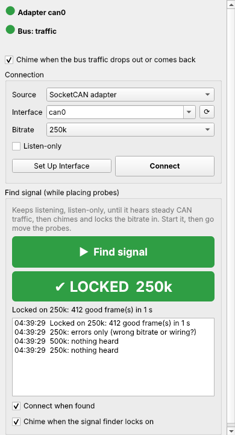
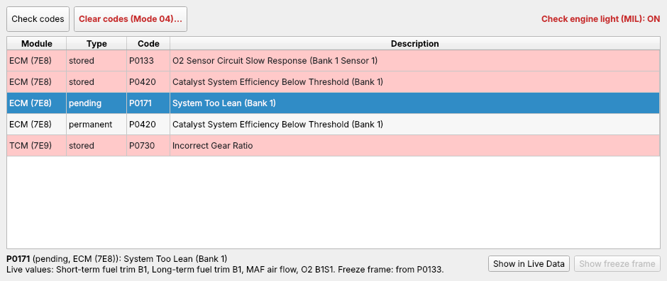
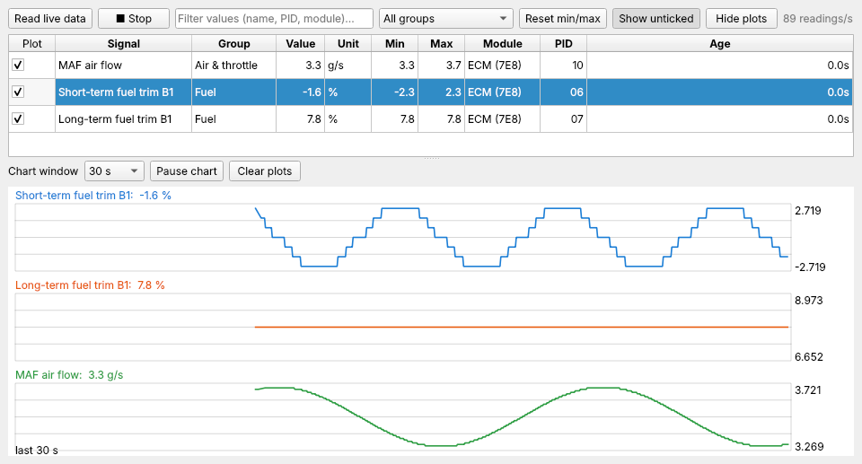
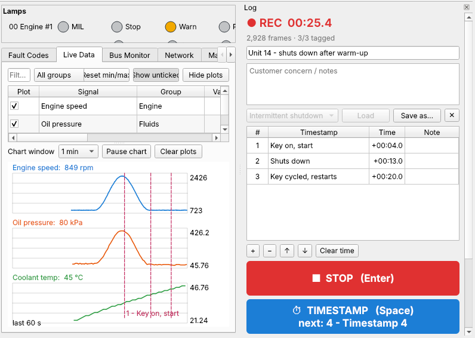
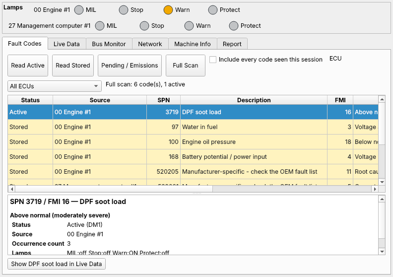
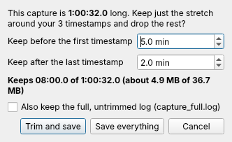

# CANopener

A free, Open Source diagnostic tool for **heavy equipment, trucks, and cars**. Plug a USB CAN adapter into a Linux
laptop, connect to the machine; read fault codes, watch live data, and
record what happens while you work the machine.

**For now, just this program.** With active development for a Raspberry Pi-based handheld, packed with features to make it an all-in-one electrical and electronic diagnostic platform.

* **Features Techs actually want:** Error codes take you to the indicated sensor, a signal finder that chimes when you pick up or lose CAN
  signal, a [Log tool](#recording-a-job-the-log-tool) that records *everything* with timestamps you tag from the keyboard, with playback, and one-click
  export to a USB stick.
  **Easy setup, clear indicators, configurable layout and controls.**
* **Not ones we don't:**  NEVER ANY $1000 Dongles, proprietary nonsense, or gatekeeping.

**Supports:**

* **Equipment and trucks (J1939):** forklifts, telehandlers, loaders, generators, on-highway
  trucks. Active and stored codes with warning lamps, ~35 live engine and chassis values, every
  module on the bus.
* **Battery trucks and controllers (CANopen):** traction, pump and battery controllers (Curtis,
  ZAPI and others): every node and its state, errors as they happen and the stored error
  history, the controller's name, versions and serial number.
* **Cars and light trucks (OBD-II):** codes from every module, live sensor data, freeze frame,
  readiness for inspection, and clearing codes, like a good generic scan tool.


## Get it

**Linux laptop** (Mint, Ubuntu, Debian), just a few minutes. Open a terminal and paste:

```bash
sudo apt update && sudo apt install -y git
git clone https://github.com/AidanIsaacson/CANopener.git ~/CANopener
~/CANopener/deploy/linux/install.sh
```

That gets you CANopener in the app menu and on the desktop, plus the drivers for USB CAN adapters.
Step by step, with your adapter: [Linux laptop guide](docs/install/linux-laptop.md).
For a **Raspberry Pi** that starts CANopener full screen at power-on: [Raspberry Pi guide](docs/install/raspberry-pi.md) [Untested].

**Try it without a machine:** tick **Connection → Show simulators**, then open **🔌 Connection**,
pick **Simulator** (a telehandler) or **OBD-II simulator (car)**, and press **Connect**.

**Updating:** **Help → Check for updates…**, then **Install update** and **Restart now**.
(Tick **Help → Check for updates at startup** to be told when there's one.)

## The handheld (in progress)

The same core app runs on desktop and Raspberry Pi. To try it on the laptop: **Settings → Handheld (Pi) screen**
(and **System → Desktop app instead** to come back).

The Raspberry Pi, however, can be made into a portable handset, packed with other features.

Plans include:
* 4-channel DMM, which can log alongside the CANBUS data
* Small, Wireless DMM modules
* Logic Analyzer
* Support for LIN and OBD-I
* Any other method of data gathering you can imagine

Details for builders:
[docs/DEVICE.md](docs/DEVICE.md).

## Hooking up (¬‿¬)

**Use any adapter** that Linux sees as a CAN interface: CANable / candleLight, PEAK, Kvaser,
8devices, or a CAN HAT on a Pi. The installer sets up the CANable (both firmwares) for you. Currently developed on the CANable 2.0 Pro.

**Other adapters** (PEAK, Kvaser, Vector, IXXAT, ...): install the maker's driver, then
**Connection → Find other adapters**, or type the adapter under Interface as `interface:channel`,
e.g. `pcan:PCAN_USBBUS1`, `kvaser:0` or `slcan:/dev/ttyACM0`, and pick its bitrate. (This goes
through [python-can](https://python-can.readthedocs.io), which the installer includes.)

1. Plug the adapter into the laptop and connect it to CAN HI&LO (the machine's diagnostic port, or back-probe any CAN HI/LO pair) Key on.
2. Open **🔌 Connection** (top left, or **F3**). Pick **SocketCAN adapter**, then the bitrate:
   **250k** for most equipment and trucks, **500k** for cars and some newer machines, or **Auto** to scan baud rates.
   Press **Connect**.
3. Two lamps at the bottom of the window or **🔌 Connection** panel tell you where you stand:
   * **Adapter:** is the adapter plugged in and working?
   * **Bus:** is it hearing the machine? Green = traffic, amber = connected but silent (key on?
     probes on CAN-H / CAN-L?), red = errors only (wrong bitrate, or the wires swapped).

## Features I'm really proud of

### It tells you when your probes land



Back-probing connectors is iffy at best, and CAN needs a solid connection. That would usually mean jiggling a probe, walking back to the
laptop, squinting at the screen, realizing it wasn't at the right angle, and walking back again. Here you press **Find signal** in the
**🔌 Connection** panel (or **F4**) and go do the probing. It listens the whole time, without sending a
thing, and **chimes** as soon as it hears steady traffic, usually within 5 seconds of a good probe
position. Then it locks in the bitrate and connects. Once connected, a falling tone tells you the
traffic dropped out (a probe slipped) and a rising one that it's back, so you can keep your head
in the machine. Both chimes can be switched off in the Connection panel. Turn the laptop volume
up, or wire a buzzer to a Pi (**Settings → Sound cues**).

<br clear="right">

### From a code straight to its sensor

**My favorite!** When you pull codes and a code points at a specific sensor, ***there's a button that
pulls that sensor up in Live Data***, already ticked and charting. No hunting through a list of
fifty values for the right one. On J1939 it's **Show this parameter in Live Data**; on a car
it's **Show in Live Data**, and if the car stored a freeze frame for that code, **Show freeze
frame** takes you to the snapshot from the moment it was set.


*Pick a code (here P0171, system too lean)...*


*...press **Show in Live Data**, and its sensors are already ticked and charting.*

### Data logs built for the fault that only happens sometimes

Customer states: *"It runs about ten minutes, shuts down, then you have to wait 30 seconds and
cycle the key twice before it'll start again."* A data log guarantees that when you reproduce that
fault after an hour of driving in circles, you have the data you need, and can pick it
apart afterwards. The Log tool is built around exactly that job.

Before you start, list the moments you expect:

1. Key on, start: **slap the spacebar** (timestamp 1)
2. Drive it around
3. It shuts down: **spacebar** (timestamp 2)
4. Wait 30 seconds, key on: **spacebar** (timestamp 3), and so on

Each press tags the next moment on your list, and you can name them, so when more than one thing
happens you can tell them apart. Unplanned moments get a press too. The log records **everything
on the bus for the whole run**. Afterwards, tick just the readings you care about and they're
charted with **your timestamps drawn as lines on the graph**, so you can see exactly what oil
pressure, voltage or engine speed were doing at the moment it quit. The saved capture also has a
plain-text timeline of codes coming and going against those same timestamps, ready to send to
someone.


*Three timestamps tagged with the spacebar, drawn on the chart of the readings you ticked.*

Did you *actually* have to drive the machine around for an hour? Logs record for as long as you have disk space, about 100-170 MB per hour on a busy bus.
After the log is stopped, you have the option to trim it to just the area you timestamped!

(All the details: [Recording a job](#recording-a-job-the-log-tool).)

### It opens in about a second

Unlike *some other* diagnostic programs. On my laptop it's open in about a second, so it's
quicker to check something than to talk yourself out of checking it.

## Equipment and trucks (J1939)



| Tab | What you get |
|---|---|
| **Fault Codes** | **Read Active** / **Read Stored** / **Pending / Emissions** / **Full Scan**. Each code with its description, occurrence count and the warning lamps. Tick *Include every code seen this session* to catch intermittent ones. **Show this parameter in Live Data** jumps to the sensor behind a code. **Clear Codes…** clears active (DM11) or stored (DM3) codes on every module, or the one picked under ECU, after asking. |
| **Live Data** | Engine speed, temperatures, pressures, voltages, DPF / DEF and more, with min / max. Tick values to chart them. **Hide unticked** and **Hide plots** tidy a small screen. |
| **Bus Monitor** | Every raw frame, or one row per ID with changing bytes highlighted, for figuring out proprietary data. **Find changes…** and **Label…** (below). |
| **Network** | Every module on the bus and what it sends. **Name this module…** gives one your own name. |
| **Machine Info** | Component and software IDs, VIN, engine hours, fuel used. |
| **Report** | A text report of the last scan, to save or copy. |

**Machine profiles** (the **Profile** box, top right) name a specific machine's modules and add
its own parameters. The app recognises a machine and offers its profile. **Profiles → Manage
profiles…** hides ones you don't use and sets the order. Making your own: [docs/DEVELOPING.md](docs/DEVELOPING.md#machine-profiles).

### Naming things CANopener doesn't know

Most forklift and equipment traffic is the maker's own. You can label it yourself and keep it:

* **Name a module:** in **Network**, pick an address (or CANopen node) and press **Name this
  module…** (e.g. "Traction controller"). The name shows everywhere that module does.
* **Find the data that moves:** in **Bus Monitor**, press **Find changes…**. Hold the pedal (or
  switch, or lever) one way and press **Mark now** on A, the other way and **Mark now** on B. The
  bytes that changed are listed, the likeliest first (rolling counters are left out). You can also
  compare two Log tool timestamps, or two stretches of a saved log.
* **Label it:** pick a result (or a row in Bus Monitor) and press **Label…**. Choose the byte(s) or
  bits, then set scale, offset and unit while you work the control and watch the live number and
  chart. Add a normal range or states (`0 = Off`, `1 = On`) if you like. **Save**, and it's in
  **Live Data** straight away (group *My labels*).

Your labels go in a profile of your own (the first label asks you to name it, e.g. "Unit 14
reach truck"), built on the profile you had picked, so nothing built in is changed. Make one per
machine: **Profiles → Save profile as…** copies the one in use under a new name.
**Profiles → My labels…** lists them to edit or remove, and has **Recognise this machine** (next
time it offers this profile when it sees these modules), **Export…** (to a USB stick, say) and
**Delete profile…**. **Profiles → Import profile…** loads one someone exported. It works the same
on CANopen messages, and the label dialog has **high byte first** for makers that send numbers
that way (try it if a value jumps about).

### CANopen (battery trucks, motor controllers)

Many electric forklifts and their motor, pump and battery controllers talk **CANopen** instead of
J1939 (often at 125k or 250k: **Auto** bitrate finds it). Pick the **Generic CANopen** profile (top
right) and the screens switch to CANopen, the way **OBD-II vehicle** switches them to a car: no
warning lamps or J1939 reads, and nothing J1939 is sent. For the rare machine with both on one bus
(a J1939 engine and CANopen controllers, say), **Generic J1939 + CANopen** shows both. On a J1939
profile, CANopener notices CANopen nodes and offers the right profile; nothing changes unless you
say so.

* **Fault Codes:** errors a controller reports (CANopen "EMCY") are **Active**; **Read Stored**
  also reads each controller's error history (**Stored**). The code's meaning is the standard
  class (e.g. *Device temperature*); a maker's own codes can be named in a profile. **Clear Codes →
  Clear CANopen error history…** empties a controller's history (asks first).
* **Network:** every node with its state (*Operational*, *Pre-operational*, *Stopped*), heartbeat,
  restarts and each message it sends. **Name this module…** names a node. **Read node info** reads
  its name, versions, product and serial number (also in **Machine Info**, and in a **Full Scan**).
  **Find CANopen nodes** asks every node number, for controllers that don't send a heartbeat.
  **NMT…** starts, stops or resets a node: these change the machine, so they say so and ask first.
  Only do it parked and safe.
* **Live Data, Bus Monitor, Find changes and Label…** work on CANopen messages (11-bit IDs) just
  like J1939: what each message means (e.g. *TPDO1 node 01*) is shown, and you can label the
  values in them. A maker's message layout isn't published, so labeling is how you name them.
Try it: **Connection → Show simulators**, then **CANopen simulator (battery truck)**.

**Modules beyond the engine** (ABS, transmission, body): **Diagnostics → Read a module (UDS)**
reads their codes, and can clear them or reset the module.

## Cars and light trucks (OBD-II)

Pick the **OBD-II vehicle** profile (top right; connecting the OBD-II simulator does it for you).
The screen becomes one row of pages:

| Page | What you get |
|---|---|
| **Trouble Codes** | **Check codes** reads every module (engine, transmission ...): stored, pending and permanent codes, with descriptions, and the check-engine light. **Clear codes** asks first and tells you what else it resets. Pick a sensor code and press **Show in Live Data** to watch that sensor, or **Show freeze frame**. |
| **Live Data** | Every value the car offers, streaming, with min / max and charts. Same controls as the J1939 Live Data. |
| **Freeze Frame** | The values saved when the code was set. |
| **Readiness** | Inspection monitors: complete, incomplete or not supported, and a READY / NOT READY verdict. |
| **On-Board Tests** | Ask the car to run a test, e.g. the EVAP leak test. |
| **Test Results** | Each monitor's last test value against its limits. Spots a part that passes, but only just. |
| **Vehicle Info** | VIN, calibration IDs, module names. |
| **Bus Monitor** | Raw frames, as on the J1939 side. |

Newer cars often have a security gateway: the diagnostic port is silent unless the tool asks
something. The Bus lamp then shows an indigo **"Bus: quiet (gateway?)"**, which is normal.

## Recording a job (the Log tool)

Open it with **📝 Log** (top right, or **F2**). Plan the moments you care about, record, and tag
them with one key while you work the machine. Its keys only work while it's open, and never while
you're typing in a box (**Esc** leaves a box):

| Key | Not recording | Recording |
|---|---|---|
| **Enter** | start | stop |
| **Space** | add a timestamp and type its name | tag the next timestamp |
| **Shift+Space** | add a timestamp and type its name (also while typing one: keeps it and starts the next) | add a timestamp at the end |
| **1** … **9**, **0** | | tag timestamp 1 … 10 directly |
| **Backspace** | | undo the last tag |

Remap them under **Log → Keyboard shortcuts…**.

1. Name the job, write the customer concern, and list the timestamps ("Key on", "Start",
   "Shuts down" ...), or load a template like *Intermittent shutdown*.
2. **Start**, then tag as you go. The Live Data chart shows each tag as a line.
3. **Stop**, fix up names and notes if needed, then **Save**.

On a car the Log tool keeps it talking while it records: it reads the codes once, then streams
the ticked live values.

Each capture is a folder in `~/canopener/logs/`:

| File | What's in it |
|---|---|
| `summary.txt` | Your notes and timestamps, and one timeline of codes appearing and clearing, warning lamps, and modules dropping off the bus, each with the phase it happened in. **The file to send someone.** |
| `live_data.csv` | Every live value twice a second, with your timestamps in a column. Opens in a spreadsheet. |
| `capture.log` | Every raw frame (reopen it with **Open…** in the Log panel, then **View data**). |
| `markers.csv`, `capture.json` | The timestamps, and everything in machine-readable form. |

**How long can a recording be?** As long as the disk allows: frames go straight to the file. A
busy 250k J1939 bus is roughly 500 to 900 frames a second, about 100 to 170 MB an hour. Saving
reads the whole log back to write the summary (about 350 MB of memory per hour at 500 frames a
second), so multi-hour captures are fine on a laptop; split all-day ones. The Bus Monitor and
**File → Export frames as CSV** only keep the latest 250,000 frames (a few minutes on a busy
bus); the capture's log has everything.



**Trimming a long one:** drove around for an hour before the fault finally showed? Tag it, stop,
and when you press **Save** the Log tool offers to keep just the stretch around your timestamps:
a few minutes before the first and after the last (you pick how many, and it remembers). It shows
how much it keeps before it cuts, can keep the full log alongside, and **Save everything** skips
it. **Trim…** in the Log panel does the same any time, saved captures included.

<br clear="right">

Captures survive a crash: the next start offers to recover anything unsaved.

**Export Logs** (in the Log panel, or **Ctrl+E**): plug in a USB stick, press **Export**. It
copies this session's captures and reports onto the stick and ejects it.

## What it sends

* **Reading** sends only standard requests (J1939, OBD-II, UDS and CANopen SDO reads). Tick **Listen-only** in
  the Connection panel to send nothing at all: J1939 codes (DM1) and live data still work,
  because the machine broadcasts them. (Not on a CANable with slcan firmware, which can't do
  listen-only: see [docs/install/linux-laptop.md](docs/install/linux-laptop.md).)
* **Commands that change a vehicle** (clear codes, start an on-board test, reset a module, a
  CANopen NMT start / stop / reset) say what they change and wait for a Yes.
* **Diagnostics → Transmit a frame** sends a frame you compose: off by default, it shows the
  exact bytes and asks before every send.

## Command line

Everything works over SSH too (handy on a Pi):

```bash
canopener-cli find --iface can0 --sound             # signal finder: wait for traffic, chime
canopener-cli scan --iface can0 --full --units imperial
canopener-cli obd --iface can0 --all                # car: codes, readiness, freeze frame, live data
canopener-cli obd --iface can0 --clear              # car: clear codes (asks first)
canopener-cli canopen --iface can0 --info --errors  # CANopen: nodes, state, errors, identity
canopener-cli decode capture.log --csv frames.csv   # decode a saved log
canopener-cli capture FOLDER --trim 5 2            # trim a capture: 5 min before, 2 min after its timestamps
canopener-cli update                                # check for and install updates
canopener-cli --help                                # everything else
```

## More

* [docs/DEVELOPING.md](docs/DEVELOPING.md): working on the code, making machine profiles, plugins.
* [docs/ARCHITECTURE.md](docs/ARCHITECTURE.md): how the software is built.
* [docs/DESIGN.md](docs/DESIGN.md): the CAN Opener field-diagnostic handheld this is heading for.

## License

GPL-2.0-or-later (see [LICENSE](LICENSE)): you may use, modify and redistribute CANopener, and
anything you distribute that includes it must be offered under the same license, with source.

The generic OBD-II trouble-code descriptions in `canopener/obd/dtc_codes.py` and the Mode 06
unit/scaling table come from [python-OBD](https://github.com/brendan-w/python-OBD) (GPL-2.0-or-later,
© Donour Sizemore, Secons Ltd., Peter J. Creath, Brendan Whitfield).

Installed alongside, not part of CANopener: [python-can](https://github.com/hardbyte/python-can)
(LGPL-3.0) for the "other adapters" above, and Pygame for the handheld UI.
