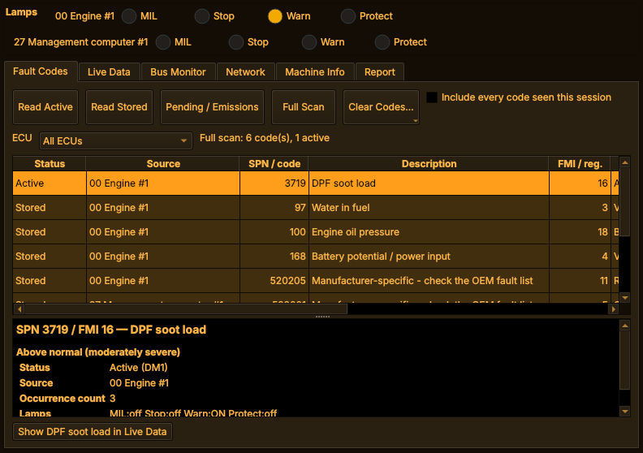

# CANopener

A free, open-source diagnostic tool for **heavy equipment, trucks and cars**. Plug a USB CAN
adapter into a Linux laptop, connect to the machine, and read fault codes, watch live data, and
record what happens while you work the machine.

No $1000 dongles, no subscriptions, no gatekeeping.



## What it talks to

| Protocol | Machines | What you get |
|---|---|---|
| **J1939** | Forklifts, telehandlers, loaders, generators, on-highway trucks | Active and stored codes with warning lamps, ~35 live engine and chassis values, every module on the bus |
| **CANopen** | Battery trucks: traction, pump and battery controllers (Curtis, ZAPI and others) | Every node and its state, errors as they happen and the stored error history, the controller's name, versions and serial number |
| **OBD-II** | Cars and light trucks | Codes from every module, live data, freeze frame, inspection readiness, clearing codes |

## Why it's different

* **It tells you when your probes land.** Press **Find signal**, go back-probe the connector, and
  it chimes as soon as it hears the bus.
* **From a code straight to its sensor.** One button takes a fault code to its sensor in Live
  Data, already ticked and charting.
* **Logs built for the intermittent fault.** Records everything on the bus; tap the spacebar to
  tag "it just shut down", and your tags are drawn on the chart. Trim to the interesting part,
  export to a USB stick.
* **Name what it doesn't know.** Find the bytes that move when you work a control, label them,
  and keep them in your own machine profile.
* **Opens in about a second.**

More, with screenshots: **[Features](docs/FEATURES.md)**.

## Install

On a **Linux laptop** (Mint, Ubuntu, Debian), open a terminal and paste:

```bash
sudo apt update && sudo apt install -y git
git clone https://github.com/AidanIsaacson/CANopener.git ~/CANopener
~/CANopener/deploy/linux/install.sh
```

A few minutes later CANopener is in the app menu and on the desktop, with the drivers for USB CAN
adapters. Updating is **Help → Check for updates…**.

Step by step, Raspberry Pi, updating and plugins: **[Install & update](docs/INSTALL.md)**.
Windows and macOS aren't supported yet.

**No machine handy?** Tick **Connection → Show simulators**, open **🔌 Connection**, pick
**Simulator** (a telehandler) or **OBD-II simulator (car)**, and press **Connect**.

## Connect to a machine

1. Plug the adapter into the laptop and connect it to CAN-H and CAN-L (the diagnostic port, or
   back-probe any CAN pair). Key on.
2. Open **🔌 Connection** (top left, or **F3**). Pick **SocketCAN adapter** and the bitrate:
   **250k** for most equipment and trucks, **500k** for cars, or **Auto** to find it. Press
   **Connect**.
3. The two lamps at the bottom tell you where you stand. **Adapter**: is it plugged in and
   working? **Bus**: green = traffic, amber = silent (key on? probes on CAN-H / CAN-L?), red =
   errors only (wrong bitrate, or the wires swapped).

Any adapter Linux sees as a CAN interface works: CANable / candleLight, PEAK, Kvaser, 8devices, or
a CAN HAT on a Pi. Developed on a CANable 2.0 Pro.

Reading codes, live data, the Log tool, labeling, the command line: **[Usage](docs/USAGE.md)**.

## Safe by default

Reading sends only standard requests, and **Listen-only** sends nothing at all. Anything that
changes a vehicle (clearing codes, on-board tests, module resets, CANopen start / stop) says what
it changes and waits for a **Yes**. Details: [What it sends](docs/USAGE.md#what-it-sends).

## The handheld (in progress)

The same app is heading for a Raspberry Pi handheld: CAN plus a 4-channel meter, a logic analyzer
and wireless probes, all recorded on one timeline. Try its screen on your laptop with
**Settings → Handheld (Pi) screen**. For builders: [docs/DEVICE.md](docs/DEVICE.md).

## All the docs

[docs/README.md](docs/README.md) lists everything: using it, building the handheld, and working
on the code.

## License

GPL-2.0-or-later (see [LICENSE](LICENSE)): you may use, modify and redistribute CANopener, and
anything you distribute that includes it must be offered under the same license, with source.

The generic OBD-II trouble-code descriptions in `canopener/obd/dtc_codes.py` and the Mode 06
unit/scaling table come from [python-OBD](https://github.com/brendan-w/python-OBD) (GPL-2.0-or-later,
© Donour Sizemore, Secons Ltd., Peter J. Creath, Brendan Whitfield).

Installed alongside, not part of CANopener: [python-can](https://github.com/hardbyte/python-can)
(LGPL-3.0) for adapters beyond SocketCAN, and Pygame for the handheld UI.
