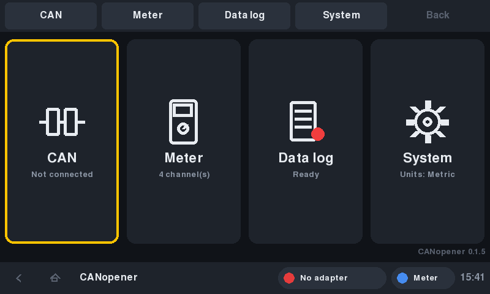
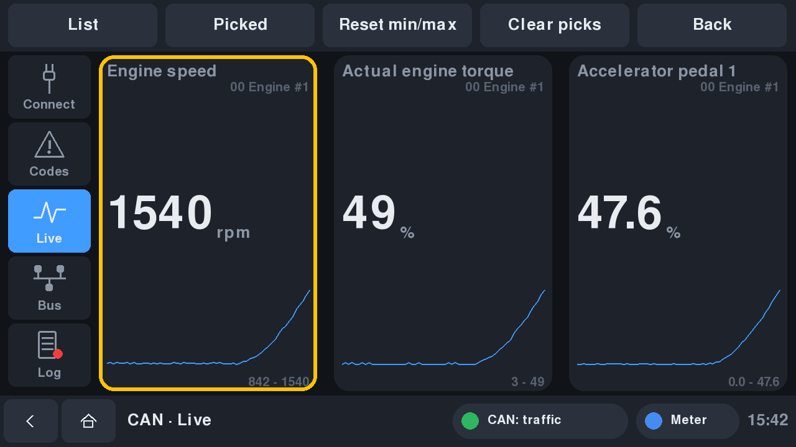
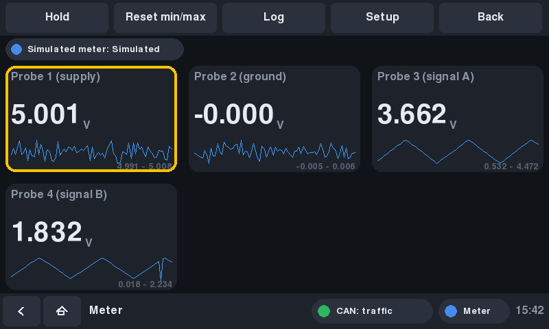
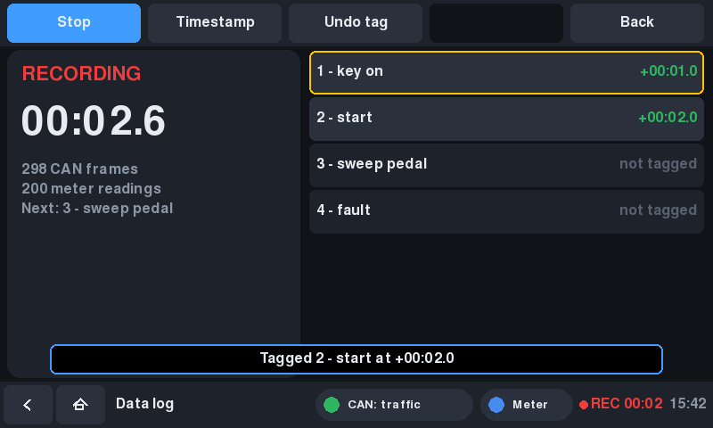

# The handheld UI (Raspberry Pi)

`canopener-device` is the instrument UI for the CANopener handheld ([DESIGN.md](DESIGN.md)): a
full-screen Pygame front-end, made to be run with a finger, a glove, a rotary encoder, a d-pad and
a row of hardware buttons. It is a third front-end over the same `core/` as the desktop GUI and
the CLI, so a fix in the scan, capture or decode code reaches all three.

> **Status:** runs and is tested headless against the simulators at 800x480, 1280x720 and
> 1280x800. **Not yet run on a Pi, a DSI panel or the real controls.** The pieces that only real
> hardware can prove are listed in [Not tested yet](#not-tested-yet).



## Try it on a laptop

```bash
pip install -e ".[device]"
canopener-device --sim                 # simulated machine + simulated meter, 800x480 window
canopener-device --sim --size 1280x720 # the 7" Touch Display 2 used landscape
canopener-device --obd-sim             # a simulated car (OBD-II)
```

**From the desktop app:** tick **Settings → Handheld (Pi) screen**. CANopener closes (asking
about an unsaved log as usual) and reopens as the handheld UI in a window. It stays that way,
from the menu entry and the `canopener` command too, until you pick **System → Desktop app
instead** on the handheld. The window size is **System → Window size** (800x480 by default);
`canopener --desktop` always opens the desktop app. The same switch works on the Pi: the
launcher starts whichever you last chose.

Keyboard stand-ins for the hardware: **F1-F4** soft keys, **F5** button 5, **arrows** d-pad,
**Enter** encoder push (hold it for Back), **mouse wheel** or **Page Up/Down** the encoder,
**Esc** Back, **Home** home, **F9** start/stop the log, **F10** timestamp, **Ctrl+Q** quit. The
mouse stands in for a finger: click to tap, drag to scroll.

## How it's laid out

Fixed, like a scan tool: nothing reflows or pops up where a thumb doesn't expect it.

* **Soft keys** sit on the edge where the hardware buttons are (the top, by default) so each label
  is right next to its button. Their labels change with the screen. They can be tapped too.
* **Status strip** on the other edge: Back and Home (for touch), where you are, the CAN lamp
  (adapter / bus, same logic as the desktop app's lamps), the meter's health, **REC** with the
  elapsed time, and the clock. Tapping the CAN or Meter lamp jumps to that mode.
* **Home** has one tile per mode. More modes slot in later (logic analyzer, scope, ...) through
  `canopener/device/modes.py`, and plugins can add their own with `register_device(api)`.

Navigation is the same everywhere: **rotate** the encoder to move through a list, **push** it to
select, **hold** it (0.7 s) to go back; **d-pad up/down** moves like the encoder, **left/right**
changes page (CAN) or value (System settings). Touch targets are 10 mm on every panel: the size
is worked out from the screen's pixel density (System > Screen size), not fixed in pixels.
Anything that changes a machine asks first with **No** as the default, so an accidental push of
the encoder does nothing.

| Mode | Pages / what's there |
|---|---|
| **CAN** | **Connect** (source, interface, bitrate or *Auto* via the signal finder, listen-only, profile, connect at power-on, adapter and bus status). **Codes** (J1939 active / stored / full scan with lamps, or OBD-II codes from every module; select a code for details, *Live data* jumps to its sensor). **Live** (every value, tick the ones you want, *Grid* shows them big with a 60 s trace). **Bus** (modules with frame rates, or every CAN ID with changing bytes marked). **Log** (below). |
| **Meter** | Each measurement channel as a big readout with min / max and a trace; Hold; each source's status ("not detected, retrying"). |
| **Data log** | Start / stop, timestamps (planned list or as-you-go), undo, save, trim to the stretch around the timestamps, copy to a USB stick, recover a log a power cut interrupted. Records the bus **and every meter channel**. |
| **System** | Brightness, screen size, picture rotation, which edge the buttons are on, 4 or 5 buttons and what button 5 does, units, sound cues and buzzer, meters, logs folder and USB export, about (temperature, uptime, IP), close / restart / power off. |



Everything is read-only. The device UI only sends J1939 requests and OBD-II reads; it has no
clear-codes or transmit screen yet. When it gets one, it follows CLAUDE.md: state what it
changes, default No, never in listen-only.

## Meters and the data log (the groundwork)

Anything the handheld can read should land on the same timeline as the CAN bus, so a probe
voltage can be lined up with the fault code that fired a moment later. That's built in from
the start:

* **`core/measure.py`**: a `Channel` (id, name, unit, normal range), a `Sample` (time, value,
  flag such as `OL`), a `MeasurementSource` base class, and the `MeasurementHub` every source
  pushes into. Samples carry wall-clock time, the same clock as CAN frames. A source with its own
  clock (a Pico counting microseconds since the sync pulse) maps it with `ClockMapper`.
* **`core/meters.py`**: the sources. `SimulatedMeter` (four probes on a pretend pedal sensor whose
  signal B drops out mid-travel, the DESIGN.md use case), `SerialLineSource` (anything that
  prints readings on a USB serial port: the Pico coprocessor, the ESP32 bridge for wireless
  satellites) and `IioSource` (an ADC the kernel already drives, such as an ADS1115 with
  `dtoverlay=ads1015`: real probe voltages on a bench Pi before the Pico board exists).
* **The capture records them.** `Capture.start(session, ..., measurements=hub)` writes
  `measurements.csv` beside `capture.log` while recording (flushed every second, so a power cut
  loses at most that). On save, each channel becomes a column in `live_data.csv` next to the CAN
  values, going out of range or "no reading" become timeline events in `summary.txt` among the
  fault codes and markers, and the summary lists each channel's range and its value at every
  timestamp. Trim cuts both. A capture can be meters-only (no bus connected). The desktop Log
  tool gets the same files once it passes the hub in.
* **Live views** get them too: `MeasurementLiveData` shapes channels like CAN signals, so the
  CAN > Live list and grid show a probe next to engine speed.



**Meter line protocol** (what the Pico / ESP32 firmware should print, one line each, UTF-8):

```
{"hello": "canopener-meter", "name": "Pico DMM", "channels": [{"id": "p1", "name": "Probe 1", "unit": "V", "decimals": 3, "low": 0.5, "high": 4.5}]}
{"ch": "p1", "v": 4.512}                     reading now
{"ch": "p1", "v": 4.512, "t_us": 81234567}   with the device's own clock
{"ch": "p1", "v": null, "flag": "OL"}         no valid reading, and why
{"status": "error", "text": "probe 3 over voltage"}
p1=4.512 p2=0.118                            the same, minimal
```

The source re-opens the port after a dropout and reports its state, the "Pico not detected,
Retry?" pattern from DESIGN.md. Waveforms and logic captures (kHz-MHz) don't belong in a CSV row
per sample: they will be their own files in the capture folder, on the same timebase, listed in
`capture.json`.



## Controls: wiring

The cheapest, most robust way to wire the buttons is **one GPIO per switch**, switch to ground,
using the kernel's `gpio-key` driver. Each button then *is* a key press (kernel debounced, no
polling, works the same under a desktop or without one), and a USB keyboard does the same thing
on the bench. The rotary encoder uses the kernel's `rotary-encoder` driver; the app reads it from
`/dev/input` (the user must be in the `input` group: `install.sh --device`).

Suggested pins (Pi 5, also fine on a 4 / CM4). They leave the buses the rest of the design needs
free: I2C1 for an ADC or RTC, SPI0 + GPIO25 for the MCP2518FD CAN controller, the UART, and
GPIO18-21 for a PWM buzzer or I2S audio.

| Control | GPIO | Sends | App action |
|---|---|---|---|
| Top button 1-4 | 5, 6, 12, 13 | F1-F4 | Soft keys 1-4 |
| Top button 5 | 16 | F5 | Back (or soft key 5, start/stop log, timestamp: System > Button 5 does) |
| D-pad up / down / left / right | 17, 27, 22, 23 | arrows | Move / change page |
| Encoder A / B | 24, 4 | REL_X | Move (rotate) |
| Encoder push | 26 | Enter | Select (hold: Back) |

That's twelve pins. The overlay lines are in
[`deploy/raspberry-pi/config-controls.txt`](../deploy/raspberry-pi/config-controls.txt): append
them to `/boot/firmware/config.txt` and reboot. The Alps RKJXT1F42001 named in DESIGN.md is the
d-pad, push and encoder in one part, so it covers seven of these pins on its own.

**About a resistor ladder for the buttons:** the Pi has no analog inputs, so a ladder needs an
ADC (an ADS1115 on I2C, or the Pico's ADC), can't see two buttons pressed together, and adds a
polling loop. If pins run short it's supported: set `device.ladder` in settings.json to the IIO
channel (`/sys/bus/iio/devices/iio:device0/in_voltage3_raw`) and `device.ladder_levels` to each
button's voltage; `LadderButtons` decodes it with debouncing and a dead band between levels. Pins
are not short here (twelve of the free ones), so one GPIO each is the recommendation.

Change what any key does in `~/.config/canopener/settings.json`, e.g.
`"device.keys": {"f6": "log", "f7": "tag"}` for two more buttons as dedicated Log / Timestamp
keys (System > Key map shows the current map).

## Displays

| Panel | Pixels | Set |
|---|---|---|
| Raspberry Pi Touch Display 2 (7") | 720x1280, portrait | Rotate picture: 90° (or 270°), screen size 7" |
| Original Raspberry Pi 7" display | 800x480 | screen size 7" |
| Typical 10.1" DSI panels | 1280x800 | screen size 10.1" |

Under the Pi desktop, rotate the screen in the desktop's Screen Configuration instead and leave
the app's rotation at 0°. **Rotate picture** is for running without a desktop, where nothing
else rotates: the app draws sideways and turns touch coordinates to match.

## On the Pi

```bash
git clone https://github.com/AidanIsaacson/CANopener.git ~/CANopener
cd ~/CANopener
./deploy/raspberry-pi/install.sh --sudoers --autostart --device
```

`--device` adds you to the `input` (encoder) and `video` (brightness) groups and installs a udev
rule for the backlight. The installer switches a fresh install to the handheld UI, and the
launcher starts whichever UI was last chosen, full screen (switch in the app as above, or force
one with `CANOPENER_UI=device` / `desktop` in the service). Logs go to
`~/.local/state/canopener/launch.log`.

**Without a desktop** (Pi OS Lite, boot straight to the instrument): run with
`SDL_VIDEODRIVER=kmsdrm`. Pygame from pip may be built without KMS/DRM support; if it won't open
the display, use Raspberry Pi OS's own build instead:
`sudo apt install python3-pygame`, then recreate the venv with `--system-site-packages` and
`pip uninstall pygame-ce` in it.

## Keeping a Pi branch up to date with main

The handheld UI is part of `main` (since 0.2.0). Work that only makes sense on the Pi, such as
hardware experiments, can live on a branch: the handheld code is mostly its own files
(`canopener/device/`, `core/settings.py`, `measure.py`, `meters.py`, `obd_stream.py`,
`system.py`), so merges from `main` are normally clean.

```bash
scripts/sync-from-main.sh          # merge origin/main in, then lint + test
scripts/sync-from-main.sh --push   # and push it if everything passes
```

It merges rather than rebases, so the branch's history never changes under anyone.

## Not tested yet

These need the real hardware, and are the first things to check on the Pi:

* Pygame's video driver on Pi OS (Wayland desktop, and `kmsdrm` without one), and full-screen
  frame rate on the Pi 5 at 1280x720 (it draws at 30 fps; drop `device.fps` if needed).
* The touch panel's events arriving as mouse events (SDL's default), and rotation with touch.
* The `gpio-key` and `rotary-encoder` overlays on the Pi 5's RP1 GPIO, the encoder's
  steps per detent, and the pull-ups.
* Brightness through `/sys/class/backlight` with the udev rule.
* The serial meter source against a real Pico, and the IIO source against an ADS1115.
