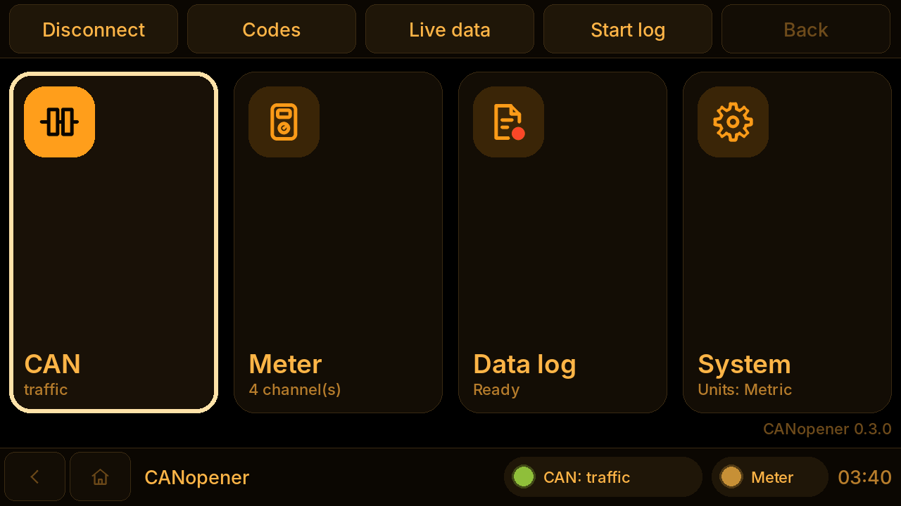
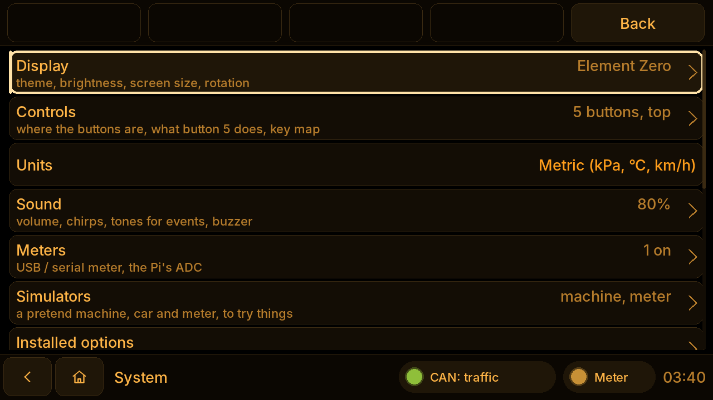
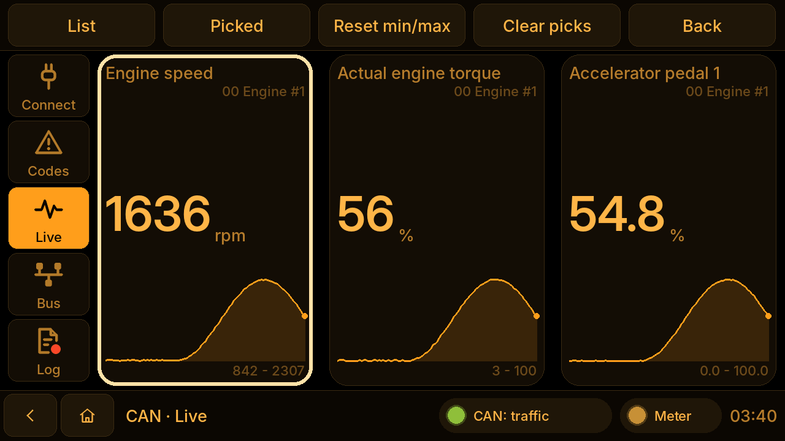
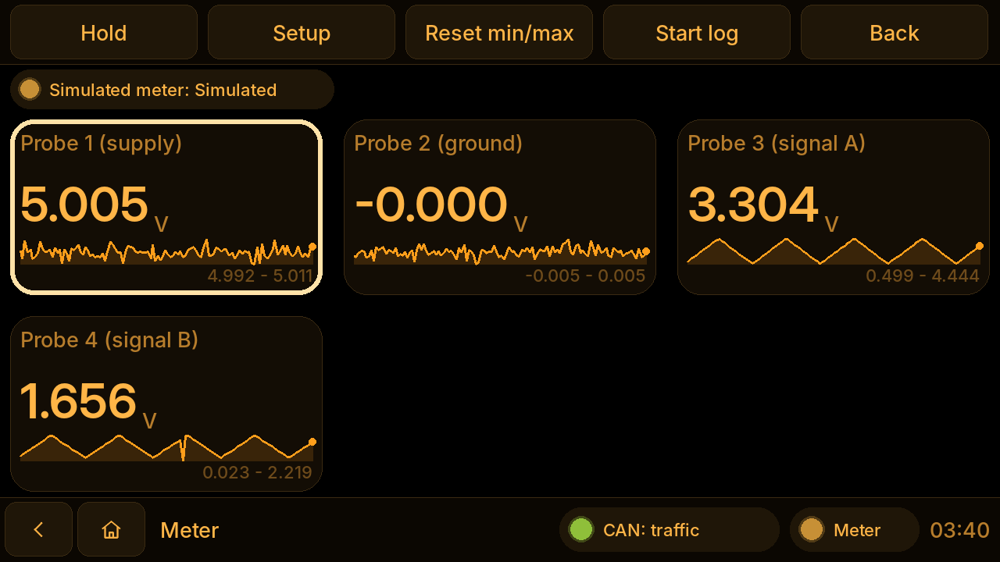
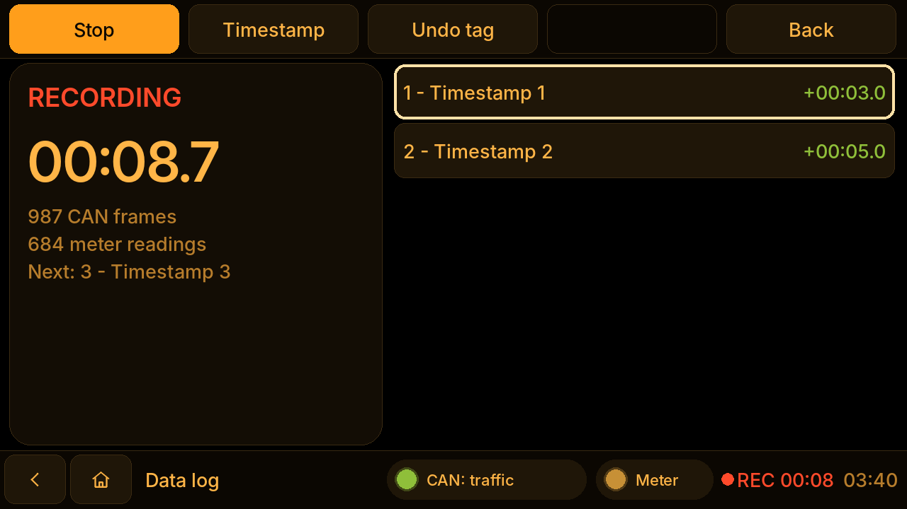

# The handheld UI (Raspberry Pi)

`canopener-device` is the instrument UI for the CANopener handheld ([DESIGN.md](DESIGN.md)): a
full-screen Pygame front-end, made to be run with a finger, a glove, a rotary encoder, a d-pad and
a row of hardware buttons. It is a third front-end over the same `core/` as the desktop GUI and
the CLI, so a fix in the scan, capture or decode code reaches all three.

> **Status:** runs and is tested headless against the simulators at 800x480, 1280x720 and
> 1280x800, and runs full-screen on a Pi 5 with an HDMI screen and a USB CANable (starting at
> login). **Not yet run on a DSI panel or with the real controls.** The pieces that only real
> hardware can prove are listed in [Not tested yet](#not-tested-yet).



**On the Pi:** start with [Handheld, first steps](install/handheld-stage0.md) (Pi 5 + Touch
Display 2 + USB CANable, then the first buttons and the encoder), then
[Handheld prototype wiring](install/handheld-prototype.md) (the CAN module, the Picos, the ADS1115).

## Try it on a laptop

```bash
pip install -e ".[device]"
canopener-device --sim                 # simulated machine + simulated meter, 800x480 window
canopener-device --sim --size 1280x720 # the 7" Touch Display 2 used landscape
canopener-device --obd-sim             # a simulated car (OBD-II)
```

**From the desktop app:** tick **Settings → Handheld (Pi) screen**. CANopener closes (asking
about an unsaved log as usual) and reopens as the handheld UI in a window. It stays that way,
from the menu entry and the `canopener` command too, until you pick **System → Software → Desktop app
instead** on the handheld; a log still recording there is stopped and saved first. The window
can be resized or maximized (everything scales with it, like a bigger panel) and reopens at the
size it was closed at; **System → Display → Window size** sets a size directly. `canopener --desktop`
always opens the desktop app (installed with `deploy/linux/install.sh` it isn't on the
terminal's PATH: run `~/CANopener/.venv/bin/canopener --desktop`). The same switch works on the Pi: the launcher starts whichever
you last chose.

Each switch starts the other app as a new process and writes its output to
`~/.local/state/canopener/canopener.log`; if a UI ever fails to open, the reason is there. If
the handheld UI can't open at all, it switches the choice back to the desktop app by itself.

Keyboard stand-ins for the hardware: **F1-F4** soft keys, **F5** button 5, **arrows** d-pad,
**Enter** encoder push (hold it for Back), **mouse wheel** or **Page Up/Down** the encoder,
**Esc** Back, **Home** home, **F9** start/stop the log, **F10** timestamp, **Ctrl+Q** quit. The
mouse stands in for a finger: click to tap, drag to scroll.

## How it's laid out

Fixed, like a scan tool: nothing reflows or pops up where a thumb doesn't expect it.

* **Soft keys** sit on the edge where the hardware buttons are (the top, by default) so each label
  is right next to its button. Their labels change with the screen. They can be tapped too.
* **Status strip** on the other edge: Back and Home (for touch), where you are, the CAN lamp
  (adapter / bus, same logic as the desktop app's lamps), the meter's health, **REC** with the
  elapsed time, and the clock. Tapping the CAN or Meter lamp jumps to that mode.
* **Home** has one tile per mode, and its soft keys are quick actions: **Connect** (or
  Disconnect), **Codes** and **Live data** (straight to those CAN pages), **Start log** (or Stop
  log). More modes slot in later (logic analyzer, scope, ...) through
  `canopener/device/modes.py`, and plugins can add their own with `register_device(api)`.
* Soft keys that do the same thing sit on the same button: **Reset min/max** is button 3 on Live
  and Meter, and **Start log** is button 4 on Home and Meter.

Navigation is the same everywhere: **rotate** the encoder to move through a list, **push** it to
select, **hold** it (0.7 s) to go back; **d-pad up/down** moves like the encoder, **left/right**
changes page (CAN) or value (System settings). Touch targets are 10 mm on every panel: the size
is worked out from the screen's pixel density (System > Display > Screen size), not fixed in pixels.
Anything that changes a machine asks first with **No** as the default, so an accidental push of
the encoder does nothing.

| Mode | Pages / what's there |
|---|---|
| **CAN** | **Connect** (source, interface, bitrate or *Auto* via the signal finder, listen-only, profile, connect at power-on, adapter and bus status; for **Bluetooth OBD**, the adapter, the **Vehicle** (car, J1939 truck, or a plugin's bus) and **Bluetooth adapters**: scan, pair with a PIN picked from the common ones, rename from a short list, test (what the adapter can do), forget; the battery voltage at the OBD port appears on the Meter screen and in the data log). **Codes** (J1939 active / stored / full scan with lamps, or OBD-II codes from every module; select a code for details, *Live data* jumps to its sensor). **Live** (every value, tick the ones you want, *Grid* shows them big with a 60 s trace). **Bus** (modules with frame rates, or every CAN ID with changing bytes marked). **Log** (below). |
| **Meter** | Each measurement channel as a big readout with min / max and a trace; Hold; each source's status ("not detected, retrying"). |
| **Data log** | Start / stop, timestamps (planned list or as-you-go), undo, save, trim to the stretch around the timestamps, copy to a USB stick, recover a log a power cut interrupted. Records the bus **and every meter channel**. |
| **System** | A short menu; each group opens its own page. **Display** (theme and accent colour, [below](#themes); brightness, screen size, picture rotation). **Controls** (which edge the buttons are on, 4 or 5 buttons, what button 5 does, the key map). **Units** (changed right on the menu). **Sound** ([below](#sound)). **Meters** (USB / serial meter, the Pi's ADC). **Simulators** (a pretend machine, car and meter, and which car the Bluetooth OBD simulator plays). **Installed options**. **Storage** (logs folder, copy to USB). **Software** (check for updates, plugins, desktop app instead). **About this device** (temperature, uptime, IP), and exit to desktop / restart / power off. |





Everything is read-only. The device UI only sends J1939 requests and OBD-II reads; it has no
clear-codes or transmit screen yet. When it gets one, it follows CLAUDE.md: state what it
changes, default No, never in listen-only.

## Themes

**System > Display > Theme** picks the look; it changes straight away. **Accent colour** below
it swaps the accent (selected tabs, values you can change, traces) in whichever theme is on.

| Theme | For |
|---|---|
| **Element Zero** | The default: amber on black, like a glowing hologram. Easy on eyes that have adjusted to a dark cab. |
| **Graphite** | A quieter dark look: flat panels with a fine outline, teal accent. |
| **Daylight** | Sunlight: dark text on white, strong colours, a black ring on what's selected. |
| **Basic** | The original look: raised panels, a blue accent, Pygame's own font. |

All but Basic use the **Inter** font and rounded line icons. The installers add the font
(`fonts-inter`); without it they use DejaVu Sans. The desktop app has matching colours: see
[USAGE.md](USAGE.md#colour-themes).

**Your own theme:** put a `.json` file in `~/.config/canopener/themes/`. It starts from a
built-in theme (`base`) and changes only what it names. The file name (without `.json`) is its
id, and `name` is what the Theme list shows:

```json
{
  "name": "Workshop orange",
  "base": "graphite",
  "colors": {"accent": "#ff7a1a", "focus": "#ffffff"},
  "style": {"radius": 0.25},
  "fonts": {"text": ["Roboto:medium", "DejaVu Sans"]}
}
```

* `colors`: `"#rrggbb"` (or `[r, g, b]`). Surfaces: `bg` (behind everything), `bar` (the soft-key
  and status strips), `panel` (rows, tiles), `panel2` (buttons, a selected row), `panel_hi` (a
  selected tile), `line` (outlines). Text: `text`, `dim`, `faint`. Accent: `accent`, `accent_dim`
  (behind accent icons), `on_accent` (text on an accent fill), `edge_accent`. `focus` is the ring
  on what the encoder is on; `press` lights what a finger is on. Status: `ok`, `wait`, `bad`,
  `on_bad`, `warn`, `off`, `sim`, `idle`, `rec`, `on`. Finish: `shadow`, `edge`, `edge_bad`.
* `style`: `radius` (corner size, 0-0.5 of a 10 mm touch target), `shadow`, `edge` (a light line
  along the top of buttons), `border` (an outline round panels), `trace_fill` (shading under
  traces) as true / false; `icons` (`classic` or `line`); `tile` (home tiles: `disc` or `chip`);
  `font_scale` (0.6-1.5).
* `fonts`: `text` (most text), `heading` (titles), `numbers` (big readouts). Each is a list tried
  in order: an installed font's name, optionally with a weight (`"Inter:semibold"`), or a path to
  a `.ttf` / `.otf` file. If none is found, Pygame's own font.

The file is read when you pick it, so to see an edit pick another theme and back. If something
in it is wrong (a colour that isn't one, a misspelt key), a message says what at the bottom of
the screen and the rest of the theme still applies. A file can't replace a built-in theme's name.

## Sound

**System > Sound**: the speaker **volume** (0-100 %, in 10 % steps; a buzzer has one loudness),
speaker on / off, **chirp on taps and buttons** (a short tick each time a press registers; off
until you turn it on), the CAN traffic chime, the buzzer, and **Tones for events**: one row per
event (tap or press, signal found, traffic stopped / back, log started / stopped, timestamp,
codes found, something failed, a game's clear and game over), each set to one of the tones in
`core/sound.py` (`TONES`) or *Off*. Changing a row plays the tone you picked; *Back to the
standard sounds* resets them. Kept in `settings.json` as `sound.volume`, `sound.touch` and
`sound.tones` (event -> tone, only the ones changed).

On the handheld, tones go through Pygame's mixer (opened on the first sound), so a chirp starts
within a few milliseconds of the tap. Without an audio device it falls back to `pw-play` /
`paplay` / `aplay` like the desktop app.

## Updates

**System > Software > Check for updates** does what the desktop app's *Help > Check for updates* does
(`core/updates.py`): fetches from GitHub, lists what's new, and **Install** pulls the new version
(fast-forward only; local changes stop it) and reinstalls the Python packages if they changed.
Then it asks to restart: under the Pi's service it exits with the code systemd restarts on,
otherwise it starts the new version itself. If an update also changes the system setup
(`deploy/`), it says to run the installer once in a terminal.

## Games (hidden)

Tap **Show games menu** in the corner of **System > About this device** (or open About seven
times in a row) and a **Games** tile joins the home screen (after System, so the soft keys don't
change); the same button, now **Hide games menu**, or **System > Software > Show games** hides it again.

Both games (the screens are `device/screens/games.py`) are played with the handheld turned a
quarter turn anticlockwise, so they draw portrait and turn the picture. The encoder turns the
piece, the d-pad's up / down (now left / right) move it, its left (now down) drops it, pushing
the encoder swaps it for the side piece, Back pauses. With just the touchscreen: tap a column to
move the piece there (tap the piece to turn it), the row of buttons under the board (move left,
Turn, Swap, Drop, move right), and tap the score to pause.

**Harness** (`device/harness.py`): wire segments fall into a board between two bus bars. A wire
touching the bars at two points clears with everything joined to it: bar to bar scores double,
back to the same bar single; wires falling into the gap can close a chain.

**Cargo** (`device/cargo.py`): a falling-block game. Crates of Cargo's own shapes (singles, pairs,
a pallet, three-crate bars and corners, five-crate P / U / V / T / L loads) drop into a trailer;
a row packed wall to wall ships out, and several rows at once score more.

**Controls from CAN** (`device/game_controls.py`): every control goes through one command
interface, so the machine's own signals, decoded by the active profile, can play it too: steer
to turn the piece, the lower switch drops it (both games). Games > Controls from CAN picks a signal on the bus
for each action. A binding is an **edge** (a threshold, for switches), a **delta** (one step per
so much change, for a steering angle) or a **position** (the value's range spread across the
columns). They're kept per profile in `settings.json`:

```json
"games.controls": {"loader": [
  {"signal": "Steering angle", "do": "turn", "every": 15},
  {"signal": "Lower switch", "do": "drop", "above": 0.5},
  {"signal": "Joystick X", "do": "column", "min": -100, "max": 100}
]}
```

Reading only: nothing is sent. The signals are read straight from the session each frame (Live
Data samples five times a second, too slow for a quick switch).

## Meters and the data log (the groundwork)

Anything the handheld can read should land on the same timeline as the CAN bus, so a probe
voltage can be lined up with the fault code that fired a moment later. That's built in from
the start:

* **`core/measure.py`**: a `Channel` (id, name, unit, normal range), a `Sample` (time, value,
  flag such as `OL`), a `MeasurementSource` base class, and the `MeasurementHub` every source
  pushes into. Samples carry wall-clock time, the same clock as CAN frames. A source with its own
  clock (a Pico counting microseconds since the sync pulse) maps it with `ClockMapper`.
* **`core/meters.py`**: the sources. `SimulatedMeter` (four probes on a pretend pedal sensor whose
  signal B drops out mid-travel, the DESIGN.md use case), `SerialLineSource` (anything that
  prints readings on a USB serial port: the Pico coprocessor, the ESP32 bridge for wireless
  satellites) and `IioSource` (an ADC the kernel already drives, such as an ADS1115 with
  `dtoverlay=ads1115`: real probe voltages on a bench Pi before the Pico board exists).
* **The capture records them.** `Capture.start(session, ..., measurements=hub)` writes
  `measurements.csv` beside `capture.log` while recording (flushed every second, so a power cut
  loses at most that). On save, each channel becomes a column in `live_data.csv` next to the CAN
  values, going out of range or "no reading" become timeline events in `summary.txt` among the
  fault codes and markers, and the summary lists each channel's range and its value at every
  timestamp. Trim cuts both. A capture can be meters-only (no bus connected). The desktop Log
  tool gets the same files once it passes the hub in.
* **Live views** get them too: `MeasurementLiveData` shapes channels like CAN signals, so the
  CAN > Live list and grid show a probe next to engine speed.



**Meter line protocol** (what the Pico / ESP32 firmware should print, one line each, UTF-8):

```
{"hello": "canopener-meter", "name": "Pico DMM", "channels": [{"id": "p1", "name": "Probe 1", "unit": "V", "decimals": 3, "low": 0.5, "high": 4.5}]}
{"ch": "p1", "v": 4.512}                     reading now
{"ch": "p1", "v": 4.512, "t_us": 81234567}   with the device's own clock
{"ch": "p1", "v": null, "flag": "OL"}         no valid reading, and why
{"status": "error", "text": "probe 3 over voltage"}
p1=4.512 p2=0.118                            the same, minimal
```

The source re-opens the port after a dropout and reports its state, the "Pico not detected,
Retry?" pattern from DESIGN.md.

**Installed options** (`core/hardware.py`, System > Installed options, or
`canopener-cli hardware`): the handheld is built in stages, so each on-deck part (CAN stacks, the
two Picos, the sync input, the Pi's ADC, the ESP32, the parts behind the meter Pico) is set to Not
installed (the default: never touched), Installed (missing = a red lamp with a hint, retried) or
Use if found. "Set all from build stage" fills them in. Meter sources for the meter Pico, the ESP32
and the Pi's ADC start from these; the Meters rows above stay for a bench Pi or a laptop.
[ELECTRONICS.md](ELECTRONICS.md) section 19 has the list. Waveforms and logic captures (kHz-MHz) don't belong in a CSV row
per sample: they will be their own files in the capture folder, on the same timebase, listed in
`capture.json`.



## Calibrating the meter

Home-built probe channels read a little off: a percent or two from resistor tolerance and the
ADC's own loading. That error is the same every time, so each channel gets a zero and a gain,
set against a supply you've measured. Everything after that (the meter, CAN > Live, the data log
and its report) shows corrected readings, and each capture notes the calibration it was taken with.

Open **System > Meters > Calibration**. It lists each voltage channel (CH1, CH2, ...) with its gain
and the date it was set. You need a steady supply (a bench supply, or a 12 V battery) and, for
Full, a second meter.

* **Full** (soft key 2): for each channel in turn,
  1. **Zero:** touch the channel's probe to the COM lead. When the reading settles, push the
     encoder.
  2. **Voltage:** touch the probe to the supply's plus, COM on its minus. Push to hold the reading.
  3. **Looks right / Adjust:** measure the supply with your second meter. If the held reading
     matches, push. If not, pick **Adjust** and turn the encoder until it does (0.01 V a click;
     soft key 1 changes the step to 0.1 or 0.001), then push to save.
  4. It beeps, shows **saved** and moves on to the next channel by itself.
* **Quick** (soft key 1): measure the supply with your second meter first and set that voltage
  (turn the encoder, push to start). Then for each channel: touch COM, wait for the beep, touch the
  supply, wait for the beep. Each step is taken by itself once the reading settles, and it goes
  straight on to the next channel. A reading more than 25% away from the voltage you set is held
  back with a warning (push to use it anyway).

Tip: clip COM to the supply's minus and leave it there. Then touching the minus is the zero and
the plus is the voltage, for every channel.

Each channel is saved as soon as it's done. **Stop** or Back keeps the channels already saved;
**Skip** leaves one as it was. Pick a single channel in the list to calibrate just that one, or to
reset it. Changing **ADC input divider** clears the Pi ADC's channels, since their old numbers no
longer fit. Calibrate at the voltages you work at (12-24 V), and again if you change the front end.
Stored in `settings.json` as `meters.cal`; the beeps are **System > Sound > Tones for events**
(Calibration: reading taken / channel saved).

## Controls: wiring

The cheapest, most robust way to wire the buttons is **one GPIO per switch**, switch to ground,
using the kernel's `gpio-key` driver. Each button then *is* a key press (kernel debounced, no
polling, works the same under a desktop or without one), and a USB keyboard does the same thing
on the bench. The rotary encoder uses the kernel's `rotary-encoder` driver; the app reads it from
`/dev/input` (the user must be in the `input` group: `install.sh --device`).

Suggested pins (Pi 5, also fine on a 3B+ / 4 / CM5). They leave the buses the rest of the design
needs free ([ELECTRONICS.md](ELECTRONICS.md) 5.1): I2C1 (GPIO2/3) for the ADS1115, SPI0 for both
MCP2518FD CAN controllers (CE0 + INT GPIO25, CE1 + INT GPIO20), GPIO21 for the SYNC pulse from the
meter Pico, the UART (GPIO14/15) for the ESP32, and GPIO18 for a PWM buzzer. I2S audio is given up
for GPIO20/21; GPIO19 is the only spare. Their overlay lines are in
[`deploy/raspberry-pi/config-hardware.txt`](../deploy/raspberry-pi/config-hardware.txt).

| Control | GPIO | Sends | App action |
|---|---|---|---|
| Top button 1-4 | 5, 6, 12, 13 | F1-F4 | Soft keys 1-4 |
| Top button 5 | 16 | F5 | Back (or soft key 5, start/stop log, timestamp: System > Controls > Button 5 does) |
| D-pad up / down / left / right | 17, 27, 22, 23 | arrows | Move / change page |
| Encoder A / B | 24, 4 | REL_X | Move (rotate) |
| Encoder push | 26 | Enter | Select (hold: Back) |

That's twelve pins. The overlay lines are in
[`deploy/raspberry-pi/config-controls.txt`](../deploy/raspberry-pi/config-controls.txt): append
them to `/boot/firmware/config.txt` and reboot. The Alps RKJXT1F42001 named in DESIGN.md is the
d-pad, push and encoder in one part, so it covers seven of these pins on its own.

**About a resistor ladder for the buttons:** the Pi has no analog inputs, so a ladder needs an
ADC (an ADS1115 on I2C, or the Pico's ADC), can't see two buttons pressed together, and adds a
polling loop. If pins run short it's supported: set `device.ladder` in settings.json to the IIO
channel (`/sys/bus/iio/devices/iio:device0/in_voltage3_raw`) and `device.ladder_levels` to each
button's voltage; `LadderButtons` decodes it with debouncing and a dead band between levels. Pins
are not short here (twelve of the free ones), so one GPIO each is the recommendation.

Change what any key does in `~/.config/canopener/settings.json`, e.g.
`"device.keys": {"f6": "log", "f7": "tag"}` for two more buttons as dedicated Log / Timestamp
keys (System > Controls > Key map shows the current map).

## Displays

| Panel | Pixels | Set |
|---|---|---|
| Raspberry Pi Touch Display 2 (7") | 720x1280, portrait | Rotate picture: 90° (or 270°), screen size 7" |
| Raspberry Pi Touch Display 2 (10.1", July 2026) | 1200x1920, portrait | Rotate picture: 90° (or 270°), screen size 10.1". On the prototype; bigger than the 7" crossbar |
| Original Raspberry Pi 7" display | 800x480 | screen size 7" |
| Typical 10.1" DSI panels | 1280x800 | screen size 10.1" |

Under the Pi desktop, rotate the screen in the desktop's Screen Configuration instead and leave
the app's rotation at 0°. **Rotate picture** is for running without a desktop, where nothing
else rotates: the app draws sideways and turns touch coordinates to match.

## On the Pi

Install with the handheld options (step by step: [Handheld, first steps](install/handheld-stage0.md)):

```bash
./deploy/raspberry-pi/install.sh --sudoers --autostart --device
```

`--device` adds you to the `input` (encoder) and `video` (brightness) groups and installs a udev
rule for the backlight. The installer switches a fresh install to the handheld UI, and the
launcher starts whichever UI was last chosen, full screen (switch in the app as above, or force
one with `CANOPENER_UI=device` / `desktop` in the service). Logs go to
`~/.local/state/canopener/launch.log`.

**Without a desktop** (Pi OS Lite, boot straight to the instrument): run with
`SDL_VIDEODRIVER=kmsdrm`. Pygame from pip may be built without KMS/DRM support; if it won't open
the display, use Raspberry Pi OS's own build instead:
`sudo apt install python3-pygame`, then recreate the venv with `--system-site-packages` and
`pip uninstall pygame-ce` in it.

## Not tested yet

These need the real hardware, and are the first things to check on the Pi:

* Pygame's video driver on Pi OS (Wayland desktop, and `kmsdrm` without one), and full-screen
  frame rate on the Pi 5 at 1280x720 (it draws at 30 fps; drop `device.fps` if needed).
* The touch panel's events arriving as mouse events (SDL's default), and rotation with touch.
* The `gpio-key` and `rotary-encoder` overlays on the Pi 5's RP1 GPIO, the encoder's
  steps per detent, and the pull-ups.
* Brightness through `/sys/class/backlight` with the udev rule.
* The serial meter source against a real Pico, and the IIO source against an ADS1115.
* Bluetooth OBD on the Pi 5's built-in Bluetooth: pairing through `bluetoothctl`, Python's RFCOMM
  sockets (Pi OS's python3 has them), and a real adapter's timing (`canopener-cli obd --elm --bench`).
* Installed-option detection on a real Pi (USB names of both Picos, `/sys/class/pps`, the
  `ads1115` IIO name), and the SYNC pulse pairing (`core/sync.py`) against real pps edges.
