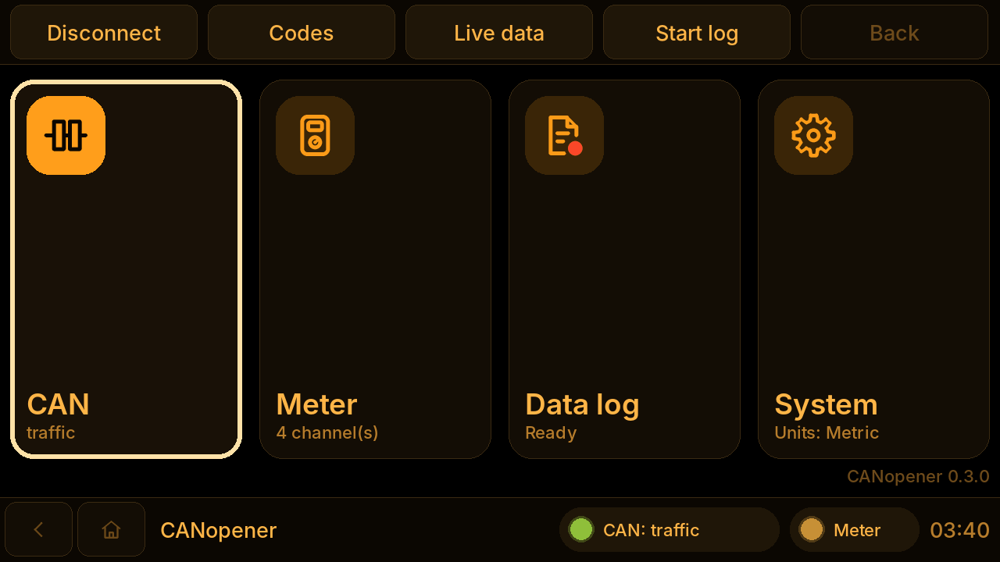
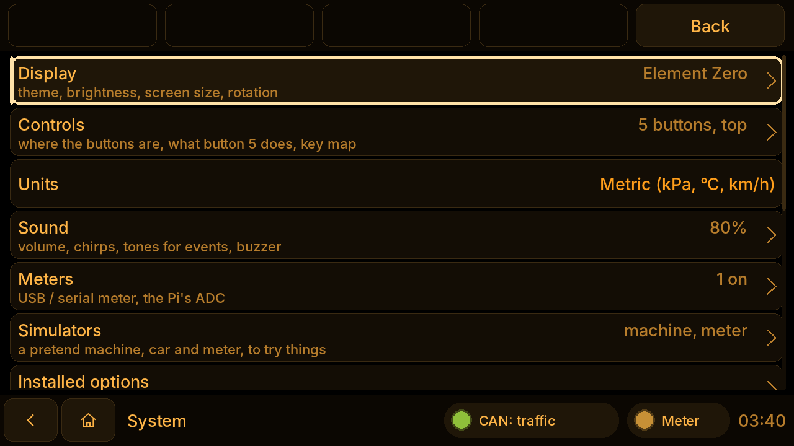
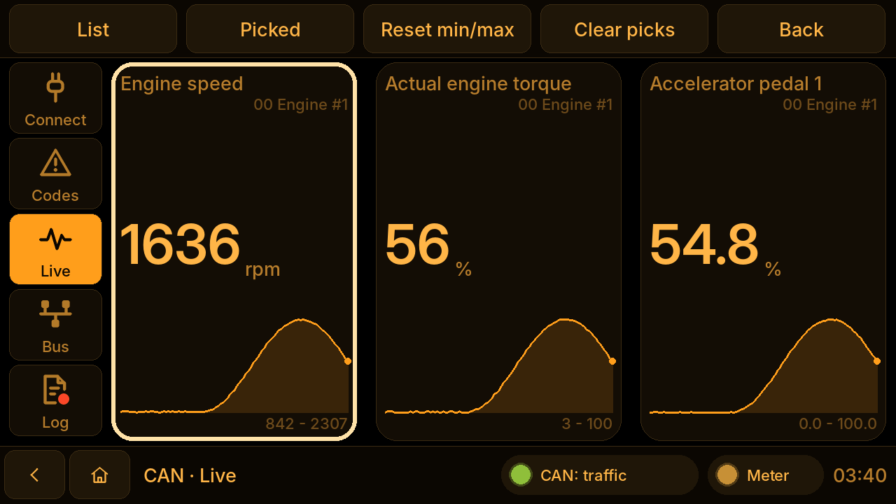
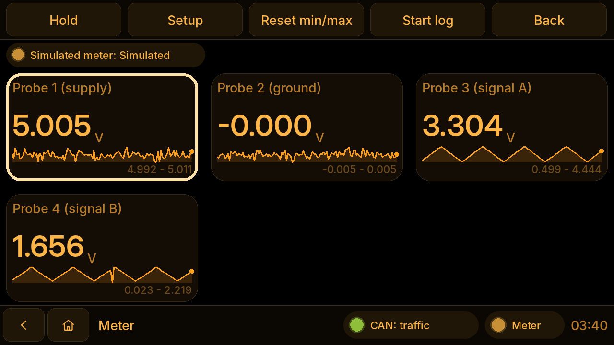
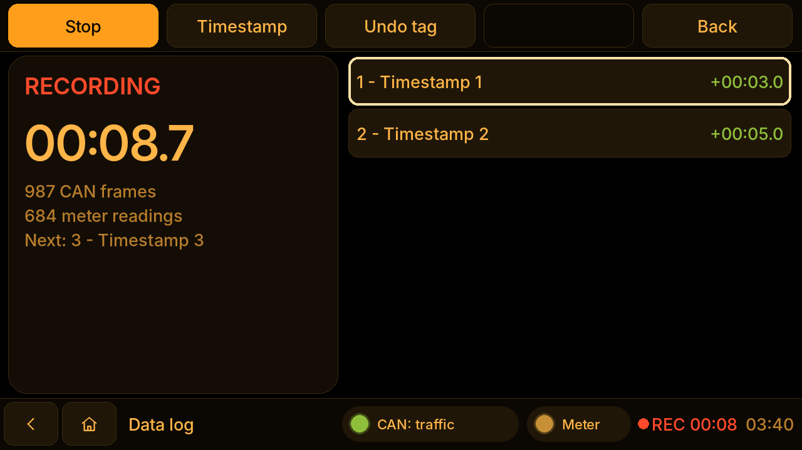

# The handheld UI (Raspberry Pi)

`canopener-device` is the instrument UI for the CANopener handheld ([DESIGN.md](DESIGN.md)): a
full-screen Pygame front-end, made to be run with a finger, a glove, a rotary encoder, a d-pad and
a row of hardware buttons. It is a third front-end over the same `core/` as the desktop GUI and
the CLI, so a fix in the scan, capture or decode code reaches all three.

> **Status:** runs and is tested headless against the simulators at 800x480, 1280x720 and
> 1280x800, and runs full-screen on a Pi 5 with an HDMI screen and a USB CANable (starting at
> login). **Not yet run on a DSI panel or with the real controls.** The pieces that only real
> hardware can prove are listed in [Not tested yet](#not-tested-yet).



**On the Pi:** start with [Handheld, first steps](install/handheld-stage0.md) (Pi 5 + Touch
Display 2 + USB CANable, then the first buttons and the encoder), then
[Handheld prototype wiring](install/handheld-prototype.md) (the CAN module, the Picos, the ADS1115).

## Try it on a laptop

```bash
pip install -e ".[device]"
canopener-device --sim                 # simulated machine + simulated meter, 800x480 window
canopener-device --sim --size 1280x720 # the 7" Touch Display 2 used landscape
canopener-device --obd-sim             # a simulated car (OBD-II)
```

**From the desktop app:** tick **Settings → Handheld (Pi) screen**. CANopener closes (asking
about an unsaved log as usual) and reopens as the handheld UI in a window. It stays that way,
from the menu entry and the `canopener` command too, until you pick **System → Software → Desktop app
instead** on the handheld; a log still recording there is stopped and saved first. The window
can be resized or maximized (everything scales with it, like a bigger panel) and reopens at the
size it was closed at; **System → Display → Window size** sets a size directly. `canopener --desktop`
always opens the desktop app (installed with `deploy/linux/install.sh` it isn't on the
terminal's PATH: run `~/CANopener/.venv/bin/canopener --desktop`). The same switch works on the Pi: the launcher starts whichever
you last chose.

Each switch starts the other app as a new process and writes its output to
`~/.local/state/canopener/canopener.log`; if a UI ever fails to open, the reason is there. If
the handheld UI can't open at all, it switches the choice back to the desktop app by itself.

Keyboard stand-ins for the hardware: **F1-F4** soft keys, **F5** button 5, **arrows** d-pad,
**Enter** encoder push (hold it for Back), **mouse wheel** or **Page Up/Down** the encoder,
**Esc** Back, **Home** home, **F9** start/stop the log, **F10** timestamp, **Ctrl+Q** quit. The
mouse stands in for a finger: click to tap, drag to scroll.

## How it's laid out

Fixed, like a scan tool: nothing reflows or pops up where a thumb doesn't expect it.

* **Soft keys** sit on the edge where the hardware buttons are (the top, by default) so each label
  is right next to its button. Their labels change with the screen. They can be tapped too.
* **Status strip** on the other edge: Back and Home (for touch), where you are, the CAN lamp
  (adapter / bus, same logic as the desktop app's lamps; amber **little traffic** under about 10
  frames a second; a second lamp when a second bus is watched), the meter's health, **REC** with the
  elapsed time, and the clock. Tapping the CAN or Meter lamp jumps to that mode.
* **Home** has one tile per mode, and its soft keys are quick actions: **Connect** (or
  Disconnect), **Codes** and **Live data** (straight to those CAN pages), **Start log** (or Stop
  log). More modes slot in later (logic analyzer, scope, ...) through
  `canopener/device/modes.py`, and plugins can add their own with `register_device(api)`.
  **Press and hold a tile, then drag it** to move it: the others make room as it goes, and the
  order is kept, through restarts too. A tile that appears later (Games, a plugin's) goes after
  the ones you've arranged.
* Soft keys that do the same thing sit on the same button: **Reset min/max** is button 3 on Live
  and Meter, and **Start log** is button 4 on Home and Meter.

Navigation is the same everywhere: **rotate** the encoder to move through a list, **push** it to
select, **hold** it (0.7 s) to go back; **d-pad up/down** moves like the encoder, **left/right**
changes page (CAN) or value (System settings). Touch targets are 10 mm on every panel: the size
is worked out from the screen's pixel density (System > Display > Screen size), not fixed in pixels.
Anything that changes a machine asks first with **No** as the default, so an accidental push of
the encoder does nothing.

| Mode | Pages / what's there |
|---|---|
| **CAN** | **Connect** (one big **Auto-Connect**: it listens first, listen-only, finds the bitrate and the busier port, connects, then offers the known profile that fits and the values other profiles know; **Manual settings** holds the rest, and with anything set there the button says *Connect (250k ...)* and **Back to Auto-Connect** undoes it; **Disconnect** takes the interface down so it can't disturb the next machine. The manual settings: source, interface, bitrate or *Auto* via the signal finder; with two CAN ports on the unit they're listed as **CAN 1** / **CAN 2**, and a port not in use can be switched off so it leaves the list; **Watch CAN 2 too** opens the other port alongside, listen-only at its own bitrate, with its own lamp and its own file in the data log; with both ports in use, **Main bus: the busier port (Auto)** (on until you pick a port) listens to both first, listen-only, and makes the busier one the main bus, saying which and how busy each was, and **Make CAN 2 the main bus** swaps the two by hand; listen-only, profile, connect at power-on, adapter and bus status; for **Bluetooth OBD**, the adapter, the **Vehicle** (car, J1939 truck, or a plugin's bus) and **Bluetooth adapters**: scan, pair with a PIN picked from the common ones, rename from a short list, test (what the adapter can do), forget; the battery voltage at the OBD port appears on the Meter screen and in the data log). **Codes** (J1939 active / stored / full scan with lamps, CANopen errors and each node's error history (**Clear...** empties it, after asking), or OBD-II codes from every module; select a code for details, *Live data* jumps to its sensor; on an older K-line machine that answers almost nothing, *More... > Deep probe* asks everything read-only and saves the answers as a log). **Live** (every value, tick the ones you want, *Grid* shows them big with a 60 s trace; **Group** (button 5, in place of Back, while the list shows; Back is still a long press of Select or the arrow in the status strip) picks **One list**, **By controller** or **By group** and folds or opens every heading, and Select or a tap on a heading folds just that one; with button 5 set to something else, **Group** is the list's first row; **double-tap** one in the grid to enlarge it, with the others stacked beside it, and double-tap it again or press Back to put it back; what's ticked, the grid and the enlarged value are kept when you go to another screen or restart, and come back as soon as those values are on the bus again). On a saved log, *More > What changed between the timestamps?* lists the bytes and bits that followed each thing you did, names them from a short list and saves them as a profile ([USAGE.md](USAGE.md#working-out-a-machine-from-what-its-bus-does)). **Bus** (**Modules**: every module with its frame rate, against the ones the profile says the machine has, missing and gone-quiet ones first in red; **Remember** saves the modules heard as the machine's, [USAGE.md](USAGE.md#which-module-is-missing); or **CAN IDs**: every ID with changing bytes marked). **Log** (below). |
| **Meter** | Each measurement channel as a big readout with min / max and a trace; **Hold** freezes the readings, min / max and traces on the screen (the meter and the data log keep running); **double-tap** a channel to enlarge it, with the others stacked beside it (double-tap it again, or Back, puts the grid back; it stays enlarged after another screen or a restart); each source's status ("not detected, retrying"). **Inputs** switches off an input with nothing on it, so it isn't shown, charted or recorded, and leads to meter setup. |
| **Data log** | Start / stop, timestamps (planned list or as-you-go), undo, save, trim to the stretch around the timestamps, copy to a USB stick, recover a log a power cut interrupted, **Open** a saved one again. Records the bus **and every meter channel**. **Plan > Automatic timestamps** sets timestamps from the bus while recording: a fault code appearing, or a button or switch you pick turning on (each named after what set it). **Machine** picks what's being logged from what the bus reports or a recent machine; **Upload** sends a saved log to your upload server or a private GitHub repository ([USAGE.md](USAGE.md#machine-details-and-uploading-captures)); **More** has Trim, Copy to USB and Upload to…. |
| **Profile builder** | For a machine nothing describes yet: it asks what the machine is (kind, including electric stand-up reach and counterbalance trucks, fuel, aftertreatment, hydraulic controls, mast height sensing), then walks you through its controls and functions one at a time, key on first and the engine after. After each step it shows what moved, live: work the control again and tick the value that follows it. A control's two directions become one signal; interlock warnings a step raises are named and waited out. Save adds the values to the profile in use (or a profile on top of it) or makes a new one built on it, and switches it on. The page also lists the known profiles that fit this bus (**Load**), the values other profiles on the unit know for this bus's undecoded messages (**Add all**), and **Explore the bus** lists every value live, named or not, to pick one and name it yourself ([USAGE.md](USAGE.md#working-out-a-machine-from-what-its-bus-does)). It only listens. |
| **Control mapping** | Every button and the encoder, live, and what each does ([below](#control-mapping)). |
| **System** | A short menu; each group opens its own page. **Display** (theme and accent colour, [below](#themes); brightness, screen size, picture rotation). **Controls** (which edge the buttons are on, 4 or 5 buttons, what button 5 does, the key map, a way into Control mapping). **Units** (changed right on the menu). **Sound** ([below](#sound)). **Meters** (USB / serial meter, the Pi's ADC). **Simulators** (a pretend machine, car and meter, and which car the Bluetooth OBD simulator plays). **Installed options**. **Storage** (logs folder, copy to USB). **Software** (check for updates, plugins, [team access](#team-access), desktop app instead). **About this device** (temperature, uptime, IP), and exit to desktop / restart / power off. |





Reads are free: J1939 requests, OBD-II reads and CANopen SDO reads. Clearing codes (J1939 DM11 /
DM3, OBD-II Mode 04, a CANopen node's error history) is the only thing that changes the machine,
and each follows CLAUDE.md: it says what it changes, defaults to No, and never runs in
listen-only. There's no transmit screen on the handheld.

## Themes

**System > Display > Theme** picks the look; it changes straight away. **Accent colour** below
it swaps the accent (selected tabs, values you can change, traces) in whichever theme is on.

| Theme | For |
|---|---|
| **Element Zero** | The default: amber on black, like a glowing hologram. Easy on eyes that have adjusted to a dark cab. |
| **Graphite** | A quieter dark look: flat panels with a fine outline, teal accent. |
| **Daylight** | Sunlight: dark text on white, strong colours, a black ring on what's selected. |
| **Basic** | The original look: raised panels, a blue accent, Pygame's own font. |

All but Basic use the **Inter** font and rounded line icons. The installers add the font
(`fonts-inter`); without it they use DejaVu Sans. The desktop app has matching colours: see
[USAGE.md](USAGE.md#colour-themes).

**Your own theme:** put a `.json` file in `~/.config/canopener/themes/`. It starts from a
built-in theme (`base`) and changes only what it names. The file name (without `.json`) is its
id, and `name` is what the Theme list shows:

```json
{
  "name": "Workshop orange",
  "base": "graphite",
  "colors": {"accent": "#ff7a1a", "focus": "#ffffff"},
  "style": {"radius": 0.25},
  "fonts": {"text": ["Roboto:medium", "DejaVu Sans"]}
}
```

* `colors`: `"#rrggbb"` (or `[r, g, b]`). Surfaces: `bg` (behind everything), `bar` (the soft-key
  and status strips), `panel` (rows, tiles), `panel2` (buttons, a selected row), `panel_hi` (a
  selected tile), `line` (outlines). Text: `text`, `dim`, `faint`. Accent: `accent`, `accent_dim`
  (behind accent icons), `on_accent` (text on an accent fill), `edge_accent`. `focus` is the ring
  on what the encoder is on; `press` lights what a finger is on. Status: `ok`, `wait`, `bad`,
  `on_bad`, `warn`, `off`, `sim`, `idle`, `rec`, `on`. Finish: `shadow`, `edge`, `edge_bad`.
* `style`: `radius` (corner size, 0-0.5 of a 10 mm touch target), `shadow`, `edge` (a light line
  along the top of buttons), `border` (an outline round panels), `trace_fill` (shading under
  traces) as true / false; `icons` (`classic` or `line`); `tile` (home tiles: `disc` or `chip`);
  `font_scale` (0.6-1.5).
* `fonts`: `text` (most text), `heading` (titles), `numbers` (big readouts). Each is a list tried
  in order: an installed font's name, optionally with a weight (`"Inter:semibold"`), or a path to
  a `.ttf` / `.otf` file. If none is found, Pygame's own font.

The file is read when you pick it, so to see an edit pick another theme and back. If something
in it is wrong (a colour that isn't one, a misspelt key), a message says what at the bottom of
the screen and the rest of the theme still applies. A file can't replace a built-in theme's name.

## Sound

**System > Sound**: the speaker **volume** (0-100 %, in 10 % steps; a buzzer has one loudness),
speaker on / off, **chirp on taps and buttons** (a short tick each time a press registers; off
until you turn it on), the CAN traffic chime, the buzzer, and **Tones for events**: one row per
event (tap or press, signal found, traffic stopped / back, a module went quiet or is missing, log
started / stopped, timestamp,
codes found, something failed, a game's clear and game over), each set to one of the tones in
`core/sound.py` (`TONES`) or *Off*. Changing a row plays the tone you picked; *Back to the
standard sounds* resets them. Kept in `settings.json` as `sound.volume`, `sound.touch` and
`sound.tones` (event -> tone, only the ones changed).

On the handheld, tones go through Pygame's mixer (opened on the first sound), so a chirp starts
within a few milliseconds of the tap. Without an audio device it falls back to `pw-play` /
`paplay` / `aplay` like the desktop app.

## Updates

**System > Software > Check for updates** does what the desktop app's *Help > Check for updates* does
(`core/updates.py`): fetches from GitHub, lists what's new, and **Install** pulls the new version
(fast-forward only; local changes stop it) and reinstalls the Python packages if they changed.
Then it asks to restart: under the Pi's service it exits with the code systemd restarts on,
otherwise it starts the new version itself. If an update also changes the system setup
(`deploy/`), it says to run the installer once in a terminal.

## Team access

**System > Software > Team access** shows the unit's serial and where it stands (the row's value:
the serial until it joins, then *waiting*, *approved* and the version, or *withdrawn*). The
handheld has no keyboard for an invite link, so **Ask** asks the unit's upload server for access
(read the serial out to whoever looks after it); once approved, **Check** installs the team plugin,
**Install** appears when there's a newer one, and **Leave** removes it. An invite link works with
`canopener-cli team join LINK` over SSH. A unit whose access is withdrawn loses the plugin at its
next start online, as on the desktop ([USAGE.md](USAGE.md#team-access)).

## Games (hidden)

Tap **Show games menu** in the corner of **System > About this device** (or open About seven
times in a row) and a **Games** tile joins the home screen (after System, so the soft keys don't
change); the same button, now **Hide games menu**, or **System > Software > Show games** hides it again.

There are four of CANopener's own, and Doom as an optional download (below). **Configure
controls**, at the bottom of the Games menu, sets how they're played: which way you hold the
handheld for Harness and Cargo (turned anticlockwise or clockwise; the picture, the d-pad and the
buttons follow), whether pushing the encoder swaps or drops there, reversing the encoder in every
game, Doom's turn speed from CAN and putting Doom's keys back, and the machine's own signals as
controls (**Controls from CAN**, below; **Clear CAN** forgets this profile's).

Each of the four has a **How to play** soft key (Arbitration explains itself on its first
screen), keeps its best score (Loom: the highest level opened), and makes the game sounds set
under **System > Sound** (cleared, next level, wrong answer, game over).

Harness and Cargo (the screens are `device/screens/games.py`) are played with the handheld turned
a quarter turn anticlockwise (or clockwise: **Configure controls**), so they draw portrait and turn
the picture. As described here it's held anticlockwise; held clockwise, the d-pad's directions
swap ends to match. The encoder turns the
piece, the d-pad's up / down (now left / right) move it, its left (now down) drops it, pushing
the encoder swaps it for the side piece, Back pauses. With just the touchscreen: tap a column to
move the piece there (tap the piece to turn it), the row of buttons under the board (move left,
Turn, Swap, Drop, move right), and tap the score to pause. In both, pieces are dealt from a
shuffled bag (no shape stays away for long), a piece that has landed can still be slid or turned
for a moment before it sets, and the outline shows where it will land.

**Harness** (`device/harness.py`): wire segments fall into a board between two bus bars. A wire
touching the bars at two points clears with everything joined to it: bar to bar scores double,
back to the same bar single; wires falling into the gap can close a chain. Wire that already
reaches a bar is drawn lit, and the landing outline changes colour when the segment would join
lit wire or close a circuit.

**Cargo** (`device/cargo.py`): a falling-block game. Crates of Cargo's own shapes (singles, pairs,
a pallet, three-crate bars and corners, five-crate P / U / V / T / L loads) drop into a trailer;
a row packed wall to wall ships out, and several rows at once score more. Shipping something with
crate after crate builds a streak (a bonus each time), and emptying the trailer is a clean sweep.

Loom and Arbitration are played the ordinary way up.

**Loom** (`device/loom.py`, screen `device/screens/games_loom.py`): a puzzle with no clock. A
wiring loom has been pulled apart: turn the tiles until the battery feeds every wire and every
lamp is lit. The d-pad moves the cursor, the encoder turns the tile under it (push: a quarter
turn), or tap a tile. Fewer turns than par earns three stars; solving a level opens the next,
bigger one (**Level −** / **Level +** go back to earlier ones).

**Arbitration** (`device/arbitration.py`, screen `device/screens/games_arbitration.py`): several
nodes start sending at once; pick the frame that wins the bus before the time runs out (tap it,
press its soft key, or move the marker and push). It follows CAN's real rules, brought in a level
at a time: the lowest identifier wins, a data frame beats a remote request for the same
identifier, an 11-bit frame beats a 29-bit one that starts with the same 11 bits, and a J1939
identifier is decided by its priority first. After each answer the bits are drawn one frame under
the other, with the bit where each loser backed off marked. A mistake adds 64 to the error
counter and a right answer takes 8 off; at 256 it's bus-off and the game is over. The identifiers
are random numbers, not any machine's.

**Doom** (`device/doom.py`) is the real one, and optional: nothing of it is in CANopener or
installed with it. The first time the games menu is turned on, the handheld asks whether to
download it (the Chocolate Doom engine and the free Freedoom levels, about 40 MB from the system's
package archive; needs internet). Say No and it stays off; the **Doom** row under Games asks
again whenever you like. Your own `doom.wad` or `doom2.wad` copied into
`~/.config/canopener/doom/` is played instead of Freedoom. Doom takes over the whole screen:

* D-pad: walk and turn. Encoder push: fire.
* Soft keys: 1 use / open, 2 next weapon, 3 map, 4 hold to strafe.
* Fifth button: Doom's menu. **Quit Game** there (push to confirm) comes back to CANopener.

The keys are set in `default.cfg` and `chocolate-doom.cfg` in that folder, written the first time
Doom starts and left alone after that (delete them to get the handheld's setup back). Doom
doesn't start while a log is recording. It isn't turned with the screen (**System > Display >
Rotate**): on a panel that needs that setting, such as the Touch Display 2, it comes up sideways
unless the system itself turns the screen, and the machine's signals can play it too (Doom from CAN, below). To remove it:
`sudo apt-get remove chocolate-doom freedoom`.

**Controls from CAN** (`device/game_controls.py`): every control goes through one command
interface, so the machine's own signals, decoded by the active profile, can play it too: steer
to turn the piece, the lower switch drops it. In Loom the move and follow-value controls move the
cursor along the row and drop / swap move it down / up; in Arbitration they move the marker and
drop answers. **Games > Configure controls** picks a signal on the bus for each action. A binding is an **edge** (a threshold, for switches), a **delta** (one step per
so much change, for a steering angle) or a **position** (the value's range spread across the
columns). They're kept per profile in `settings.json`:

```json
"games.controls": {"loader": [
  {"signal": "Steering angle", "do": "turn", "every": 15},
  {"signal": "Lower switch", "do": "drop", "above": 0.5},
  {"signal": "Joystick X", "do": "column", "min": -100, "max": 100}
]}
```

Reading only: nothing is sent. The signals are read straight from the session each frame (Live
Data samples five times a second, too slow for a quick switch).

**Doom from CAN** (`device/doom_controls.py`): Doom reads the keyboard itself, so it has its own
actions in the Doom part of **Games > Configure controls**: **Walk forward**, **Walk back**, **Fire**
and **Use / open**. Each holds its key down for as long as the signal is past its threshold (a
pedal past a quarter of its travel, a switch that's on), and **Turn the piece** also turns you,
so a steering angle steers. While Doom runs, the handheld makes a keyboard and a mouse of its own
for this (through `/dev/uinput`) and removes them when Doom ends. A signal that stops arriving
lets its key go after a second. Three things to know:

* It needs the machine connected (**CAN**) before Doom starts, and at least one of those five
  actions set.
* It needs `install.sh --device` (it lets the `input` group make input devices: see
  `72-canopener-uinput.rules`), then logging out and in. Without it Doom still plays, and the
  handheld says why the signals didn't reach it when you come back.
* How far a step of the turn binding turns you is **Turn speed from CAN** there (mouse counts, 40 to
  start with; bigger turns further), with **Reverse Doom's turning from CAN** beside it.

## Meters and the data log (the groundwork)

Anything the handheld can read should land on the same timeline as the CAN bus, so a probe
voltage can be lined up with the fault code that fired a moment later. That's built in from
the start:

* **Inputs can be switched off** (`meters.off`, `MeasurementHub.set_off`): the hub drops a
  switched-off channel's readings as they arrive, so no view, chart or capture sees them, while
  the source keeps running.
* **`core/measure.py`**: a `Channel` (id, name, unit, normal range), a `Sample` (time, value,
  flag such as `OL`), a `MeasurementSource` base class, and the `MeasurementHub` every source
  pushes into. Samples carry wall-clock time, the same clock as CAN frames. A source with its own
  clock (a Pico counting microseconds since the sync pulse) maps it with `ClockMapper`.
* **`core/meters.py`**: the sources. `SimulatedMeter` (four probes on a pretend pedal sensor whose
  signal B drops out mid-travel, the DESIGN.md use case), `SerialLineSource` (anything that
  prints readings on a USB serial port: the Pico coprocessor, the ESP32 bridge for wireless
  satellites) and `IioSource` (an ADC the kernel already drives, such as an ADS1115 with
  `dtoverlay=ads1115`: real probe voltages on a bench Pi before the Pico board exists).
* **The capture records them.** `Capture.start(session, ..., measurements=hub)` writes
  `measurements.csv` beside `capture.log` while recording (flushed every second, so a power cut
  loses at most that). On save, each channel becomes a column in `live_data.csv` next to the CAN
  values, going out of range or "no reading" become timeline events in `summary.txt` among the
  fault codes and markers, and the summary lists each channel's range and its value at every
  timestamp. Trim cuts both. A capture can be meters-only (no bus connected). The desktop Log
  tool gets the same files once it passes the hub in.
* **Live views** get them too: `MeasurementLiveData` shapes channels like CAN signals, so the
  CAN > Live list and grid show a probe next to engine speed.



**Meter line protocol** (what the Pico / ESP32 firmware should print, one line each, UTF-8):

```
{"hello": "canopener-meter", "name": "Pico DMM", "channels": [{"id": "p1", "name": "Probe 1", "unit": "V", "decimals": 3, "low": 0.5, "high": 4.5}]}
{"ch": "p1", "v": 4.512}                     reading now
{"ch": "p1", "v": 4.512, "t_us": 81234567}   with the device's own clock
{"ch": "p1", "v": null, "flag": "OL"}         no valid reading, and why
{"status": "error", "text": "probe 3 over voltage"}
p1=4.512 p2=0.118                            the same, minimal
```

The source re-opens the port after a dropout and reports its state, the "Pico not detected,
Retry?" pattern from DESIGN.md.

**Installed options** (`core/hardware.py`, System > Installed options, or
`canopener-cli hardware`): the handheld is built in stages, so each on-deck part (CAN stacks, the
two Picos, the sync input, the Pi's ADC, the ESP32, the parts behind the meter Pico) is set to Not
installed (the default: never touched), Installed (missing = a red lamp with a hint, retried) or
Use if found. "Set all from build stage" fills them in. Meter sources for the meter Pico, the ESP32
and the Pi's ADC start from these; the Meters rows above stay for a bench Pi or a laptop.
**Setting a part on the Pi's own pins also sets the Pi up for it** (`core/bootconfig.py`): the page
shows the lines it will add to `/boot/firmware/config.txt`, asks first, writes them into one marked
block through the root helper `canopener-boot-config` (installed by the Pi installer), and
loads the driver at once where it can (the CAN stacks, the ADC, the sync input). The buttons and the
ESP32's UART need a restart, which it offers; so does taking a part out. Each CAN stack has its
crystal (20 MHz on the prototype module, 40 MHz on the custom board) and SPI speed (1 MHz for
breadboard wiring) on the same page. `canopener-cli hardware --apply` does the same over SSH.
[ELECTRONICS.md](ELECTRONICS.md) section 19 has the list. Waveforms and logic captures (kHz-MHz) don't belong in a CSV row
per sample: they will be their own files in the capture folder, on the same timebase, listed in
`capture.json`.



## Calibrating the meter

Home-built probe channels read a little off: a percent or two from resistor tolerance and the
ADC's own loading. That error is the same every time, so each channel gets a zero and a gain,
set against a supply you've measured. Everything after that (the meter, CAN > Live, the data log
and its report) shows corrected readings, and each capture notes the calibration it was taken with.

Open **System > Meters > Calibration**. It lists each voltage channel (CH1, CH2, ...) with its gain
and the date it was set. You need a steady supply (a bench supply, or a 12 V battery) and, for
Full, a second meter.

* **Full** (soft key 2): for each channel in turn,
  1. **Zero:** touch the channel's probe to the COM lead. When the reading settles, push the
     encoder.
  2. **Voltage:** touch the probe to the supply's plus, COM on its minus. Push to hold the reading.
  3. **Looks right / Adjust:** measure the supply with your second meter. If the held reading
     matches, push. If not, pick **Adjust** and turn the encoder until it does (0.01 V a click;
     soft key 1 changes the step to 0.1 or 0.001), then push to save.
  4. It beeps, shows **saved** and moves on to the next channel by itself.
* **Quick** (soft key 1): measure the supply with your second meter first and set that voltage
  (turn the encoder, push to start). Then for each channel: touch COM, wait for the beep, touch the
  supply, wait for the beep. Each step is taken by itself once the reading settles, and it goes
  straight on to the next channel. A reading more than 25% away from the voltage you set is held
  back with a warning (push to use it anyway).

Tip: clip COM to the supply's minus and leave it there. Then touching the minus is the zero and
the plus is the voltage, for every channel.

Each channel is saved as soon as it's done. **Stop** or Back keeps the channels already saved;
**Skip** leaves one as it was. Pick a single channel in the list to calibrate just that one, or to
reset it. Changing **ADC input divider** clears the Pi ADC's channels, since their old numbers no
longer fit. Calibrate at the voltages you work at (12-24 V), and again if you change the front end.
Stored in `settings.json` as `meters.cal`; the beeps are **System > Sound > Tones for events**
(Calibration: reading taken / channel saved).

## Controls: wiring

The cheapest, most robust way to wire the buttons is **one GPIO per switch**, switch to ground,
using the kernel's `gpio-key` driver. Each button then *is* a key press (kernel debounced, no
polling, works the same under a desktop or without one), and a USB keyboard does the same thing
on the bench. The rotary encoder uses the kernel's `rotary-encoder` driver; the app reads it from
`/dev/input` (the user must be in the `input` group: `install.sh --device`).

Suggested pins (Pi 5, also fine on a 3B+ / 4 / CM5). They leave the buses the rest of the design
needs free ([ELECTRONICS.md](ELECTRONICS.md) 5.1): I2C1 (GPIO2/3) for the ADS1115, SPI0 for both
MCP2518FD CAN controllers (CE0 + INT GPIO25, CE1 + INT GPIO20), GPIO21 for the SYNC pulse from the
meter Pico, the UART (GPIO14/15) for the ESP32, and GPIO18 for a PWM buzzer. I2S audio is given up
for GPIO20/21; GPIO19 is the only spare. (The Waveshare 2-CH CAN FD HAT's second channel uses
GPIO18-21 and 24: with it, the buttons go on a second ADC instead,
[below](#buttons-and-battery-on-the-second-adc).) Their overlay lines are in
[`deploy/raspberry-pi/config-hardware.txt`](../deploy/raspberry-pi/config-hardware.txt), and
System > Installed options writes them for you.

| Control | GPIO | Sends | App action |
|---|---|---|---|
| Top button 1-4 | 5, 6, 12, 13 | F1-F4 | Soft keys 1-4 |
| Top button 5 | 16 | F5 | Back (or soft key 5, start/stop log, timestamp: System > Controls > Button 5 does); on the CAN > Live list it's **Group** instead of Back |
| D-pad up / down / left / right | 17, 27, 22, 23 | arrows | Move / change page |
| Encoder A / B | 24, 4 (17, 27 with the button ADC) | REL_X | Move (rotate) |
| Encoder push | 26 | Enter | Select (hold: Back) |

That's twelve pins. The overlay lines are in
[`deploy/raspberry-pi/config-controls.txt`](../deploy/raspberry-pi/config-controls.txt): append
them to `/boot/firmware/config.txt` and reboot. The Alps RKJXT1F42001 named in DESIGN.md is the
d-pad, push and encoder in one part, so it covers seven of these pins on its own.

**Short of pins?** With the Waveshare HAT fitted, put the buttons on the second ADC instead
([below](#buttons-and-battery-on-the-second-adc)): every button moves off the GPIOs.

Change what any key does in `~/.config/canopener/settings.json`, e.g.
`"device.keys": {"f6": "log", "f7": "tag"}` for two more buttons as dedicated Log / Timestamp
keys (System > Controls > Key map shows the current map).

### Buttons and battery on the second ADC

The Waveshare 2-CH CAN FD HAT's second channel takes GPIO18-21 and 24, and the side buttons
(Back, Hold, Record, Timestamp) need four more inputs. So on the HAT build every button is on
**resistor stacks** read by a **second ADS1115**, which also reads the **battery**. Only the
encoder's A and B lines stay on GPIO: a turning encoder is too quick for an ADC.

* The second ADS1115 sits on the same I2C wires as the probe ADC (GPIO2 / 3) with its **ADDR pin
  tied to 3.3 V**, so it answers at **0x49** (the probe ADC is 0x48, ADDR to ground).
* Its **A0** is the battery, through a divider. **A1-A3** are three stacks of buttons.
* The encoder moves to **GPIO17 (A)** and **GPIO27 (B)**, physical pins 11 and 13 (ground on 14).
* Switch it on in **System > Installed options > Buttons and battery ADC**, with **Buttons and
  encoder** marked installed too. It writes the boot settings: the encoder lines, no button lines,
  and the second ADC. Run the Pi installer once more first, so the boot-settings helper knows the
  new layout.

**Each stack:** a 10 kΩ pull-up from 3.3 V to the input, and each button from the input to ground
through its own resistor. The same five resistors on every stack, so the voltages are the same:

```
3.3 V ──[10 kΩ]──┬──────────────────── ADS1115 (0x49) A1 / A2 / A3
                 ├─[button 1]──────────────── GND     0 V
                 ├─[button 2]───[2.2 kΩ]───── GND     0.60 V
                 ├─[button 3]───[5.6 kΩ]───── GND     1.18 V
                 ├─[button 4]───[12 kΩ]────── GND     1.80 V
                 └─[button 5]───[27 kΩ]────── GND     2.41 V
                                     nothing pressed:  3.3 V
```

| Input | Button 1 | Button 2 | Button 3 | Button 4 | Button 5 |
|---|---|---|---|---|---|
| A1: top row | F1 (soft key 1) | F2 | F3 | F4 | F5 (button 5) |
| A2: d-pad and push | Up | Down | Left | Right | Encoder push (Select; hold for Back) |
| A3: side | Back | Hold | Record | Timestamp | (none) |

Each stack is read about 40 times a second, so a press shows within about 50 ms. That needs every
input of the ADC at its full 860 samples a second: `install.sh --device` adds a rule that sets it.
An input left at the chip's default (8 a second) slows every stack to a few reads a second, and
presses come half a second late. **Control mapping** shows how often the stacks are read and
names any slow input.

Buttons on different stacks work together (an arrow while holding a soft key). Two on the same
stack don't: the input reads as one or the other, or neither. That means no diagonals on the
d-pad. 1% or 5% resistors both work. Different values? Put each button's voltage in
`device.button_levels` in settings.json, button 1 first.

**The battery (A0):** a DeWalt 20V MAX pack is 5 cells, about 20.5 V full and about 15 V flat
[verify against your pack]. A **100 kΩ over 15 kΩ** divider brings a full pack to about 2.7 V on A0:

```
pack + ──[100 kΩ]──┬──────── ADS1115 (0x49) A0
                   ├─[15 kΩ]── GND (pack −)
                   ├─[100 nF]─ GND
                   └─ BAT54S: one diode to 3.3 V, one from ground
```

The pack's minus must be the Pi's ground: with an ordinary (non-isolated) buck converter it
already is. The divider draws about 0.2 mA. The clamp protects A0 if the 15 kΩ ever comes loose. Not a zener: its leakage through 13 kΩ
shifts the reading.
Different resistors? Set `battery.divider` to (top + bottom) / bottom.

The charge shows at the right of the status strip: dim while it's fine, amber when low (20%), red
when very low (8%), each said once on screen with a tone (**System > Sound > Tones for events >
Battery low**). Power-tool packs don't all switch themselves off when they're flat, so when the
pack has sat at 3.0 V a cell (15 V) for 30 s, the handheld saves a running log and **powers off**.
**System > Power > Battery** shows the charge and volts, and turns the power-off on or off. A
input with no divider on it floats and can read anything, so the battery only counts once the
input has read like a charged pack (3.3 V a cell or more) steadily for a few readings. Until then
nothing shows in the status strip, nothing warns, and nothing powers off. Below 10 V it goes back
to that.

If the button ADC stops answering, the screen says so, and touch still works.
**System > Installed options** says what to check.

**Doom** reads the keyboard itself. While it runs, the app passes the stacks' presses on as the
same keys the GPIO buttons send, through the same input permission the controls from CAN use
(`install.sh --device`).

**What the HAT build leaves free:** GPIO 4, 5, 6, 7, 12, 13, 14, 15, 16, 22, 23, 26. GPIO12 / 13
can do PWM, so a buzzer could go on one of them. GPIO14 / 15 are the UART, for an ESP32 later.
The sync input from the meter Pico could go on any of them.

The same Back / Hold / Record / Timestamp functions on keys instead (a USB keypad on the bench,
or buttons on spare GPIOs on a build without the HAT) need no setting:

| Button | Sends (Linux key code) | Does |
|---|---|---|
| Back | Esc (1) | Back |
| Hold | Pause (119) | Freezes the values on the screen (Live, the traces; on the Meter page, its own Hold). HOLD shows in the status strip. The bus, the meters and a running log carry on |
| Record | F9 (67) | Start / stop the data log, from any screen |
| Timestamp | F10 (68) | Tag a timestamp in the running log, from any screen |

With a dedicated Back button, set **System > Controls > Button 5 does** to **Soft key 5**, so the
fifth top button is one more context-dependent key. (Button 5 can also be Hold.) What it does:

| Screen | Five soft keys |
|---|---|
| CAN > Codes (J1939) | **Full scan**, **Active**, **Stored**, **Clear...**, **Live data** (no More... menu needed) |
| CAN > Codes (OBD-II) | the usual four, then **Start log** / **Stop log** |
| CAN > Connect | the usual keys, then **Codes** once connected |
| CAN > Live, CAN > Bus | the usual keys, then **Start log** / **Stop log** |
| Data log, while recording | Stop, Timestamp, Undo tag, then **Hold** |
| Meter | the usual four, then **Timestamp** while recording, otherwise **CAN** |
| Home | Connect, Codes, Live data, Start log, then **Meter** |
| Any other page | its own keys, then **Home** |

## Control mapping

The **Control mapping** tile tests the buttons and the encoder, and fixes in software what the
wiring got wrong. It has one row for every input that's installed:

* With the button ADC, the rows are grouped by input. Each input row (**Input A1** ... **A3**)
  shows the voltage it reads and the button that voltage means. Under it are that stack's five
  buttons, each with its voltage and what it does.
* With buttons on GPIO, there's one row per button (F1 ... F5, the d-pad, the push), with its GPIO.
* The encoder: steps counted as you turn it, and **Direction**.
* **Last presses**: the latest presses with how long ago, and, with the button ADC, how many there
  were in the last 5 seconds.

A lit dot is a button that's down right now.

**Testing** is on when the page opens. While it is, the buttons and the encoder only light up on
this page and don't do anything else, so you can press anything safely. Touch still works
everything (the back arrow in the status strip leaves the page). Tap **Testing** to use the
buttons normally again.

* **A button doing the wrong thing** (F1 and F3 wired the wrong way round): select it and pick
  what it should do, or **Nothing** to ignore it.
* **A button that reads as its neighbour** (a different resistor): hold it down and, with the
  other hand, select it and pick **Take its level now**. **Back to the usual level** undoes it.
* **A stack that isn't wired yet**: select its input row to switch the whole stack off.
* **The encoder runs backwards**: select **Direction**.
* **Reset** puts everything back the usual way.

**Presses nobody made.** An input with nothing pulling it up (the stack's 10 kΩ pull-up missing,
or the stack not wired at all) floats. Its voltage wanders through the buttons' levels and reads
as press after press. The handheld spots a stack doing that, says so on screen and ignores it
until it reads steady again, so it can't run through the screens. On this page, its input row
shows the voltage wandering. Wire the pull-up, or switch the stack off until you do. With nothing
pressed, an input should read about 3.3 V.

## Displays

| Panel | Pixels | Set |
|---|---|---|
| Raspberry Pi Touch Display 2 (7") | 720x1280, portrait | Rotate picture: 90° (or 270°), screen size 7" |
| Raspberry Pi Touch Display 2 (10.1", July 2026) | 1200x1920, portrait | Rotate picture: 90° (or 270°), screen size 10.1". On the prototype; bigger than the 7" crossbar |
| Original Raspberry Pi 7" display | 800x480 | screen size 7" |
| Typical 10.1" DSI panels | 1280x800 | screen size 10.1" |

Under the Pi desktop, rotate the screen in the desktop's Screen Configuration instead and leave
the app's rotation at 0°. **Rotate picture** is for running without a desktop, where nothing
else rotates: the app draws sideways and turns touch coordinates to match.

## On the Pi

Install with the handheld options (step by step: [Handheld, first steps](install/handheld-stage0.md)):

```bash
./deploy/raspberry-pi/install.sh --autostart --device
```

`--device` adds you to the `input` (encoder) and `video` (brightness) groups and installs udev
rules for the backlight and for Doom from CAN (above). The installer switches a fresh install to the handheld UI, and the
launcher starts whichever UI was last chosen, full screen (switch in the app as above, or force
one with `CANOPENER_UI=device` / `desktop` in the service). Logs go to
`~/.local/state/canopener/launch.log`.

**Without a desktop** (Pi OS Lite, boot straight to the instrument): run with
`SDL_VIDEODRIVER=kmsdrm`. Pygame from pip may be built without KMS/DRM support; if it won't open
the display, use Raspberry Pi OS's own build instead:
`sudo apt install python3-pygame`, then recreate the venv with `--system-site-packages` and
`pip uninstall pygame-ce` in it.

## Not tested yet

These need the real hardware, and are the first things to check on the Pi:

* Pygame's video driver on Pi OS (Wayland desktop, and `kmsdrm` without one), and full-screen
  frame rate on the Pi 5 at 1280x720 (it draws at 30 fps; drop `device.fps` if needed).
* The touch panel's events arriving as mouse events (SDL's default), and rotation with touch.
* The `gpio-key` and `rotary-encoder` overlays on the Pi 5's RP1 GPIO, the encoder's
  steps per detent, and the pull-ups.
* Brightness through `/sys/class/backlight` with the udev rule.
* The serial meter source against a real Pico, and the IIO source against an ADS1115.
* Bluetooth OBD on the Pi 5's built-in Bluetooth: pairing through `bluetoothctl`, Python's RFCOMM
  sockets (Pi OS's python3 has them), and a real adapter's timing (`canopener-cli obd --elm --bench`).
* Installed-option detection on a real Pi (USB names of both Picos, `/sys/class/pps`, the
  `ads1115` IIO name), and the SYNC pulse pairing (`core/sync.py`) against real pps edges.
