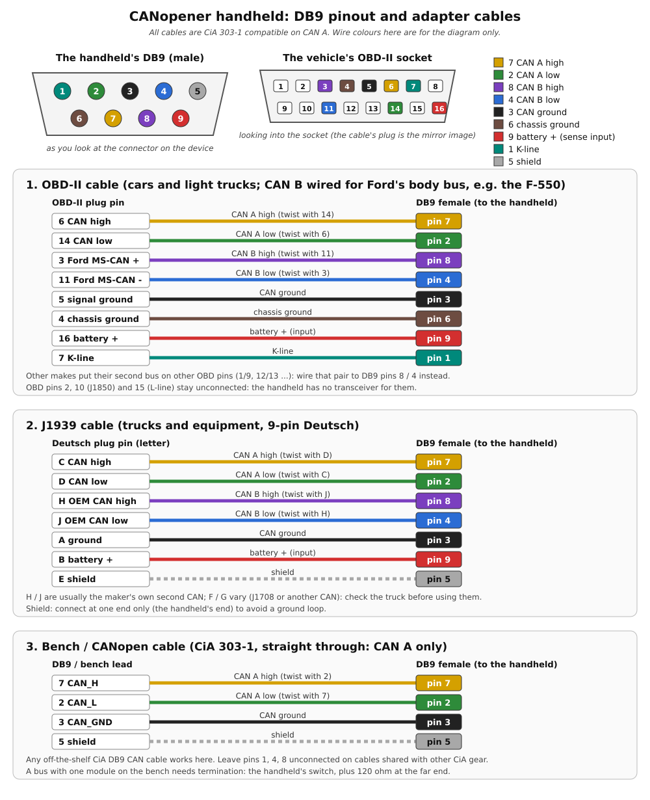

# CANopener: Electronics Bring-up (adapter-board prototype)

*Living doc. Rev 0.8, 2026-11-09. This repo copy is the one to edit from now on.*

**Scope.** The hand-wired proof of concept built on SOP/QFN-to-DIP adapter boards: pinouts, protection, what is sensitive to wire length, the front-end and timing design, and a working BOM. It is **not** the custom PCB. It exists to (1) get a working platform and (2) record what we learn as layout requirements. Enclosure, UI and software architecture stay in [DESIGN.md](DESIGN.md) / [DEVICE.md](DEVICE.md) / [ARCHITECTURE.md](ARCHITECTURE.md). DESIGN.md was brought up to these decisions in rev 0.6 (and the DB9 in 0.8). Code for each part: [Software per component](#18-software-per-component). The custom board: [hardware/README.md](../hardware/README.md).

**Legend.** **[V]** checked against a datasheet or repo file. **[P]** proposed, needs your OK. **[TBD]** not researched yet. **[D]** decided.

---

## 1. Decisions

| # | Decision | Status |
|---|---|---|
| D1 | Electrical scope is **12-48 V systems**. Design to about **60 V working** (48 V packs read about 58-62 V while charging or equalizing). 72/80 V trucks are out of scope. | [D] |
| D2 | **Two Picos.** The original Pico (RP2040) runs stock sigrok-pico as the logic analyzer. A Pico 2 (RP2350) runs custom meter firmware (ADS8584S, thresholds, CAN monitors, sync). | [D] |
| D3 | **Periodic sync.** One pulse source; T+0 is the first pulse after capture start; every later pulse corrects drift. Section 9. | [D] |
| D4 | **ADC rate scales with channels in use**, with a fixed USB budget. Section 8. | [D] |
| D5 | **No external CAN TVS on the prototype.** The TCAN1051V's own protection covers ESD; keep an unpopulated footprint on the custom board. Section 7. | [P] |
| D6 | Voltage probe inputs: **10 Mohm, x10 compensated attenuator** into the ADC (about +/-100 V full scale). Section 6.1. | [P] |
| D7 | Second CAN INT = **GPIO20**; sync input = **GPIO21**. Only I2S audio is lost; a PWM buzzer on GPIO18 still works. | [P] |
| D8 | ESP32 on the **Pi UART (GPIO14/15)** for the prototype. | [P] |
| D9 | DB9: **male on the device**, **one connector for both CAN stacks** (section 5.5). CAN A on the CiA 303-1 pins (7 CAN_H, 2 CAN_L, 3 CAN_GND, 6 GND, 9 V+, 5 shield), so off-the-shelf CiA cables and adapters still fit; the extras on the pins CiA leaves reserved: **CAN B on 8 (H) / 4 (L)**, **K-line on 1**. Pin 9 is a protected battery-sense **input** only. Use the ordered female DB9s for harness and bench cables. | [D] pinout; [P] pin 1 / pin 9 parts |
| D10 | Custom board: **40 MHz** CAN clock. **TCAN1051HV-Q1** (+/-70 V instead of +/-58 V) as cheap insurance if pin- and price-compatible. | [P] |
| D11 | **Shared probes ("option B").** The four meter probes double as logic channels: each probe has a second attenuator into a comparator with a DAC-set threshold, feeding the logic Pico. The meter sets thresholds from what the ADC sees. Plus a dedicated low-voltage logic header. Section 6.2. | [D] |
| D12 | **Protection policy** (section 2): survive the mistakes a responsible tech can make on a 12-48 V machine; don't harden against the rest. | [D] |
| D13 | **Component test source.** A current-limited, metered **5 V source on probe 4 ("SRC")**, plus switchable pull-ups on probes 1-2, for powering sensors (Hall encoders, speed sensors, ratiometric pots) off the machine. Supplies of 12 V and up are an accessory, not on-deck (footnote 1). Section 6.7. | [P] |

---

## 2. Protection policy [D12]

**Goal:** a responsible user can't smoke the expensive parts (Pi/CM5, ADS8584S, display) with a plausible mistake on a 12-48 V machine. Not a goal: hardening every input against 80 V, mains, or several simultaneous faults. Rule of thumb: field-facing pins only touch **cheap, replaceable parts** (transceiver, Picos, comparators, resistors). Nothing from the field reaches the Pi's GPIO directly.

| Scenario | In scope? | What handles it |
|---|---|---|
| Probe tip on any point of a 12-48 V system, in any mode (volts, logic, ohms) | **Yes** | Volts/logic: 9 Mohm attenuators limit current to microamps. Ohms: PTC + clamp (6.3) |
| Ohms mode left on, probe touches a live circuit | **Yes** | PTC + clamp protects the analog switch; firmware shows the voltage and refuses an ohms reading |
| SRC probe (5 V source on or off) touches a 12-48 V point | **Yes** | 100 V Schottky blocks backfeed into the source and pull-ups; SMAJ60A at the jack (6.7) |
| SRC enabled onto a circuit that is already powered | **Yes** | Firmware pre-check refuses to enable; if it happens anyway, the blocking diode and current limit cover it (6.7) |
| SRC output shorted to COM or ground | **Yes** | Load switch current limit and thermal shutdown; fault flag to the meter Pico (6.7) |
| Probe COM clipped to B+ while the CAN harness is grounded | **Yes** | PTC on COM (6.4) |
| CAN harness or adapter mis-pinned onto battery + (homemade adapter, a slipped back-probe, a bent pin; e.g. on the 9-pin Deutsch J1939 connector battery + sits next to CAN-H) | **Yes** | TCAN1051V tolerates +/-58 V on CANH/CANL. No extra parts |
| ESD on connectors and jacks; contactor-coil spikes coupled into probe leads | **Yes** | TCAN built-in ESD (+/-15 kV IEC); SMAJ60A at probe jacks; attenuators |
| A slip onto 12-24 V on the low-voltage logic header | **Yes** | 2.2 kohm series + Schottky clamp per pin (6.5) |
| Battery voltage across the CAN bus itself | No | Every module on that bus is already dead; nothing to diagnose |
| A miswired or wrong-pinout cable puts battery + or K-line voltage on any DB9 pin (CAN A, CAN B, pin 1, pin 9) | **Yes** | CAN pins: the TCAN's +/-58 V. Pin 9: 60 V-rated divider + clamp. Pin 1: only a battery-rated K-line transceiver. 5.5 |
| 72/80 V systems | No | D1 |
| 48 V on the low-voltage logic header | No | Header labeled "3.3/5 V" |
| Mains or any CAT-rated measurement | **No, never** | This is not a CAT II/III instrument. Say so on the label and in the manual |
| Faulty charger connected while on a machine | No | Rule: battery only when connected (10) |

**Firmware's role:** user-facing protection only (warnings, refusing a mode on an unsafe reading, auto-thresholds). The hardware must survive a fault without firmware reacting.

---

## 3. Stages

| # | Stage | Done when |
|---|---|---|
| 0 | Pi 5 + Touch Display 2 + USB CANable 2.0 | `canopener-device` starts full screen at boot, touch works, the CANable is `can0`, a bench bus or a real machine reads (listen-only needs candleLight firmware). No soldering. Guide: [install/handheld-stage0.md](install/handheld-stage0.md) |
| 0b | First controls: a few buttons + the encoder | Each wired button acts as its key in the UI; the encoder moves the focus one row per detent. Pins and overlay lines from `config-controls.txt`; touch still works for anything not wired yet. Same guide |
| 1 | CAN stack A (MCP2518FD + TCAN1051V) | Its interface appears (not always `can0` with the CANable plugged in: `canopener-cli hardware` says which); loopback passes; frames exchanged with the CANable on a terminated bench bus on the same Pi; then listen-only on a real machine |
| 2a | Logic Pico (original Pico, sigrok-pico) | `sigrok-cli` captures from it on the Pi |
| 2b | Meter Pico (Pico 2) | Meter line protocol over USB; sync pulse generated and timestamped by the Pi |
| 3 | ADS1115 on I2C | Probe voltages appear in a capture via the IIO source. **Front end per 5.7, never bare probes into the Pi's ADC** |
| 4 | The rest of the controls | All five buttons and the RKJXT1F42001 (d-pad + push + encoder in one part) in place of 0b's bench parts; final panel size decided (7" vs 10.1") |
| 5 | CAN stack B | Second MCP2518FD on SPI0 CE1, INT on GPIO20, to DB9 8 (H) / 4 (L) with its own termination switch (5.5); frames on the Ford body bus (OBD 3 / 11) through the OBD-II cable |
| 6 | ESP32 | ESP-NOW receiver / Bluetooth gateway over the Pi UART |
| 7 | Probe front end, one channel | Attenuators + comparator + DAC on one channel, tested with the meter Pico's internal ADC first |
| 7b | Component test source (6.7) | SRC powers a Hall sensor on the bench; current reads on the INA226; current limit and fault flag trip on a short; SRC survives a touch to a 48 V bench supply (on and off); pull-ups make an open-collector output readable |
| 8 | ADS8584S on the meter Pico | Last. **Only one unit.** Practice reflow on scrap first |

## 4. Block diagram

```
 DSI panel <-------- DSI
 buttons/joystick -> GPIO (gpio-key, rotary-encoder)
                                         Raspberry Pi
 SPI0 CE0 + GPIO25 --> MCP2518FD A --> TCAN1051V --> DB9 7 / 2 (+ 3, 6 GND)
 SPI0 CE1 + GPIO20 --> MCP2518FD B --> TCAN1051V --> DB9 8 / 4 (stage 5)
 (K-line transceiver, later) ------------------------> DB9 1
 (battery sense, 60 V-rated divider) <---------------- DB9 9
 I2C1 --------------> ADS1115 (stage 3, early analog, through a divider + clamp)
 UART 14/15 --------> ESP32 (stage 6)
 USB ---------------> Meter Pico (RP2350)
                        SPI --> ADS8584S <-- [x10 attenuator A] <--+
                        I2C --> MCP4728 DAC --> thresholds         |-- probe 1..4 (+ COM via PTC)
                        I2C --> ADS1115 (ohms node)                |
                        I2C --> INA226 (SRC current)               |
                        GP8/9 --> SRC load switch --> Schottky --> probe 4 (6.7)
                        GP10/11 --> pull-up enables --> Schottky + 4.7k --> probes 1-2
                        ADC0-2 <-- CAN-H / CAN-L / CAN GND monitors|
                        GP15 --> SYNC                              |
 USB ---------------> Logic Pico (RP2040, sigrok-pico)             |
                        D3-D6 <-- comparators <-- [x10 attenuator B] <--+
                        D7-D14 <-- low-voltage logic header (2.2k + clamp)
                        D2 <-- SYNC
 GPIO21 (pps-gpio) <-- SYNC
```

## 5. Pinouts

### 5.1 Raspberry Pi 40-pin header

Same header on the 3B+ and Pi 5. Control pins come from the repo (`docs/DEVICE.md`, `deploy/raspberry-pi/config-controls.txt`).

| Pin | GPIO | Function | Status |
|---|---|---|---|
| 1 / 17 | 3V3 | MCP2518FD VDD, TCAN VIO, ADS1115 VDD | [P] |
| 2 / 4 | 5V | TCAN VCC | [P] |
| 6, 9, 14, 20, 25, 30, 34, 39 | GND | Common ground | |
| 3 | 2 (SDA1) | ADS1115 SDA | [P] |
| 5 | 3 (SCL1) | ADS1115 SCL | [P] |
| 19 | 10 (MOSI) | MCP2518FD A/B SDI | [V] |
| 21 | 9 (MISO) | MCP2518FD A/B SDO | [V] |
| 23 | 11 (SCLK) | MCP2518FD A/B SCK | [V] |
| 24 | 8 (CE0) | MCP2518FD A nCS | [V] |
| 22 | 25 | MCP2518FD A INT | [V] repo overlay |
| 26 | 7 (CE1) | MCP2518FD B nCS | [P] |
| 38 | 20 | MCP2518FD B INT | [P] D7 |
| 40 | 21 | SYNC **input** from meter Pico (`pps-gpio`) | [P] D7 |
| 8, 10 | 14 (TXD), 15 (RXD) | ESP32 RX0 / TX0 | [P] D8 |
| 12 | 18 | PWM buzzer (optional) | repo |
| 35 | 19 | Free (was I2S) | |
| 29, 31, 32, 33 | 5, 6, 12, 13 | Buttons 1-4 | [V] repo |
| 36 | 16 | Button 5 | [V] repo |
| 11, 13, 15, 16 | 17, 27, 22, 23 | D-pad up, down, left, right | [V] repo |
| 18, 7 | 24, 4 | Encoder A, B | [V] repo |
| 37 | 26 | Encoder push | [V] repo |
| 27, 28 | 0, 1 | HAT ID EEPROM. Do not use | |

`deploy/raspberry-pi/config-controls.txt` keeps these clear of the controls (updated for D7/D8 in rev 0.6); the overlay lines for each stage are in `deploy/raspberry-pi/config-hardware.txt`.

### 5.2 MCP2518FD (SOIC-14, on a SOP14 adapter) [V datasheet]

| Pin | Name | Connect to |
|---|---|---|
| 1 | TXCAN | TCAN1051V pin 1 (TXD) |
| 2 | RXCAN | TCAN1051V pin 4 (RXD) |
| 3 | CLKO/SOF | Test point: can output the clock to confirm the crystal runs (default divider [TBD], see datasheet) |
| 4 | INT | Pi GPIO25 (stack A) / GPIO20 (stack B) |
| 5 | OSC2 | Crystal side B + C2 |
| 6 | OSC1 | Crystal side A + C1 |
| 7 | VSS | GND |
| 8 | INT1/GPIO1 | NC |
| 9 | INT0/GPIO0/XSTBY | NC (the TCAN1051V's S pin is *silent* mode, not standby) |
| 10 | SCK | Pi GPIO11 |
| 11 | SDI | Pi GPIO10 |
| 12 | SDO | Pi GPIO9 |
| 13 | nCS | Pi GPIO8 (A) / GPIO7 (B) |
| 14 | VDD | 3V3 + 0.1 uF |

VDD 2.7-5.5 V. **Errata item 4 limits SCK to 0.85 x (SYSCLK/2)**: about **8.5 MHz** with the 20 MHz crystal, enforced automatically by the Linux driver. Plenty for J1939; 40 MHz doubles it (D10).

Config: `dtoverlay=mcp251xfd,spi0-0,oscillator=20000000,interrupt=25` (stack B: `spi0-1`, `interrupt=20`). The oscillator value must match the crystal. Confirm parameter names with `dtoverlay -h mcp251xfd` on the Pi.

### 5.3 TCAN1051V-Q1 (SOIC-8, on a SOP8 adapter) [V datasheet, TI product page]

| Pin | Name | Connect to |
|---|---|---|
| 1 | TXD | MCP2518FD pin 1 |
| 2 | GND | GND |
| 3 | VCC | 5V + 0.1 uF |
| 4 | RXD | MCP2518FD pin 2 |
| 5 | VIO | 3V3 + 0.1 uF |
| 6 | CANL | DB9 pin 2 (stack B: pin 4) |
| 7 | CANH | DB9 pin 7 (stack B: pin 8) |
| 8 | S (silent, active high) | GND for normal mode |

Built-in protection per TI: ESD +/-16 kV HBM and up to +/-15 kV IEC on the bus pins; +/-58 V bus fault (+/-70 V on H variants); +/-30 V receiver common mode.

### 5.4 Crystal

ABLS-20.000MHZ-B2-T: 20 MHz, 18 pF load. C1 on OSC1 and C2 on OSC2, each to GND. Calculated value C = 2 x (18 - Cstray) = **27 pF** at about 5 pF stray. 22 pF if hand wiring adds more stray; 33 pF on hand too.

### 5.5 DB9 (CAN A, CAN B, K-line) [D9: pinout decided; CAN A per CiA 303-1]

One male DB9 on the device carries both CAN stacks, so one set of cables covers every adapter. CAN A
keeps the CiA 303-1 pins, so any off-the-shelf CiA cable or adapter works on it unchanged; CAN B and
the K-line use the pins CiA leaves reserved (1, 4, 8). There's no universal standard for a second
channel on one DB9: 8 / 4 mirrors CAN A's geometry (pin 8 sits between 3 and 4 as 7 sits between 2
and 3), so each pair is a diagonal neighbour and the twisted pairs stay short to the pins.

| DB9 | Signal | Device side | CiA 303-1 |
|---|---|---|---|
| 7 | CAN A high | Stack A TCAN pin 7 | CAN_H |
| 2 | CAN A low | Stack A TCAN pin 6 | CAN_L |
| 3 | CAN ground / signal ground | GND | CAN_GND |
| 6 | Second ground (chassis) | GND | GND (optional) |
| 9 | Battery + | **Sense input only**: 60 V-rated divider + clamp (see below). Never an output | CAN_V+ (optional) |
| 5 | Shield | Chassis through an RC (or NC on the prototype); never a signal | CAN_SHLD (optional) |
| 8 | CAN B high | Stack B TCAN pin 7 | reserved |
| 4 | CAN B low | Stack B TCAN pin 6 | reserved |
| 1 | K-line (ISO 9141 / KWP2000) | A K-line / LIN transceiver later; NC with a footprint until then | reserved |

Front view of the device's connector (male): wide row 1-5, left to right; narrow row 6-9.



**Cables** (female DB9 at the handheld's end; the diagram above is the wiring guide, redrawn with
`scripts/db9_cables_diagram.py`):

| Cable | Wiring (vehicle pin -> DB9 pin) | Notes |
|---|---|---|
| OBD-II (Ford, e.g. the F-550) | 6->7, 14->2, 3->8, 11->4, 5->3, 4->6, 16->9, 7->1 | 3 / 11 are Ford's body bus (MS-CAN). Other makes use other pairs for a second bus (1/9, 12/13 ...): a different cable, not a different board. OBD 2 / 10 (J1850) and 15 (L-line) stay unconnected: no transceiver for them (the Bluetooth OBD adapter covers J1850) |
| J1939, 9-pin Deutsch | C->7, D->2, H->8, J->4, A->3, B->9, E->5 | H / J are usually the maker's own second CAN; F / G vary (J1708, or another CAN on newer connectors) [TBD per truck] |
| Bench / CANopen | 7, 2, 3 (and 5) straight through | Any off-the-shelf CiA DB9 cable. CAN A only |

Twist 6/14 (OBD) or C/D (Deutsch) together, and 3/11 or H/J. Shield to the DB9 shell or pin 5 at
the handheld's end only.

- **Pin 9 (battery +)** can see 12 V (car), 24 V (truck) or a full forklift pack (36/48 V, ~60 V
  charging) through a miswired harness: design it to the D1 60 V scope. Prototype [P]: a divider of
  about 20:1 (e.g. 200k / 10k, 0.1%) with a clamp to 3.3 V into a spare ADS1115 input, so the
  handheld reads battery voltage itself (as the Bluetooth OBD adapter's ATRV does today). Powering
  the handheld from it later needs reverse-polarity protection and an ideal diode, and must never
  feed back out.
- **Pin 1 (K-line)** idles at battery voltage (pulled up in the vehicle): only a K-line / LIN
  transceiver rated for it (L9637 / TJA1021 class [P]) may connect. Unconnected on the prototype,
  with a footprint.
- **Stack B** gets its own termination switch, twisted pair and TCAN1051V near the connector, the
  same as stack A (DESIGN.md).
- **The other OBD-to-DB9 pinout.** Some ready-made OBD-II to DB9 cables (SparkFun's OBD-II boards
  among them) use a different layout: ground on 1 / 2, CAN-H on 3, CAN-L on 5, K-line on 7. On a CiA
  device that shorts the vehicle's CAN-H to ground (pin 3), which disturbs the vehicle's bus while
  plugged in, and puts K-line voltage on CAN-H (the TCAN tolerates it). Label the handheld
  "CiA 303-1" and only buy or build CiA-style cables.
- **Other CiA gear with these cables:** most leave pins 1 / 4 / 8 unconnected, so a full cable is
  harmless there; one that uses those reserved pins could see K-line voltage. Keep the full cables
  for the handheld.

### 5.6 Picos

**Logic Pico: original Pico (RP2040), stock sigrok-pico firmware.**
- Digital channels D2-D22 (probably GPIO2-22) and analog A0-A2 (GP26-28) over its own USB CDC protocol. Nothing else runs on it.
- Speed (per its guide): up to 120 Msps with 1-4 digital channels and up to 400K samples; 60 Msps or less recommended for 8+ channels; long captures drop to about 500 ksps with RLE.
- Software: the libsigrok `raspberrypi-pico` driver is in mainline sigrok since 2023, but **sigrok-cli 0.7.2 (what Debian/Pi OS ship, as far as I know) predates it**. Plan on building libsigrok/sigrok-cli from source on the Pi. [TBD: confirm Pi OS version]
- RP2040 GPIO are **3.3 V only, not 5 V tolerant**. Every input goes through a comparator (6.2) or the protected header (6.5); no field wire lands on a Pico pin directly.

| sigrok channel | Source | Status |
|---|---|---|
| D2 | SYNC (from meter Pico GP15) | [P] |
| D3-D6 | Probe 1-4 comparator outputs | [P] D11 |
| D7-D14 | Low-voltage logic header, 8 channels | [P] |
| D15-D22 | Spare | |
| A0-A2 | Unused (the meter Pico does analog) | |

Confirm sigrok's D-numbers equal GPIO numbers before wiring. [TBD]

**Meter Pico: Pico 2 (RP2350), custom firmware.** It has 520 KB RAM (twice the RP2040), useful for burst captures.

| Pico pin | GPIO | Use | Status |
|---|---|---|---|
| USB | | Data + power to the Pi | |
| 20 | GP15 | SYNC **output** (timer-driven pulse) to Pi GPIO21 and logic Pico D2 | [P] |
| 21, 22, 24, 25 | GP16-19 | ADS8584S SCLK, CS, DOUTA, DOUTB (serial mode) | [P] |
| 26, 27, 29 | GP20-22 | ADS8584S CONVSTA+B (tied), BUSY, RESET | [P] [TBD] pin table |
| 6, 7 | GP4, GP5 (I2C0) | MCP4728 threshold DAC (0x60) + ADS1115 for the ohms node (0x48) + INA226 SRC current (0x40) | [P] |
| 9 | GP6 | Ohms excitation enable (TS5A3153 control) | [P] |
| 10 | GP7 | COM PTC / fault sense (optional) | [P] |
| 11 | GP8 | SRC load switch enable (6.7) | [P] D13 |
| 12 | GP9 | SRC load switch fault flag (open-drain, pull-up to 3V3) | [P] D13 |
| 14, 15 | GP10, GP11 | Pull-up enable, probe 1 / probe 2 (6.7) | [P] D13 |
| 31, 32, 34 | GP26, 27, 28 (ADC0-2) | CAN-H, CAN-L, CAN GND monitors (6.6) | design doc |
| 33, 35 | AGND, ADC_VREF | Analog ground / reference, bypass | |

### 5.7 ADS1115 (stage 3, on the Pi)

VDD to 3V3, GND, SCL to GPIO3, SDA to GPIO2, ADDR to GND (0x48), AIN0-3 to probes. This one is on the **Pi's** I2C, so per the protection policy it never gets a bare probe: use a high-value divider (about 1 Mohm total) and a Schottky clamp to 3.3 V per input. Inputs must stay within about GND-0.3 V to VDD+0.3 V. 860 SPS max: a meter, not a scope. **Overlay:** the repo uses `dtoverlay=ads1015`. The Pi has a separate `ads1115` overlay, and as far as I know ads1015 mode treats the chip as the 12-bit part. Check `dtoverlay -h ads1115` on the Pi. The repo now says `dtoverlay=ads1115` and finds the IIO device as `ads1115` (or `ads1015`) [verify on the Pi].

### 5.8 Controls (stage 4)

Per `config-controls.txt`. Prototype with B3F-4000 through-hole buttons. RKJXT1F42001: digital 2-axis joystick per DigiKey; encoder and push pinout [TBD] from the Alps datasheet.

### 5.9 ESP32 (stage 6)

ESP32-WROOM-32UE-N8: castellated pads, 1.27 mm pitch, no USB; needs a breakout or carrier. Pi GPIO14 TX to ESP32 RX0, GPIO15 RX to ESP32 TX0 (both 3.3 V). On the 3B+, free the UART from onboard Bluetooth with `dtoverlay=disable-bt` (or `miniuart-bt`). Flashing needs EN and IO0 control (pull-ups plus two buttons, or a USB-UART bridge for the first flash). One U.FL antenna on hand for two modules.

### 5.10 ADS8584S (stage 8) [V full datasheet]

- 64-pin LQFP, 10 x 10 mm; needs an LQFP-64 adapter (not in the kit).
- 4 channels, 16-bit, **simultaneous sampling**: one CONVST edge (CONVSTA and CONVSTB tied) converts all four.
- Input impedance **1 Mohm typ, 0.85-1.15 Mohm**, so each channel needs calibration if it sets a divider ratio.
- RANGE pin is **global** (+/-10 V or +/-5 V for all channels); about 80 us settling after a change.
- **Built-in anti-alias filter:** 3rd-order Butterworth, **-3 dB at 24 kHz** (+/-10 V range), 16 kHz (+/-5 V). Flat (-0.1 dB) to 14 kHz / 9.5 kHz.
- Timing: acquisition 1 us min, conversion 2 us; cycle 3.8 us reading serially on both DOUTA (ch1-2) and DOUTB (ch3-4) after conversion, 5.5 us on one line; SCLK up to about 20 MHz. Max 330 kSPS per channel.
- Input clamp: off up to +/-15 V, turns on beyond; **+/-10 mA abs max**, not for sustained use. The datasheet recommends a matching resistance on AIN_nGND when there is source impedance on AIN_nP.
- Built-in oversampling (up to 64x) for low-noise meter readings.

### 5.11 Displays

| Panel | Pixels | Notes |
|---|---|---|
| Touch Display 2, 10.1" (launched July 2026) | 1200 x 1920 | Incoming. Not in DEVICE.md's display table yet. Bigger than the 7" the chassis is designed around |
| Touch Display 2, 7" | 720 x 1280 portrait | Design target |
| TFT on hand (3B+) | ? | If it is an SPI hat, it conflicts with CAN on SPI0. Not needed now the Pi 5 is the bring-up Pi |

---

## 6. Probe front end (stages 7-8; design for the custom board)

Each of the four probe jacks feeds **two** passive attenuators in parallel: A for the ADC (meter/scope), B for the comparator (logic). Both are about 10 Mohm, so the tip sees about **5 Mohm** total. That is still 100x better than the old 60 kohm divider and close to a DMM.

```
             +-- [9M || Ccomp_A] --+-- AIN_nP (ADS8584S, 1M internal)        attenuator A: meter / scope
             |                     +-- Cshunt_A to AGND
probe tip ---+-- SMAJ60A to GND
             |
             +-- [9M || Ccomp_B] --+-- comparator + input (clamped to rails) attenuator B: logic
                                   +-- [1M || Cshunt_B] to AGND
                                                comparator - input <-- MCP4728 threshold
                                                comparator output --> logic Pico D3..D6
```

### 6.1 Attenuator A: voltage channels [P, D6]

- 9 Mohm in series with the ADC's own 1 Mohm: about 10:1, so the +/-10 V range reads about **+/-100 V full scale at about 3 mV per count**, with margin above the 60 V working limit (D1). The ratio depends on the ADC's 0.85-1.15 Mohm input, so **calibrate each channel** against a reference voltage.
- **Current limiting is built in:** 60 V through 9 Mohm is about 7 uA; even a 1 kV spike is about 110 uA, far under the ADC clamp's 10 mA. No PTC needed on voltage channels.
- **Compensation:** 9 Mohm against about 10 pF of input/stray capacitance is a 1.8 kHz low-pass. Fix it the way a x10 scope probe does: Ccomp across the 9 Mohm, sized against a deliberate Cshunt at the ADC pin, Ccomp x 9M = Cshunt x 1M. Trim with a square wave.
- **Resistor string:** 3 x 3 Mohm (or similar) 1206 parts in series, for voltage rating and creepage. 1% is fine since every channel is calibrated.
- **TVS:** SMAJ60A at the jack conducts only above about 67 V, so it is invisible in 12-48 V work and protects both strings from surges.
- **Range:** keep RANGE at +/-10 V. +/-5 V would be +/-50 V full scale (too tight for charging 48 V packs) and lowers the filter to 16 kHz.

### 6.2 Attenuator B + comparator: logic channels [D11]

- **Why a separate attenuator:** if the comparator hung off attenuator A, its input clamp would load the high-impedance ADC node whenever the signal went past the comparator's rails, and the voltage reading would be wrong. A second string keeps the two paths independent.
- **Ratio x10** (9 Mohm over an external 1 Mohm). The comparator runs on 3.3 V, so its input range is 0-3.3 V: thresholds at the tip run from about 0.1 V up to **about 33 V**, which covers 3.3 V logic through 48 V signals (threshold about 24 V). Above about 36 V at the tip, the comparator's input clamp conducts, but through 9 Mohm that is a few microamps: harmless, and the output just stays high.
- **Negative signals** clamp at the ground-side diode the same way, also microamps.
- **Comparator** [P]: fast, rail-to-rail input, push-pull output at 3.3 V so it drives the Pico directly. The TI TLV3501 (single) / TLV3502 (dual) class fits (nanosecond-level delay, small internal hysteresis); add external hysteresis (a few tens of mV) for noisy truck signals. Confirm the part on its datasheet.
- **Thresholds:** an MCP4728 quad 12-bit I2C DAC on the meter Pico, one channel per comparator, 0-3.3 V.
- **Auto-threshold:** the meter Pico watches each channel's min and max on the ADC and sets the threshold halfway between, with presets for 3.3 V / 5 V / 12 V / 24 V / 48 V logic. This is the "ADC confirms it's safe" idea from earlier, used to set the threshold, since the hardware is already safe.
- **Bandwidth:** a compensated attenuator plus a fast comparator should reach the **low MHz**: CAN (to 1 Mbps), LIN, UART, PWM. Fast board-level SPI belongs on the low-voltage header (6.5). Measure the real limit in stage 7.
- **Bonus:** one probe gives both views of the same wire at the same instant, such as the CAN-H waveform on the meter and its decoded frames from sigrok.

### 6.3 Resistance channel (one probe channel)

The excitation path connects to the probe tip directly, and the TS5A3153 analog switch is a low-voltage (about 5 V) part:

```
probe tip -- PTC (rated >= 60 V) --+-- TS5A3153 -- 10k 0.1% -- REF3025 (2.5 V)
                                   |
                              clamp to ~5 V (TVS or Schottky to a rail)
                                   |
                       measurement tap --> ADS1115 on the meter Pico (I2C0)
```

- Measure the ohms node directly (0-2.5 V) on a 16-bit ADS1115 with PGA +/-4.096 V, not through the x10 attenuator (which would leave only about 800 counts for the 2.5 V span).
- Live-voltage detection: the same probe's attenuator A reading shows any external voltage. Firmware refuses the ohms reading and shows the voltage; the PTC and clamp protect the hardware either way.
- The ordered **MF-MSMF050-2 PTCs are rated 15 V max**, so they can't go here. Use a PTC rated at least 60 V.
- Put the ohms channel on a probe other than probe 4, so ohms and SRC (6.7) never share a tip.

### 6.4 Probe COM (ground lead)

One COM jack, tied to instrument ground through a **PTC rated at least 60 V**. If COM is clipped to B+ while the CAN harness is grounded, the PTC trips instead of burning the ground path. Optional: sense the voltage across it on GP7 so the UI can say "COM fault". The SRC supply (6.7) returns through COM, so the **PTC hold current must sit above the SRC current limit** (for example 200 mA hold against a 100 mA limit).

### 6.5 Low-voltage logic header (8 channels)

For board-level work (SPI, I2C, UART on 3.3/5 V logic): logic Pico D7-D14 through **2.2 kohm series + a Schottky clamp (e.g. BAT54S) to 3.3 V and GND per pin**. 5 V signals are clamped to safe levels; a slip onto 12-24 V puts at most about 9 mA into the clamp and survives. Labeled "3.3/5 V only"; 48 V here is out of scope (section 2). 2.2 kohm with about 10 pF of input capacitance still passes about 7 MHz.

### 6.6 CAN monitors (meter Pico ADC0-2)

CAN-H, CAN-L and CAN GND into the Pico ADC (0-3.3 V). High-value dividers (100 kohm or more total, so they don't load the bus much) with a clamp to 3.3 V that survives the +/-58 V miswire case. A small cap at each ADC pin (about 10 nF) holds the sample, since the Pico ADC needs low source impedance. Values [P] on the bench; the ordered 49.9k 0.1% parts work here.

### 6.7 Component test source (probe 4 "SRC") [P, D13]

Powers a sensor off the machine so it can be tested on the bench or on a harness pigtail: Hall quadrature encoders, Hall speed sensors, ratiometric pots (pedal, steer), switches. Same pattern as the ohms channel: a source switched onto a probe tip, protected so the tip can still touch anything in scope.

```
5V rail -- load switch (I-limit ~100 mA) -- 0.5R shunt -- 100 V Schottky --+-- probe 4 tip (SMAJ60A already there)
           EN <-- GP8, nFAULT --> GP9      INA226 (0x40)                    |
                                                                            +-- attenuator A/B as usual (reads SRC voltage)
SRC rail (after shunt) -- [GP10/11 switch] -- 100 V Schottky -- 4.7k --> probe 1 / probe 2 tip (pull-ups)
```

- **Output:** +5 V, return through COM. Not bipolar; machine sensors don't need a negative rail.
- **Load switch:** adjustable current limit with thermal shutdown and a fault flag (TPS2553 class, set to about 100 mA) [P]. Short-proof on its own. Confirm whether it blocks reverse current when disabled.
- **Backfeed blocking:** a 100 V Schottky between the source and the tip, so the SRC probe survives touching 12-48 V with the source on or off (section 2). It drops about 0.4 V at sensor currents, so set the source to about 5.4 V, or put the diode inside the regulator's feedback loop. Custom board option: a 65 V ideal-diode controller (LM74700 class) with a 60 V FET, which removes the drop [P].
- **Current measurement:** INA226 on the meter Pico's I2C0 across a 0.5 ohm shunt (100 mA is 50 mV; resolution in the microamps). Supply current is itself a diagnostic: a shorted sensor hits the limit, an open one reads near zero, a healthy Hall sensor draws a few mA, and **2-wire current-mode speed sensors (7/14 mA) become readable as a signal**.
- **Voltage at the tip:** probe 4's attenuator A already reads it, so the UI shows the supply under load without extra parts.
- **Pull-ups:** many Hall encoders are open-collector and show nothing without them. Switchable 4.7 kohm from the SRC rail to probes 1 and 2, each through its own 100 V Schottky so a 48 V tip can't backfeed. The switch sits on the rail side of the diode, so a cheap low-voltage FET does it. Extend to probe 3 later if a template needs it.
- **Example hookup (Hall quadrature encoder):** V+ to probe 4, GND to COM, A to probe 1, B to probe 2. Probe 3 is spare, e.g. V+ at the sensor end to catch harness drop. The ADC shows high/low levels and edge shape; the comparators (auto-threshold about 2.5 V) feed the logic Pico for counting.
- **Component Test mode** (under TEST) [P]:
  1. Pick a template (Hall quadrature, Hall speed, ratiometric pot, switch, coil); the screen shows the wiring.
  2. Pre-check: if any probe sees external voltage, refuse with a "circuit is powered" warning, the same as ohms mode.
  3. Enable the source and check current against the template's expected range.
  4. Live view: count, direction, frequency, duty cycle of A and B, A-to-B phase (about 90 degrees), high/low levels, missing or extra edges. Ratiometric sensors read as a percentage of the measured supply, which is how the ECU sees them.
  5. Pass/fail summary goes to the capture log.
- Supplies of 12 V and up are out of scope on-deck (footnote 1).

## 7. CAN protection

### 7.1 External TVS (PESD1CAN): dropped for now [P, D5]

- The TCAN1051V already has **+/-15 kV IEC / +/-16 kV HBM** ESD protection on CANH/CANL.
- The PESD1CAN is a 24 V working-voltage part. In the in-scope miswire (harness onto 36/48 V battery +), the transceiver survives but the TVS would conduct and likely **fail short**, and a shorted TVS in the tool pulls the machine's CAN line to ground while plugged in. Worse than no TVS.
- **Prototype:** don't fit it. **Custom board:** leave an unpopulated footprint. If ESD testing or field use shows a need, fit a CAN TVS with working voltage above 60 V and low capacitance.

### 7.2 Other notes

- Battery voltage across a live CAN bus is out of scope (section 2): every module on it would already be dead.
- Termination resistors aren't miswire-tolerant: 48 V across 120 ohm is about 19 W. Termination switch off when sniffing; accept a burnt resistor as the failure mode on the bench.
- Custom board: the **TCAN1051HV-Q1** variant raises bus fault protection to +/-70 V, which covers 48 V packs while charging (D10). Confirm pin compatibility and price before ordering.

## 8. ADC rate plan [D4]

- All four channels always convert together (simultaneous sampling). The meter Pico sets the rate with CONVST and sends only the enabled channels; they keep zero skew at any rate.
- **USB budget:** a full-speed USB CDC link carries about 1 MB/s in practice. Budget about **800 KB/s** and measure the real figure in stage 2b.
- **Useful rate:** the ADC's own filter cuts off at 24 kHz, so sampling above about 100 kSPS adds little detail. (Fast edges are the logic path's job, 6.2.)

| Channels enabled | Streaming rate per channel | Data rate |
|---|---|---|
| 1 | 330 kSPS (full) | 660 KB/s |
| 2 | 200 kSPS | 800 KB/s |
| 3 | 130 kSPS | 780 KB/s |
| 4 | 100 kSPS | 800 KB/s |

- **Burst mode:** for full rate on all four channels, capture to RAM after a trigger and send afterwards. 4 x 330k x 2 bytes = 2.64 MB/s, so about 400 KB of free RAM on the Pico 2 holds about 0.15 s.
- **Meter mode:** hardware oversampling, with average / min / max / RMS computed on the Pico; 10-50 readings a second in the repo's meter line protocol.
- Firmware: two USB CDC interfaces on the meter Pico (meter lines, waveform stream) or one framed binary stream [P].

## 9. Time sync [D3]

The design doc's T+0 pulse is kept, plus periodic pulses for drift. Pico and Pi crystals drift tens of ppm apart, which is milliseconds within minutes.

- **The meter Pico drives SYNC** from its hardware timer: a pulse every 100 ms (10 Hz) [P]. The Pi timestamps inputs much more precisely than it generates outputs, which is why the direction is reversed from DESIGN.md.
- **Pi:** GPIO21 with `dtoverlay=pps-gpio,gpiopin=21` gives kernel timestamps for each edge, on the same kernel clock SocketCAN uses for CAN frames.
- **Meter Pico:** tags samples with its microsecond counter and the pulse count.
- **Logic Pico:** SYNC on D2 puts the edges inside every logic capture.
- **T+0** = the first pulse after capture start. The Pi maps all Pico times to kernel time by interpolating between pulses.
- **Accuracy limit:** CAN frame timestamps carry interrupt and SPI latency (likely tens to hundreds of us on a Pi), well inside the design doc's 2 ms correlation example. Hardware timestamp support in the mcp251xfd driver is [TBD].
- The repo's `ClockMapper` stays as the fallback for sources without SYNC.

## 10. Power and grounding

- 3V3 rail: MCP2518FD VDD, TCAN VIO, ADS1115. 5V rail: TCAN VCC and the SRC source (6.7, about 0.5 W at the limit). Picos USB powered; comparators, DAC and INA226 on the meter Pico's 3V3.
- 0.1 uF at every IC supply pin, soldered across the adapter pins. 10 uF 1206 on each rail.
- Pi 5: 5 V / 5 A supply (or it limits USB current) and a heatsink or fan. Pi 3B+ has no RTC; the Pi 5 and CM5 have one.
- **Everything shares one ground** (CAN GND, probe COM, USB, Pi). On a forklift, CAN GND and battery negative are normally the same point. Per the protection policy: COM PTC (6.4); **battery or power bank only when connected to a machine** on the prototype; custom board doesn't charge while connected [P]. Isolated CAN is a rev 2 option only if the field shows a need.

## 11. Sensitivity to wire length

Rules of thumb, not measured. Replace with measured values.

| Net | Sensitivity | Why | Prototype rule | Later layout rule |
|---|---|---|---|---|
| Crystal OSC1/OSC2 + load caps | Very high | Stray capacitance shifts or stops the oscillator | Within about 1 cm of pins 5/6, short ground return | Tight loop, ground pour, nothing routed under it |
| Decoupling caps | Very high (lead length) | Loop inductance defeats the cap | Solder across the pins | Cap at the pin, via straight to ground |
| SPI (Pi to MCP2518FD) | Moderate at the 8.5 MHz cap | Ringing and crosstalk | About 10 cm or less, similar lengths, ground alongside | Short, ground-referenced; optional 22-33 ohm series on SCK |
| SPI to ADS8584S (Pico) | Moderate-high at up to 20 MHz | Same | Short; lower SCLK first if data is bad | Short, ground-referenced |
| TXCAN/RXCAN | Moderate | Digital, mixes with SPI noise | Adapters adjacent | Transceiver next to controller |
| CANH/CANL | Low for length, high for coupling | Differential | Twisted pair, away from SPI and supply | Transceiver near connector |
| INT lines | Low-moderate | Level signals | Up to about 30 cm | Normal routing |
| 5V / 3V3 | Moderate | IR drop and noise | Short, thick, dedicated pair | Wide traces / planes |
| I2C | Moderate | About 400 pF bus limit | Up to about 30 cm, away from SPI | Short |
| Attenuator 9 Mohm strings and their nodes (A and B) | **Very high** | High-impedance nodes pick up everything; stray capacitance breaks compensation | Very short, rigid, away from digital lines; build one channel first (stage 7) | Guard ring, keep-out, slots for creepage |
| Comparator outputs to logic Pico | Moderate | Fast edges ring | Short, ground alongside | Short, series resistor at the source |
| ADC inputs | High | Noise pickup | Short | Next to ADC, analog ground |
| Low-voltage header leads | Moderate | Ringing and loading | Short, ground lead per few channels | Protection at the connector |
| SYNC line | Moderate | A glitch corrupts time alignment | Short, away from SPI | Short |
| USB (Picos) | Moderate | Marginal cables drop out | Short, good cables | Short, routed as a pair |
| ESP32 antenna | High | Metal detunes it | Antenna clear of metal | Keep-out zone |

## 12. BOM

### 12.1 Ordered (DigiKey, subtotal $143.51)

| Qty | MPN | Description | Use | Notes |
|---|---|---|---|---|
| 5 | MCP2518FDT-E/SL | CAN FD controller, SOIC-14 | CAN stacks | |
| 1 | ADS8584SIPMR | 16-bit 4-ch simultaneous ADC, LQFP-64 | Meter Pico | Only one |
| 5 | TCAN1051VDRQ1 | CAN transceiver, SOIC-8 | CAN stacks | |
| 5 | PESD1CAN | Dual CAN TVS, 24 V WM, SOT-23 | | Not fitted (D5) |
| 10 | SMAJ60A | 60 V TVS, DO-214AC | Probe jacks | |
| 2 | A-DF 09 A/KG-T4S | DB9 female, right-angle | Harness / bench cables (D9) | |
| 1 | TS5A3153DCUR | Analog switch, VSSOP-8 | Ohms excitation | Protected per 6.3 |
| 10 | MF-MSMF050-2 | PTC 500 mA, **15 V max**, 1812 | | **Underrated** for probes; low-voltage uses only |
| 10 | ABLS-20.000MHZ-B2-T | 20 MHz crystal, 18 pF | MCP2518FD clock | |
| 2 | SC1631 | Pico 2 (RP2350) | Meter Pico (+ spare) | |
| 2 | ESP32-WROOM-32UE-N8 | ESP32 module, U.FL | Wireless | |
| 100 | GRM1555C1H270JA01D | 27 pF C0G 0402 | Crystal caps (nominal) | |
| 50 | GRM1555C1H220JA01D | 22 pF C0G 0402 | Crystal caps (-) | |
| 50 | GRM1555C1H330JA01D | 33 pF C0G 0402 | Crystal caps (+) | |
| 1 | W24P-U | 2.4 GHz antenna, U.FL | ESP32 | |
| 25 | ERA-6AEB103V | 10k 0.1% 0805 | Ohms reference, CAN monitor dividers | |
| 100 | ERA-6AEB4992V | 49.9k 0.1% 0805 | CAN monitor dividers, bench dividers | |
| 2 | DX07B024ZJ1C1088 | USB-C receptacle | Custom PCB | |
| 10 | C0402C472K5RECAUTO | 4.7 nF 0402 | Split termination | |
| 100 | C1005X7R1H104K050BB | 0.1 uF 0402 | Decoupling | |
| 2 | RKJXT1F42001 | Joystick / encoder switch | Navigation | |
| 10 | EVQ-Q2K03W | Tactile switch, SMD | Custom PCB | |
| 10 | B3F-4000 | Tactile switch, through-hole | Prototype buttons | |
| 10 | CC1206KKX5R8BB106 | 10 uF 1206 | Bulk caps | |

### 12.2 On hand

Raspberry Pi 3B+, TFT display, original Pico (RP2040; logic analyzer), loose DB9 connectors, SN65HVD230 CAN module, USB CAN adapters (stage 1 bench partner), adapter-board kit (5 each SOP8, SOT23/SOP10, SOP14, SOP16, SOP20, SOP24, SOP28, 0402/0603/0805, SOT89/SOT223; 2 each TQFP100, QFN32, QFN44/48). Arriving: Pi 5, 10.1" Touch Display 2.

### 12.3 To buy (next order)

Quantities for 4 probe channels on one unit, plus spares for the bench.

| Item | Qty (one unit) | For | Notes |
|---|---|---|---|
| 120 ohm resistors (0.25 W or more) | 4 | Bench termination | |
| 60.4 ohm | 4 | Split termination | |
| LQFP-64 adapter | 1-2 | ADS8584S | Check pitch (likely 0.5 mm) |
| 3 Mohm 1206, 1% | 24 + spares | 9 Mohm strings, attenuators A and B | 4 ch x 2 strings x 3 |
| 1 Mohm 1206, 1% | 4 + spares | Attenuator B lower leg | |
| Small C0G caps (1-100 pF) and/or trimmer caps | Assortment | Attenuator compensation | Values from the bench |
| Fast comparator, TLV3501/TLV3502 class | 4 channels | Logic path | Confirm part |
| MCP4728 quad DAC | 1 | Comparator thresholds | |
| BAT54S (or similar dual Schottky) | 8 + extras | Low-voltage header clamps; ADS1115 clamps | |
| 2.2 kohm | 8 | Low-voltage header | |
| PTC rated 60 V or more | 2 | Ohms channel, probe COM | COM PTC hold current above the SRC limit (6.4) |
| Low-voltage clamp (about 5 V TVS or Schottky pair) | 1-2 | Ohms channel switch protection | |
| REF3025 | 1 | Ohms excitation | |
| ADS1115 (breakout or VSSOP-10) | 2 | Stage 3 on the Pi; ohms channel on the meter Pico | |
| 1 Mohm-ish divider resistors | 8 | Stage 3 ADS1115 inputs | |
| Current-limited load switch, TPS2553 class | 1 + spare | SRC source (6.7) | Confirm part, limit resistor for ~100 mA, reverse blocking |
| INA226 (breakout or VSSOP-10) | 1 | SRC current (6.7) | I2C 0x40 |
| 0.5 ohm current-sense resistor, 1% | 1 + spare | SRC shunt | |
| Schottky diode, 100 V, 1 A (SMA/SOD-123) | 3 + spares | SRC blocking (1), pull-up blocking (2) | Low forward drop preferred |
| 4.7 kohm | 2 + spares | SRC pull-ups | |
| Small logic-level FET or analog switch | 2 | Pull-up enables | Low-voltage side only |
| Adjustable LDO or regulator, ~5.4 V | 1 | SRC source, makes up the diode drop | Optional on the prototype |
| ESP32 breakout/carrier | 1 | Stage 6 | USB-UART bridge optional |
| Pi 5 cooler and 5 V / 5 A supply | | If not included | |
| Male DB9 | 1 | D9 | Grab bag may cover it |
| Second TCAN1051V + termination switch | 1 | Stack B on DB9 8 / 4 (5.5) | Same parts as stack A |
| Battery-sense divider (~200k / 10k, 0.1%) + clamp | 1 set | DB9 pin 9 (5.5) | Into a spare ADS1115 input [P] |
| K-line / LIN transceiver, L9637 / TJA1021 class | 1 | DB9 pin 1 (5.5) | Later; footprint only for now [P] |
| Female DB9s + OBD-II plug + 9-pin Deutsch plug | 1 each | The three cables (5.5) | CiA-style only; twisted pair for both CAN pairs |
| 40 MHz crystal, TCAN1051HV-Q1 | | Custom board | D10 |
| Check: TS5A3153 (VSSOP-8) fits the SOT23/SOP10 adapter | | | |

## 13. Stage 1 bring-up checklist

1. Stage 1 happens on the Pi 5 (stage 0 already set it up). On a 3B+ instead, take any SPI TFT hat off and run headless over SSH.
2. Build the CAN stack unpowered; check continuity and look for shorts between 3V3, 5V and GND.
3. Power up and watch the current draw; it should be small.
4. Add the overlay line, reboot, run `dmesg | grep mcp251xfd`. A good probe reports oscillator and SPI clocks (about 8.5 MHz SPI). If `can0` is missing, check wiring and crystal first.
5. Loopback: `sudo ip link set can0 up type can bitrate 250000 loopback on`, then `cansend can0 123#DEADBEEF` and `candump can0`. This tests the chip only, not the transceiver or bus.
6. Bench bus: the MCP2518FD's interface to the CANable on the same Pi, over twisted pair with 120 ohm at **each** end (about 60 ohm across CANH/CANL, power off). Both directions at 250 and 500 kbps. Interface names come in probe order, so check which is which with `canopener-cli hardware` (`can_a` = the SPI one, `usb_can` = the CANable) before `cansend` / `candump`.
7. Real machine: listen-only first, Pi on battery or power bank. Confirm frames.

## 14. Data to record (becomes layout requirements)

| Item | Value |
|---|---|
| SPI clock reported by the driver; any errors | |
| SPI wire lengths used | |
| Crystal load caps used, clean start? | |
| Bus errors / dropped frames over a long capture (`ip -details -statistics link show can0`) | |
| Measured USB throughput from the meter Pico | |
| SYNC jitter seen in pps timestamps | |
| Attenuator compensation cap values (A and B) | |
| Logic path max clean frequency per threshold | |
| SRC current limit as measured; SRC voltage at the tip at 10 mA and at the limit | |
| SRC behavior after a touch to 48 V (source on and off) | |
| Supply current per stage | |
| Temperatures after 30 minutes | |
| Anything that only worked after rewiring | |

## 15. Open questions

- Confirm proposals D5-D10, D13.
- Which TFT is on the 3B+ (HDMI or SPI)?
- RKJXT1F42001 encoder and push pinout.
- Comparator part choice (6.2).
- SYNC rate (10 Hz proposed).
- Charging while connected to a machine: block it in hardware, firmware, or by rule?
- SRC on probe 4 vs a dedicated jack (a dedicated jack keeps all four probes free but adds a panel hole and needs its own voltage sense).
- SRC load switch part, and whether it blocks reverse current when disabled.
- Reconcile with `can_opener_build_notes_4.md`; it is not in the repo.
- DB9 pin 9: sense only, or also a power input (and then which protection)? Which ADS1115 input it uses (5.5).
- K-line transceiver part for DB9 pin 1, and whether it lives on the main board or a satellite module (5.5).
- J1939 Deutsch F / G on the trucks you work on: J1708, a second CAN, or unused (5.5).

## 16. Repo items for a Code session

- **Done (0.6):** ADS1115 overlay name (5.7): docs and `config-hardware.txt` say `ads1115` [verify on the Pi].
- **Done (0.6):** 10.1" Touch Display 2 (1200 x 1920) in DEVICE.md's display table.
- **Done (0.6):** `config-controls.txt` / DEVICE.md for GPIO20 (CAN B INT), GPIO21 (SYNC in), UART to ESP32.
- **Done (0.6):** DESIGN.md: CM5, dual CAN, two Picos, shared probes, sync direction, protection policy, front end per this doc.
- **Done (0.6):** pulse-based clock mapping alongside `ClockMapper` (`core/sync.py`; untested on hardware).
- **Started (0.6):** logic analyzer integration: `core/logic.py` builds the sigrok-cli command, labels D2-D14, reads the SYNC edges from a .sr file. No UI yet.
- **Started (0.6):** meter line protocol commands for SRC enable, pull-ups, thresholds and ohms (`core/meters.py`, firmware sketch). Front-end confirms and the Component Test screen are still to do.
- **New (0.6):** installed options (`core/hardware.py`, section 19).
- Component Test mode under TEST (6.7): templates with wiring diagrams and expected current ranges, the powered-circuit pre-check, quadrature decoding (count, direction, frequency, duty, A-B phase), ratiometric readout as a percentage of measured supply, pass/fail summary to the capture log.
- Kernel receive timestamps for CAN frames (`SO_TIMESTAMPNS`, ARCHITECTURE.md, Open work: "Kernel receive timestamps"): until then CAN frames carry user-space `time.time()` and the sync accuracy is limited by that, not by the pulse.
- Two CAN sessions at once for stack B (ARCHITECTURE.md, Open work: "Two CAN channels").

## 17. Changelog

- 0.8 (2026-11-09): one DB9 for every adapter (D9 decided, 5.5): CAN A on the CiA 303-1 pins, CAN B on 8 / 4, K-line on 1, battery sense on 9, grounds on 3 / 6, shield on 5. Cable tables and a wiring diagram (images/db9-cables.svg) for the OBD-II (Ford), J1939 Deutsch and bench cables, and a warning about the other (SparkFun-style) OBD-to-DB9 pinout. Block diagram, TCAN pins, stage 5, protection table, to-buy list and open questions updated.

- 0.7 (2026-11-02): new stage 0 (Pi 5 + Touch Display 2 + the USB CANable, no soldering) and 0b (first buttons + encoder), guide in docs/install/handheld-stage0.md. Stage 4 is now the rest of the controls. Stage 1 uses the CANable on the same Pi as bench partner. Installed options `usb_can` and `controls`; the CAN stacks are found by SPI chip select, since with a USB adapter plugged in the MCP2518FD isn't always `can0`.
- 0.6 (2026-11-01): moved into the repo as docs/ELECTRONICS.md. Section 16 marked up. New sections 18 (software per component) and 19 (installed options). Pi config lines in `deploy/raspberry-pi/config-hardware.txt`; firmware sketches in `firmware/`; custom-board groundwork in `hardware/README.md`. ESP32 port is `/dev/ttyAMA0` on both Pis (on a Pi 5, `/dev/serial0` is the debug connector).
- 0.5 (2026-11-01): component test source (D13, 6.7): current-limited, metered 5 V on probe 4 with backfeed blocking, switchable pull-ups on probes 1-2, Component Test mode outline. Protection-policy rows, meter Pico pins GP8-11, INA226 on I2C0, stage 7b, BOM lines, COM PTC hold-current note. 12 V+ supply recorded as an accessory (footnote 1).
- 0.4 (2026-10-29): protection policy (section 2). Shared probes (option B): a second attenuator per probe into a DAC-thresholded comparator feeding the logic Pico, auto-threshold from the ADC. Logic Pico channel map. Protected low-voltage logic header. Stage 3 ADS1115 front end. Probe front end built one channel first (new stage 7). To-buy list with quantities.
- 0.3 (2026-10-28): decisions log. 12-48 V scope. Two Picos. Pico-driven periodic SYNC via pps-gpio. ADC rate plan. Drop the external CAN TVS. 10 Mohm attenuator; protected ohms channel; COM PTC.
- 0.2 (2026-10-28): audit. SPI errata cap, crystal math, TFT conflict, PTC rating, probe impedance, grounding, TVS voltage, Pico/sigrok conflict, ADS1115 overlay, 10.1" display, ESP32 on UART.
- 0.1 (2026-10-28): initial draft from the DigiKey order, datasheets and the repo.

## 18. Software per component

What runs where, and the file that holds it. **Sketch** = written, not yet run on the hardware.

| Part | Runs | Code | Status |
|---|---|---|---|
| Pi 5 / 3B+ (CM5 later) | Pi OS, `canopener-device` | `canopener/` (the app), `deploy/raspberry-pi/install.sh`, `deploy/raspberry-pi/config-hardware.txt` (overlays per stage) | App runs on the simulators; overlays sketch |
| USB CANable 2.0 (stage 0) | Kernel `gs_usb` (candleLight) or `slcand` (slcan) | `can/backends.py`, `deploy/linux/adapter-setup.sh` (drivers, plug-in rule), `core/interfaces.py` | Done, used on the laptop; first run on the Pi at stage 0 |
| Touch Display 2 | Pi OS (DSI, touch as mouse events in SDL) | `device/app.py` (rotation, mm-based sizing) | Untested on the panel |
| CAN stack A / B (MCP2518FD + TCAN1051V) | Kernel `mcp251xfd` driver -> `can0` / `can1` | `can/backends.py` (SocketCAN, unchanged); a second session per bus is still to do | Stack A ready to try; stack B needs the two-session work |
| Meter Pico (Pico 2) | MicroPython now, C SDK for waveform streaming | `firmware/meter-pico/` (firmware); `core/meters.py` (Pi side: line protocol, commands) | Sketch |
| SYNC pulse | Meter Pico timer -> Pi GPIO21 (`pps-gpio`) + logic Pico D2 | `firmware/meter-pico/main.py`; `core/sync.py` (`PulseClock`, `PpsReader`, `fit_edges`) | Sketch; Pi side unit-tested |
| Logic Pico (Pico, RP2040) | Stock sigrok-pico | `firmware/logic-pico/README.md` (flash, build sigrok-cli); `core/logic.py` (command, channel names, SYNC edges) | Sketch |
| ADS1115 on the Pi (stage 3) | Kernel IIO driver | `core/meters.IioSource` (unchanged) | Ready to try |
| ESP32 | Arduino sketch | `firmware/esp32-bridge/` (ESP-NOW -> line protocol on UART0; satellite packet v1) | Sketch, not compiled |
| Probe front end, ohms, test source, ADS8584S | Meter Pico firmware | `firmware/meter-pico/parts.py` (MCP4728, ADS1115, INA226, ADS8584S) | Sketch; register values to verify |
| Buttons, d-pad, encoder | Kernel `gpio-key` / `rotary-encoder` | `deploy/raspberry-pi/config-controls.txt`, `device/input.py` | Done, untested on a Pi |

The meter Pico starts in MicroPython because stages 2b-7b are I2C parts, GPIO and 10-50 readings a
second, and it can be edited without a toolchain. Waveform streaming (section 8) needs PIO + DMA
at about 800 KB/s; that's where it moves to the C SDK, keeping the same line protocol.

## 19. Installed options

The build is tiered, so the software has to know what's fitted: a UI that polls an ADC that isn't
there must not hang. `core/hardware.py` keeps a list of options, one per part in the stages
table, each set to **Not installed** (default: hidden, never touched), **Installed** (offered; if
it can't be found it's shown as a fault with a hint and retried) or **Use if found**. "Set all from
build stage" fills them in from a stage number; single parts can then be changed either way.

| Option | Stage | Needs | Found by |
|---|---|---|---|
| `usb_can` USB CAN adapter | 0 | | a CAN interface on USB (or slcand's, with an slcan CANable plugged in). Informational: it never hides a USB adapter |
| `controls` Buttons and encoder | 0b | | input devices named `button@N` / `rotary@N` [verify the names on the Pi] |
| `can_a` CAN stack A | 1 | | the CAN interface on SPI device `spi0.0`, whatever it's named |
| `logic_pico` Logic Pico | 2a | | USB serial name (`/dev/serial/by-id`), or a set port |
| `meter_pico` Meter Pico | 2b | | USB serial name, or a set port |
| `sync` Sync pulse input | 2b | meter_pico | a pps device named `pps-gpio` |
| `adc_pi` ADC on the Pi | 3 | | IIO device `ads1115` / `ads1015` |
| `can_b` CAN stack B | 5 | | the CAN interface on `spi0.1` |
| `esp32` ESP32 wireless | 6 | | `/dev/ttyAMA0` exists |
| `probe_frontend` Probe front end | 7 | meter_pico | meter hello: MCP4728 answered |
| `ohms` Resistance channel | 7 | meter_pico | meter hello: ADS1115 answered |
| `src` Component test source | 7b | meter_pico | meter hello: INA226 answered |
| `ads8584s` Waveform ADC | 8 | meter_pico, probe_frontend | meter hello: test conversion worked |

Two rules make it safe: **detection only looks** (sysfs and `/dev` entries; it never opens a device,
so it can't block), and **talking to hardware stays on its own thread** with timeouts, as every
measurement source already does. Set them on the handheld (System > Installed options) or over SSH:
`canopener-cli hardware --stage 2b --set can_b=auto -v`. Stored in `settings.json` (`hardware`).

## Footnotes

1. **12 V+ test supply: accessory, low priority.** Don't generate it on-deck; gate the machine's own B+ instead, as the "bench power module" from the April design doc. Sketch: B+ IN clip -> 60 V eFuse with reverse and overvoltage protection (LTC4368 / TPS1663 class) -> high-side shunt on an INA228 (rated to 85 V) -> B+ OUT, with a freewheel diode and TVS at the output for coils. That gives switched, current-limited, metered B+ for energizing a contactor coil, solenoid or 12 V prox sensor on command, timed with a capture. It needs heavier jacks and handles real heat, which is why it lives off-deck. Not designed or scheduled; parts unverified.

## Sources

- [MCP2518FD datasheet](https://cdn.sparkfun.com/assets/8/a/c/b/5/MCP2518FD_datasheet.pdf)
- [mcp25xxfd SPI clock errata in the Linux driver](https://patches.linaro.org/patch/289267)
- [TCAN1051V-Q1 datasheet](https://www.ti.com/document-viewer/lit/html/SLLSET0D/GUID-486CEB4B-7919-49FB-9CE1-E1CD126C8648)
- [TCAN1051V-Q1 product page](https://www.ti.com/product/TCAN1051V-Q1)
- [ADS8584S datasheet (full)](https://www.ti.com/lit/gpn/ads8584s)
- [TMUX7462F channel protector (option A, not chosen)](https://www.mouser.co.uk/new/texas-instruments/ti-tmux7462f-protector/)
- [sigrok-pico user guide](https://github.com/pico-coder/sigrok-pico/blob/main/USER_GUIDE.md)
- [sigrok-rp2350](https://github.com/c1570/sigrok-rp2350)
- [Alps RKJXT1F42001 on DigiKey](https://www.digikey.es/en/products/detail/alps-alpine/RKJXT1F42001/19529127)
- [10-inch Touch Display 2 (Phoronix)](https://phoronix.com/news/10-inch-Raspberry-Pi-Touch-2)
- Repo: `docs/DEVICE.md`, `docs/DESIGN.md`, `deploy/raspberry-pi/config-controls.txt`, `canopener/core/measure.py`
