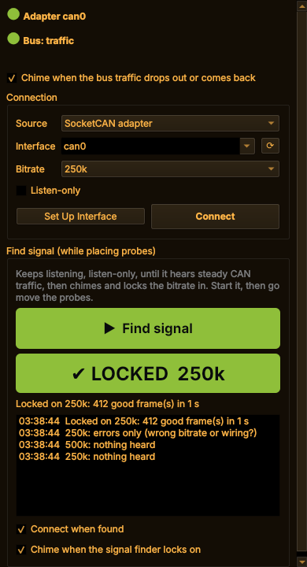
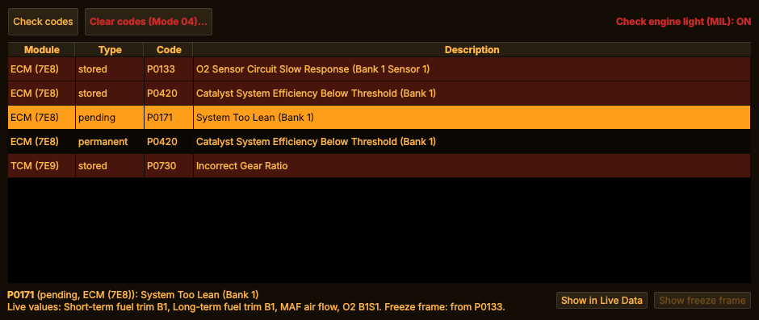
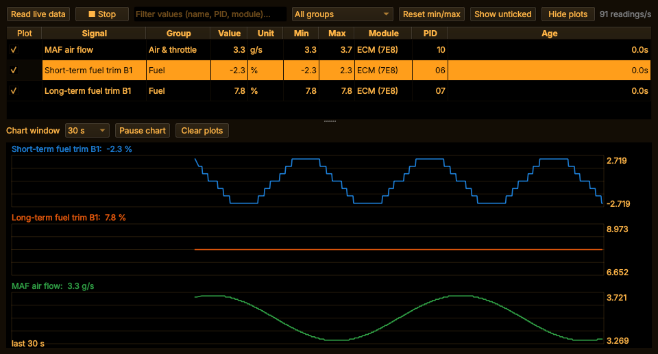
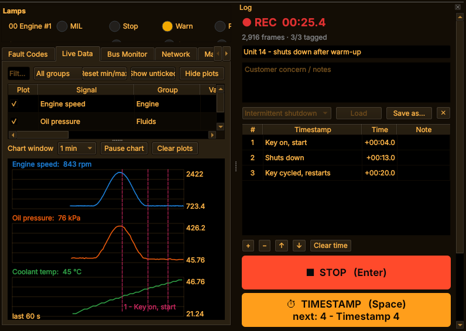

# Features

What CANopener does and why it's built the way it is. How to use each part is in
[USAGE.md](USAGE.md); installing is in [INSTALL.md](INSTALL.md).

* [It tells you when your probes land](#it-tells-you-when-your-probes-land)
* [From a code straight to its sensor](#from-a-code-straight-to-its-sensor)
* [Data logs built for the fault that only happens sometimes](#data-logs-built-for-the-fault-that-only-happens-sometimes)
* [Naming what CANopener doesn't know](#naming-what-canopener-doesnt-know)
* [It opens in about a second](#it-opens-in-about-a-second)
* [What it reads](#what-it-reads)
* [Where it's heading: the handheld](#where-its-heading-the-handheld)

## It tells you when your probes land

Back-probing connectors is iffy at best, and CAN needs a solid connection. That usually means
jiggling a probe, walking back to the laptop, squinting at the screen, realizing it wasn't at the
right angle, and walking back again.

Here you press **Find signal** in the **🔌 Connection** panel (or **F4**) and go do the probing.
It listens the whole time, without sending a thing, and **chimes** as soon as it hears steady
traffic, usually within 5 seconds of a good probe position. Then it locks in the bitrate and
connects.

Once connected, a falling tone tells you the traffic dropped out (a probe slipped) and a rising
one that it's back, so you can keep your head in the machine. Turn the laptop volume up, or wire a
buzzer to a Pi.

 

## From a code straight to its sensor

**My favorite!** When a code points at a specific sensor, ***there's a button that pulls that
sensor up in Live Data***, already ticked and charting. No hunting through a list of fifty values
for the right one. On J1939 it's **Show this parameter in Live Data**; on a car it's **Show in
Live Data**, and if the car stored a freeze frame for that code, **Show freeze frame** takes you
to the snapshot from the moment it was set.

*Pick a code (here P0171, system too lean)...*

*...press **Show in Live Data**, and its sensors are already ticked and charting.*

## Data logs built for the fault that only happens sometimes

Customer states: *"It runs about ten minutes, shuts down, then you have to wait 30 seconds and
cycle the key twice before it'll start again."* A data log means that when you finally reproduce
that fault after an hour of driving in circles, you have the data you need, and can pick it apart
afterwards. The Log tool is built around exactly that job.

Before you start, list the moments you expect:

1. Key on, start: **slap the spacebar** (timestamp 1)
2. Drive it around
3. It shuts down: **spacebar** (timestamp 2)
4. Wait 30 seconds, key on: **spacebar** (timestamp 3), and so on

Each press tags the next moment on your list, and you can name them, so when more than one thing
happens you can tell them apart. Unplanned moments get a press too.

The log records **everything on the bus for the whole run**. Afterwards, tick just the readings
you care about and they're charted with **your timestamps drawn as lines on the graph**, so you
can see exactly what oil pressure, voltage or engine speed were doing at the moment it quit. The
saved capture also has a plain-text timeline of codes coming and going against those same
timestamps, ready to send to someone.

*Three timestamps tagged with the spacebar, drawn on the chart of the readings you ticked.*

Did you *actually* have to drive the machine around for an hour first? Logs record for as long as
you have disk space, and when you save, it offers to trim the log to just the stretch around your
timestamps. Captures survive a crash, and one button copies them to a USB stick.

How to use it: [Recording a job](USAGE.md#recording-a-job-the-log-tool).

## Naming what CANopener doesn't know

Most forklift and equipment traffic is the maker's own, and nobody publishes what it means. So
you can work it out and keep it:

* **Name a module** ("Traction controller"), and the name shows everywhere that module does.
* **Find the data that moves:** hold the pedal one way and mark it, the other way and mark it
  again. The bytes that changed are listed, likeliest first.
* **Label it:** set the scale, offset and unit while you work the control and watch the live
  number. Save, and it's in Live Data straight away.

Your labels go in a machine profile of your own, which you can export to a USB stick and share.
CANopener recognises the machine next time and offers its profile.

How to use it: [Naming things](USAGE.md#naming-things-canopener-doesnt-know).

## It opens in about a second

Unlike *some other* diagnostic programs. On my laptop it's open in about a second, so it's
quicker to check something than to talk yourself out of checking it.

## What it reads

**Equipment and trucks (J1939):** active, stored and pending / emissions codes with descriptions,
occurrence counts and warning lamps; ~35 live engine and chassis values with min / max and charts;
every module on the bus and what it sends; component and software IDs, VIN, engine hours, fuel
used; a text report of the scan. Clears active or stored codes (after asking).

**Battery trucks and controllers (CANopen):** every node and its state (operational,
pre-operational, stopped), heartbeats and restarts; errors as they happen and each controller's
stored error history; the controller's name, versions, product and serial number. Clears the error
history and starts / stops / resets nodes (after asking).

**Cars and light trucks (OBD-II):** codes from every module (stored, pending, permanent) and the
check-engine light; every live value the car offers; freeze frame; inspection readiness with a
READY / NOT READY verdict; on-board tests such as the EVAP leak test; each monitor's last test
result against its limits; VIN and calibration IDs. Clears codes (after asking).

**Other modules (UDS):** ABS, transmission, body: reads their codes, and can clear them or reset
the module (after asking).

**Or with a Bluetooth OBD dongle:** a cheap ELM327-style adapter (vLinker, OBDLink ...) in the
car's OBD port does the OBD-II and UDS reads with no wires to the laptop or the handheld, on
newer CAN cars and on 1996-2007 ones that predate CAN, and listens to J1939 trucks too. It logs the
battery voltage alongside. Slower than a wired adapter, so live data updates a few times a second,
and it can miss frames on a busy bus, but it lives in the glovebox and is there when the CAN
adapter isn't ([how](USAGE.md#bluetooth-obd-adapters)).

**Any CAN bus:** a bus monitor with every raw frame, or one row per ID with the changing bytes
highlighted, for figuring out proprietary data.

All of it also works from the [command line](USAGE.md#command-line), over SSH if you like.

**Colour themes:** Element Zero (amber on black), Graphite and Daylight on both the handheld and
the desktop app, so a dark cab or a sunny yard each get a screen that suits them; the handheld
takes your own themes too ([USAGE.md](USAGE.md#colour-themes), [DEVICE.md](DEVICE.md#themes)).

## Where it's heading: the handheld

The same app runs on a Raspberry Pi, and the plan is a rugged handheld that replaces the laptop,
the multimeter and the logic analyzer in one:

* A 4-channel meter, recorded alongside the CAN data on one timeline, and calibrated on the handheld against a known voltage
* Small wireless meter modules
* A logic analyzer
* LIN and OBD-I
* Any other way of gathering data you can imagine

Try its screen on a laptop: **Settings → Handheld (Pi) screen** (and **System → Software → Desktop app
instead** to come back). The handheld UI: [DEVICE.md](DEVICE.md). The design:
[DESIGN.md](DESIGN.md).
