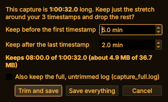

# Using CANopener

How to do things, screen by screen. What it can do, with pictures: [FEATURES.md](FEATURES.md).
Installing: [INSTALL.md](INSTALL.md).

* [Connecting](#connecting)
* [Equipment and trucks (J1939)](#equipment-and-trucks-j1939)
* [Battery trucks and controllers (CANopen)](#battery-trucks-and-controllers-canopen)
* [Cars and light trucks (OBD-II)](#cars-and-light-trucks-obd-ii)
* [Machine profiles](#machine-profiles)
* [Naming things CANopener doesn't know](#naming-things-canopener-doesnt-know)
* [Recording a job (the Log tool)](#recording-a-job-the-log-tool)
* [Machine details and uploading captures](#machine-details-and-uploading-captures)
* [Team access](#team-access)
* [What it sends](#what-it-sends)
* [The handheld screen](#the-handheld-screen)
* [Command line](#command-line)
* [Where things are saved](#where-things-are-saved)

## Connecting

1. Plug the adapter into the laptop and connect it to CAN-H and CAN-L (the machine's diagnostic
   port, or back-probe any CAN pair). Key on.
2. Open **🔌 Connection** (top left, or **F3**). Pick **SocketCAN adapter**; the interface
   (`can0`) appears below it. The list looks again each time you open it (or press **⟳**), so
   plugging in after the app opened is fine.
3. Pick the bitrate: **250k** for most equipment and trucks, **500k** for cars and some newer
   machines, **125k** or **250k** for many CANopen controllers, or **Auto** to find it (Auto
   listens only, so it never disturbs the bus).
4. Press **Connect**.

**The lamps** at the bottom of the window (and in the Connection panel):

* **Adapter:** is the adapter plugged in and working?
* **Bus:** is it hearing the machine? **Green** = traffic. **Amber** = connected but silent (key
  on? probes on CAN-H / CAN-L?). **Red** = errors only (wrong bitrate, or the wires swapped).
  **Indigo, "quiet (gateway?)"** = a newer car with a security gateway, which stays silent until
  the tool asks something. That's normal.

**Find signal** (Connection panel, or **F4**): press it, then go place your probes. It listens
without sending, **chimes** when it hears steady traffic, locks in the bitrate and connects. A
falling tone means the traffic dropped out, a rising one that it's back. Both chimes can be
switched off in the Connection panel; **Settings → Sound cues** picks the speaker or a buzzer.

**Listen-only** (Connection panel): the laptop sends nothing at all. J1939 codes (DM1) and live
data still work, because the machine broadcasts them.

**Connect on startup** (**Settings**): clicking the icon with the adapter plugged in opens
CANopener already connected. With **Auto** bitrate it's safe on any machine.

**Simulators:** tick **Connection → Show simulators**, then pick **Simulator** (a telehandler,
J1939), **CANopen simulator (battery truck)**, **OBD-II simulator (car)** or **Bluetooth OBD
simulator (car)** and press **Connect**. **Connection → Bluetooth OBD simulator plays** makes the
last one an older J1850 / K-line car.

### Other adapters

**CANable** (either firmware), candleLight, PEAK PCAN-USB, Kvaser, 8devices and Innomaker work as
`can0` with no extra setup on Linux. Note: a CANable with **slcan** firmware can't do listen-only,
so **Auto**, **Find signal** and **Listen-only** don't work on it; pick the bitrate by hand or
flash candleLight ([how](install/linux-laptop.md#your-usb-adapter-canable-20--20-pro)).

For anything else (PEAK, Kvaser, Vector, IXXAT ... through their own drivers): install the maker's
driver, then **Connection → Find other adapters**, or type the adapter under Interface as
`interface:channel`, e.g. `pcan:PCAN_USBBUS1`, `kvaser:0` or `slcan:/dev/ttyACM0`, and pick its
bitrate. This goes through [python-can](https://python-can.readthedocs.io), which the installer
includes.

### Bluetooth OBD adapters

A Bluetooth OBD dongle (ELM327-style: vLinker MC+, OBDLink MX+ and the like) plugs into a car's
OBD port and talks to CANopener over Bluetooth, no wires. It suits **cars and light trucks**: it
reads codes, live data and everything else on the OBD-II pages, and modules through **Diagnostics
→ Read a module (UDS)**. That includes **older cars (1996-2007) that don't use CAN** (J1850, ISO
9141-2, KWP2000), apart from on-board test results there. With **Vehicle: Truck or equipment
(J1939)** it listens to a truck or machine instead (a 16-to-9-pin Deutsch cable on most trucks):
codes, live data and module info, though it can miss frames on a busy bus. It's slower than a
wired adapter (see below), so the bus monitor only shows what it hears, and **Transmit**, **Find
signal** and CANopen need a wired adapter.

**Which kind:** it has to have **Classic Bluetooth** (sold for Android / Windows; "BT3.0" on the
box). One that does both Classic and Low Energy (for iPhones) is fine. An iPhone-only / BLE-only
one won't work.

**Pair it once:**

1. Plug the adapter into the vehicle's OBD port. Some only wake with the key on.
2. **🔌 Connection** → **Source: Bluetooth OBD** → **Pair / Manage Adapters…** (also under the
   **Connection** menu).
3. **Scan**, pick the adapter and press **Pair…**. A dual-mode adapter can be listed twice: pick the
   one marked **serial port** (or **Classic**), not **Low Energy only**. The PIN is usually
   **1234** (some use 0000).
4. It's now picked under **Adapter**. **Rename…** gives it a name (e.g. *vLinker (truck)*), **Test**
   checks it answers and shows the battery voltage, **Forget…** unpairs it.

**Connect:** pick it under **Adapter**, pick the **Vehicle** (*Car or light truck*, or *Truck or
equipment (J1939)*) and press **Connect**. The first connect takes a few seconds while the adapter
finds the vehicle's protocol (an older car's computer takes 2-3 s to wake up); CANopener switches to
the **OBD-II vehicle** profile (or a J1939 one) by itself. **Listen-only** appears for J1939: a car
only answers when asked. The **Adapter** lamp is the Bluetooth link; the **Bus** lamp says whether the
vehicle is answering.

**How fast:** each request makes a round trip over Bluetooth, so live data updates a few times a
second per value. Watch fewer values (**Hide unticked** on Live Data) and each one updates
faster. To measure your adapter on your vehicle: `canopener-cli obd --elm --bench 10`.

**Battery voltage:** the adapter reads the voltage at the OBD port about once a second. It shows in
the status bar (and on the handheld's Meter screen) and the Log tool records it alongside the
codes and live data: the cranking dip, the charging voltage.

**Logs:** the Log tool records the answers as usual. Their times are when each answer reached the
laptop, a few hundredths of a second late, so fine for a test drive but not for timing work. On an
older non-CAN car the answers are recorded in CAN form, the engine as `7E8`, the transmission as
`7E9`.

**What can my adapter do?** **Test** (Pair / Manage Adapters) asks it: chip, battery voltage,
which commands it understands, the vehicle's protocol. `canopener-cli bluetooth probe --protocols`
also tries every protocol. `canopener-cli bluetooth console` lets you type adapter commands (AT ...)
from its manual; it won't send anything to the vehicle.

**An older machine that says almost nothing?** Some engine computers on the old one-wire
protocols (ISO 9141-2, KWP2000) answer the standard scan-tool questions with "no live data" and
"no codes" even with the engine light on, and keep the real answers elsewhere on the same wire.
The **deep probe** asks everything standard that only reads and keeps every reply: on the
handheld, **Codes → More... → Deep probe**; on a computer, `canopener-cli bluetooth kline --out
probe.txt`. It takes about two minutes and changes nothing on the machine. (The separate **full
scan** asks thousands more questions and is for engine off, key on, machine parked: on one machine
it made the engine computer restart and the engine stop.) The handheld saves it
as a log, ready to upload, so someone can work out from it how to read that machine properly.

If a code read comes back empty from a computer that also lists no live data, CANopener says so
("'no codes' may not be the whole story"): that's the sign of one of these machines.

**Finding modules:** `canopener-cli uds --elm --find` asks every diagnostic ID whether a module is
there (it changes nothing), a minute or two. Works with a wired adapter too (`--iface can0`).

**Trouble:** "Bluetooth is off" → turn it on in the dialog, the desktop's Bluetooth menu, or
`rfkill unblock bluetooth`. "Bluetooth tools aren't installed" → `sudo apt install bluez`. "isn't
answering" → the adapter is out of range, unpowered, or connected to a phone. CANopener talks to
CAN vehicles only (most cars from 2008 on); an older car on J1850 or ISO 9141 gets a message saying
so.

## Equipment and trucks (J1939)

The default. Pick a profile for your machine in the **Profile** box (top right), or leave it on
the generic one.

| Tab | What you get |
|---|---|
| **Fault Codes** | **Read Active** / **Read Stored** / **Pending / Emissions** / **Full Scan**. Each code with its description, occurrence count and the warning lamps. Tick *Include every code seen this session* to catch intermittent ones. **Show this parameter in Live Data** jumps to the sensor behind a code. **Clear Codes…** clears active (DM11) or stored (DM3) codes on every module, or the one picked under ECU, after asking. |
| **Live Data** | Engine speed, temperatures, pressures, voltages, DPF / DEF and more, with min / max. Tick values to chart them. **Hide unticked** and **Hide plots** tidy a small screen. **By source** puts the values under a heading for each controller that sends them (**By group** for the profile's groups); click a heading to fold it away, or **Collapse all**. CANopen and OBD-II live data group the same way. |
| **Bus Monitor** | Every raw frame, or one row per ID with changing bytes highlighted. **Find changes…** and **Label…** ([below](#naming-things-canopener-doesnt-know)). |
| **Network** | Every module on the bus and what it sends, and any the machine should have that aren't talking ([below](#which-module-is-missing)). **Name this module…** gives one your own name. |
| **Machine Info** | Component and software IDs, VIN, engine hours, fuel used. |
| **Report** | A text report of the last scan, to save or copy. |

**Modules beyond the engine** (ABS, transmission, body): **Diagnostics → Read a module (UDS)**
reads their codes, and can clear them or reset the module.

## Battery trucks and controllers (CANopen)

Many electric forklifts and their motor, pump and battery controllers talk **CANopen** instead of
J1939, often at 125k or 250k (**Auto** finds it). Pick the **Generic CANopen** profile and the
same tabs switch to CANopen: no warning lamps or J1939 reads, and nothing J1939 is sent. For a bus
with both (a J1939 engine and CANopen controllers), pick **Generic J1939 + CANopen**. On a J1939
profile, CANopener notices CANopen nodes and offers the right profile; nothing changes unless you
say so.

| Tab | What you get |
|---|---|
| **Fault Codes** | Errors a controller reports (CANopen "EMCY") are **Active**; **Read Stored** also reads each controller's error history. The meaning shown is the standard class (e.g. *Device temperature*); a maker's own codes can be named in a profile. **Clear Codes → Clear CANopen error history…** empties a controller's history, after asking. |
| **Network** | Every node with its state (*Operational*, *Pre-operational*, *Stopped*), heartbeat, restarts and each message it sends. **Read node info** reads its name, versions, product and serial number (also in **Machine Info** and a **Full Scan**). **Find CANopen nodes** asks every node number, for controllers that don't send a heartbeat. **NMT…** starts, stops or resets a node: that changes the machine, so it asks first. Only do it parked and safe. |
| **Live Data, Bus Monitor** | Work on CANopen messages (11-bit IDs) just like J1939, with what each message is (e.g. *TPDO1 node 01*). A maker's message layout isn't published, so [labeling](#naming-things-canopener-doesnt-know) is how you name the values. |

## Cars and light trucks (OBD-II)

Pick the **OBD-II vehicle** profile (top right; connecting the OBD-II simulator or a
[Bluetooth OBD adapter](#bluetooth-obd-adapters) does it for you), usually at **500k**. The screen
becomes one row of pages:

| Page | What you get |
|---|---|
| **Trouble Codes** | **Check codes** reads every module (engine, transmission ...): stored, pending and permanent codes, with descriptions, and the check-engine light. **Clear codes** asks first and tells you what else it resets. Pick a sensor code and press **Show in Live Data** to watch that sensor, or **Show freeze frame**. |
| **Live Data** | Every value the car offers, streaming, with min / max and charts. |
| **Freeze Frame** | The values saved when the code was set. |
| **Readiness** | Inspection monitors: complete, incomplete or not supported, and a READY / NOT READY verdict. |
| **On-Board Tests** | Ask the car to run a test, e.g. the EVAP leak test. |
| **Test Results** | Each monitor's last test value against its limits. Spots a part that passes, but only just. |
| **Vehicle Info** | VIN, calibration IDs, module names. |
| **Bus Monitor** | Raw frames, as on the J1939 side. |

## Machine profiles

A profile names a specific machine's modules and adds its own parameters. The **Profile** box (top
right) picks one; CANopener recognises a machine from the modules it hears and offers its profile.

* **Profiles → Manage profiles…** hides ones you don't use and sets the order.
* **Profiles → Save profile as…** copies the one in use under a new name (one per machine).
* **Profiles → Import profile…** loads one someone exported.

**From another tool's files.** If you have a **DBC** file for the machine (the signal database
most CAN tools use), or the **EDS** file a CANopen controller's maker supplies, CANopener makes a
profile from it:

```bash
canopener-cli import machine.dbc                    # every message and signal in the file
canopener-cli import controller.eds --node 05       # a CANopen device's process data, named
canopener-cli canopen --iface can0 --pdo-map --save-profile "Truck 14"   # no file: ask the nodes
```

The last one asks each CANopen node what it packs into its messages and makes a profile that
splits them into values. Without the EDS they're numbered rather than named (`2001:01`), ready
for [labeling](#naming-things-canopener-doesnt-know). Imported profiles are saved in your own
profiles folder; a file you were given under a licence stays on your machine. Check a few values
against the machine before trusting an import.

Writing one by hand: [DEVELOPING.md](DEVELOPING.md#machine-profiles).

## Which module is missing

When a machine only says "communication error", CANopener can tell you which module stopped
talking. It compares the modules on the bus with the ones the profile says the machine has.

**First, save the machine's modules** (once per model, on a machine that works, key on): on the
**Network** tab press **Remember these modules…**, or on the handheld **CAN → Bus → Modules →
Remember**. They go in a profile of your own built on the one you had picked (**Recognise this
machine** under **Profiles → My labels…** saves the same list). Some profiles already list their
modules.

**Then, on the broken machine**, pick that profile and connect. The **Network** tab (and the
handheld's **Bus** page) lists every module:

* **On the bus**: it's talking.
* **Went quiet**: it was talking and stopped. The row says how long ago, and whether other
  modules are still sending to it.
* **Not heard since connecting**: the profile lists it, but nothing has come from it. For the
  first few seconds it says *listening* instead.

The ones with a problem come first, in red. When something is wrong the **Fault Codes** tab shows
the same line above the codes (the handheld's **Codes** page too). While you're connected, a module
dropping out or coming back shows in the status bar, or as a message on the handheld with the
*A module went quiet or is missing* sound (**System → Sound**). If nothing at all is heard, it says
the whole bus is quiet (key off? the right connector?) rather than blaming every module.

Only what a module sends itself counts. A master keeps sending to a module that's gone, so those
messages don't make it look present. A module that only answers when asked can look missing: press
**Request address claims** (J1939) or **Find CANopen nodes** on the **Network** tab first. It only
listens; nothing is sent to the machine.

## Naming things CANopener doesn't know

Most forklift and equipment traffic is the maker's own. Label it yourself and keep it:

* **Name a module:** in **Network**, pick an address (or CANopen node) and press **Name this
  module…** (e.g. "Traction controller"). The name shows everywhere that module does.
* **Find the data that moves:** in **Bus Monitor**, press **Find changes…**. Hold the pedal (or
  switch, or lever) one way and press **Mark now** on A, the other way and **Mark now** on B. The
  bytes that changed are listed, likeliest first (rolling counters are left out). You can also
  compare two Log tool timestamps, or two stretches of a saved log.
* **Label it:** pick a result (or a row in Bus Monitor) and press **Label…**. Choose the byte(s) or
  bits, then set scale, offset and unit while you work the control and watch the live number and
  chart. Add a normal range or states (`0 = Off`, `1 = On`) if you like. **Save**, and it's in
  **Live Data** straight away (group *My labels*). If a value jumps about, try **high byte
  first**: some makers send numbers that way.

Your labels go in a profile of your own (the first label asks you to name it, e.g. "Unit 14 reach
truck"), built on the profile you had picked, so nothing built in is changed.
**Profiles → My labels…** lists them to edit or remove, and has **Recognise this machine** (next
time it offers this profile when it sees these modules, and [names any that's missing](#which-module-is-missing)),
**Export…** (to a USB stick, say) and
**Delete profile…**.

## Working out a machine from what its bus does

When nothing names what you're looking at (a proprietary message, a machine with no profile), let
the machine tell you. It works on any J1939 or CANopen bus and needs no documentation:

1. **Record a log and tag a timestamp each time you change one thing**: key on, engine start,
   lift, tilt, forward, seat switch. One change per timestamp; hold each state for a few seconds.
2. **Save the log**, then on the handheld **Data log > More > What changed between the
   timestamps?** (on a computer: `canopener-cli changes CAPTURE_FOLDER`).
3. It lists what followed each timestamp, most marked first: `PGN FF50 from 00 w2le   3 -> 817`
   means the 16-bit value starting at byte 2 of that message went from about 3 to about 817.
   `b1.2  off -> on` is bit 2 of byte 1. Messages that started or stopped are listed too.
   Rolling counters, checksums and the scan tool's own questions are left out.
4. **Pick a line and name it.** If the value moves in step with one CANopener already knows, it
   says so and offers that name with the right scale ("it follows Engine speed": rpm = 1 x this).
   Otherwise pick the part of the machine and a name from the list.
5. **Save.** The named values become a profile (`observed-...` in your profiles folder) and it's
   switched on at once: Live Data shows them, and so does every log from then on. Do it again
   another day and add to the same profile.

**Or let it lead:** the **Profile builder** tile on the handheld's home screen first asks what
the machine is (IC forklift, sit-down electric forklift, electric stand-up, telehandler, golf
cart, pallet jack), what an engine runs on (LP, petrol, diesel) and whether a diesel has
aftertreatment, whether its hydraulic levers are electronic or move the valve themselves, and
whether the mast has a height switch or sensor, so it only asks for what that machine has. A
stand-up is a **reach truck** (reach out and in) or a **counterbalance** (no reach; usually two
drive motors, so it asks for each one: drive turning one way, then the other). Then it maps the
controls with the key on and nothing running, before the engine or pump is started; on a stand-up
with your feet off the operator pedal, so it can't drive or lift. It asks for one thing at a time
("Raise the forks and hold"), counts you in and out and tags the log itself. Steps that move the
machine say so first; it only listens to the bus.

* **Both directions of one control** (lift and lower, tilt back and forward, travel both ways,
  reach out and in) are asked for separately. On most handles and joysticks they're one value
  that swings either side of rest. When the second direction moves the value you kept for the
  first, it's offered ticked, and keeping it makes one signal of the two, signed when it swings
  either side of zero: *Lift/lower input (+ lower / - lift)*.
* **Interlock warnings are expected.** Working a control with nobody on the seat or the operator
  pedal (or holding one while getting on) makes most machines show a "release the control"
  warning. Each part of the walk-through says so before it starts. When a step raises one (a
  CANopen EMCY or a J1939 fault code), the step's result says which, the saved profile names it
  after the step (*Interlock: raised by Lift input with nobody on the machine...?*), and the next
  step waits ("Let go of everything") until the machine clears it, so it can't spoil the next
  hands-off moment. One that doesn't clear in 12 seconds is called out as maybe a real fault, and
  the builder goes on; **Skip** goes on straight away.
* **Values other profiles know** are offered first and ticked, with the profile's name ("Truck A
  calls it 'Lift input'"): the same message on a sister machine. See below.

After each step it shows **what moved, live**: up to eight values, each with its value now and a
dot that lights when it changes. **Work the control a few more times and watch**: the value that
follows it lights up and counts up ("changed 4x since 'let go'"). Tick it and press **Keep, next**
(**Next** when nothing is ticked). When one value clearly follows the control it's ticked for
you. The list puts the most-moved first, but holds still for a few seconds whenever you press a
key, so nothing moves under your finger. **Again** repeats the step; **Skip** moves on.

* It starts with a few seconds of hands off, and keeps watching during every "Get ready": values
  that change while nobody touches the machine are left out, and the screen says how many. So
  are the lowest digits of a reading (a battery voltage or a temperature wobbling between
  neighbouring numbers), which look like switches over a few seconds.
* Values the profile in use already names are listed under **Already named, moved too**, live,
  so you can see the pedal or the engine speed did move. They aren't offered again.
* A value offered for one step that then follows another says so ("also moved for Brake pedal"):
  something that follows everything is rarely the answer.

**In the log:** each step leaves three timestamps, *Lift: get ready*, *Lift* and *Lift: let go*,
so **What changed between the timestamps?** later compares exactly the hands-off moment, the
hold and what came after. The log's `README.md` gets a **Profile builder** table: every attempt
at a step, what was offered, what was kept, and the warnings it raised.

**Values other profiles know.** Machines of one family send the same messages, so traffic nothing
decodes here is often decoded by a profile made for a sister machine: a built-in one, a plugin's,
or one built on this or another unit. The **Profile builder** page checks every profile on the
unit against what the bus is sending: a value has to fit the frames, an enum has to name the raw
values seen, and a value with a normal range has to stay in or near it. A profile that fits more
of the bus wins over one that fits a single message. **Values other profiles know** lists what
fits, by message, and **Add all to the profile in use** adds them, each marked *borrowed* with
where it came from, until the builder checks it here. From a computer, `canopener-cli suggest
CAPTURE` lists the same for a log, with why each value was taken or left out.

**Before it starts**, if a known profile fits the bus (most of that profile's own messages are on
it), it offers to load that profile first, so it only looks for what isn't named yet. The
**Profile builder** page lists the profiles that fit the bus, with **Load** on each. A few
seconds after connecting, the handheld also says so if one fits clearly better than the one in
use.

**Saving.** **Save** offers:

* **Add to** the profile in use. Your own profile is added to directly. A built-in or plugin
  profile (a private one, say) gets a profile of its own on top of it (*"Hyster H80UT +
  observed"*), which builds on it, so it keeps every value it had and still gets updates.
* **New profile**, built on the profile in use (so nothing it already decodes is lost).
* **Add to** another profile made on this unit.

The saved profile is switched on at once. It's then shared with your upload server, if one is set
up; the screen says whether that worked. A profile that wasn't shared is marked *not shared
yet* on the **Profile builder** page, where selecting it offers **Share it** again.

**Or explore freely:** **Profile builder > Explore the bus** lists every value on the bus, live:
named ones and the ones nobody has named yet, with the moving ones first. Work a control and watch
what lights up at the top. Select a value to see it big with its last minute, then **Name it**:
pick the kind of thing, then the name, from the list. Tick **Not sure (?)** first and the name
gets a question mark. The first name asks where names go (the profile in use, or a new profile
built on it); it's saved at once and Live shows it. **Show** switches between the values that
change, the unnamed ones only and everything; the list holds still for a moment after each key.

Each value in an observed profile keeps a note of how it was found and how sure it is, so someone
else can check it. A log without timestamps is cut into four equal parts, which is better than
nothing but much less telling than tagging.

## Serial lines

Some controllers talk to their service console over a serial line instead of CAN. With a
USB-serial adapter on each direction of the link (how to tap one without breaking it:
[SERIAL-SNIFFING.md](SERIAL-SNIFFING.md)), CANopener records the bytes as a capture, with
timestamps, and works out what it can about them:

```bash
canopener-cli serial ports                      # the serial adapters it sees
canopener-cli serial sniff --line console=/dev/ttyUSB0 --line controller=/dev/ttyUSB1 --framing "9600 8N1"
canopener-cli serial analyze CAPTURE_FOLDER     # message kinds, checksums, who answers whom, text
canopener-cli serial baud capture.sr --channel D3   # the baud rate, from a logic capture of the line
```

While sniffing, **Enter** tags the next timestamp, a label and Enter adds one with that label, and
**q** stops and saves. The capture folder gets `serial.log` (every byte, on the same clock as the
CAN log) and `serial_analysis.txt`. A Linux user needs to be in the `dialout` group to open a
serial adapter; the laptop installer adds you.

## Recording a job (the Log tool)

Open it with **📝 Log** (top right, or **F2**).

1. Name the job, write the customer concern, and list the timestamps you expect ("Key on",
   "Start", "Shuts down" ...), or load a template like *Intermittent shutdown*.
2. **Start**, then tag each moment with the spacebar as you work the machine. The Live Data chart
   shows each tag as a line.
3. **Stop**, fix up names and notes if needed, then **Save**.

On a car, the Log tool keeps it talking while it records: it reads the codes once, then streams
the ticked live values.

**Keys** (only while the Log panel is open, and never while you're typing in a box: **Esc** leaves
a box). Remap them under **Log → Keyboard shortcuts…**.

| Key | Not recording | Recording |
|---|---|---|
| **Enter** | start | stop |
| **Space** | add a timestamp and type its name | tag the next timestamp |
| **Shift+Space** | add a timestamp and type its name (also while typing one: keeps it and starts the next) | add a timestamp at the end |
| **1** … **9**, **0** | | tag timestamp 1 … 10 directly |
| **Backspace** | | undo the last tag |

**What's saved:** each capture is a folder in `~/canopener/logs/`:

| File | What's in it |
|---|---|
| `summary.txt` | Your notes and timestamps, and one timeline of codes appearing and clearing, warning lamps, and modules dropping off the bus, each with the phase it happened in. **The file to send someone.** |
| `README.md` | What the folder is: the machine, the concern, what to look at, how it was connected, the timestamps, what the machine said about itself, and the traffic nothing decoded. Kept up to date as you edit. |
| `live_data.csv` | Every live value twice a second, with your timestamps in a column. Opens in a spreadsheet. |
| `traffic.csv` | Every message seen (PGN and sender, or 11-bit ID): how many, how often, and whether CANopener decoded it. |
| `adapter_trace.txt` | Recorded through a Bluetooth OBD adapter: everything sent to it and every line it answered, as it printed them. |
| `kline_probe.txt` | Only after a deep probe: every question it tried on the machine and each answer. |
| `capture.log` | Every raw frame. Reopen it with **Open…** in the Log panel, then **View data**. |
| `capture-can2.log` | The second bus's raw frames, when the handheld was watching one ([DEVICE.md](DEVICE.md)). Same clock as `capture.log`. |
| `markers.csv`, `capture.json` | The timestamps, and everything in machine-readable form. |



**Trimming a long one:** when you press **Save**, the Log tool offers to keep just the stretch
around your timestamps: a few minutes before the first and after the last (you pick how many, and
it remembers). It shows how much it keeps before it cuts, can keep the full log alongside, and
**Save everything** skips it. **Trim…** in the Log panel does the same any time, saved captures
included.

<br clear="right">

**How long can a recording be?** As long as the disk allows: frames go straight to the file. A busy
250k J1939 bus is about 100 to 170 MB an hour. Saving reads the whole log back to write the summary
(about 350 MB of memory per hour), so multi-hour captures are fine on a laptop; split all-day
ones. The Bus Monitor and **File → Export frames as CSV** only keep the latest 250,000 frames (a
few minutes on a busy bus); the capture's log has everything.

**After a crash**, the next start offers to recover anything unsaved.

**Export Logs** (in the Log panel, or **Ctrl+E**): plug in a USB stick and press **Export**. It
copies this session's captures and reports onto the stick and ejects it.

## Machine details and uploading captures

**Machine details.** **Machine…** in the Log panel (also **Log → Machine details…**) holds the log
name, make, model, serial / VIN, unit number, hours, customer, the concern, and **What to look
at**: a line for whoever reads the capture next ("PGN 0xFF12 from the controller doesn't decode").
**From the bus** fills them in from what the machine reports about itself (press **Read Machine
Info** on the Machine Info tab first, so it's been asked). **Recent machines** brings back one
you've entered before. You can fill it in before, during or after recording, saved captures
included; it goes into the capture's `README.md` straight away.

On the handheld, **Machine** on the Data log screen picks from what the bus reports (a **Full
scan** asks for it) or a recent machine. Typing the details is done on the desktop or with the
command line (below).

**Uploading.** A saved capture can go to your own upload server or to a private GitHub
repository, to read somewhere else a minute later.

* **Upload server:** setting it up is in [deploy/upload-server/README.md](../deploy/upload-server/README.md).
  Then **Log → Upload settings…**: the server's address (`https://...`) and an upload token, then
  **Test**. (On the handheld or over SSH: `canopener-cli upload --setup`.)
* **A private GitHub repository**, with the GitHub sign-in the handheld already uses for
  plugins (nothing to type on it). Once, from a phone or computer: make a **private** repository
  for captures. In GitHub's **Settings → Developer settings → GitHub Apps →** (the CANopener app)
  **→ Permissions & events → Repository permissions**, set **Contents** to **Read and write** and
  save. Then accept it under **Settings → Applications → Installed GitHub Apps** (it asks you to
  review the new permission there), and on the same page **Configure** the App to add the new
  repository. Then on the handheld: sign in (**System → Software → Plugins → Sign in to GitHub**),
  and the first **Upload** asks which repository (**More → Upload to…** changes it). Desktop:
  **Log → Upload settings… → Send to: GitHub**, and the repository as `owner/name`; command line:
  `canopener-cli upload --github owner/name`. Captures go on a `captures` branch of their own,
  so a plugin's repository works too (plugin updates never download that branch). Public
  repositories are refused: captures hold
  serial numbers and customers. The write permission applies to every repository the App is
  installed on, so a lost handheld could write to those too: install it only where it's needed.

After **Save**, press **⇪ Upload** in the Log panel (handheld: **Upload** on the Data log screen),
or tick **Upload every capture when it's saved** in Upload settings.

It uploads in the background and tells you when it's done, with the capture's address on the
server. With no connection it waits and tries again; uploads still waiting when you close the app
go on the next time it opens. A capture you change after uploading (relabelled, trimmed, new
machine details) shows that, and **Upload again** replaces the copy on the server.

## Remote help

Stuck at a machine with nobody to ask? On the handheld, **System > Remote help > Start** (30
minutes, 2 hours or 4). The unit calls out to your upload server, so it works from a phone
hotspot, and someone you've given the server's remote key to can look at it from wherever they
are: its screen, the connection, saved logs and profiles, fault codes, and read-only questions to
the vehicle. The page lists everything they do. If they ask for something that could change the
vehicle, the unit asks you first, and No is the default. **Stop remote help** ends it at once;
otherwise it ends when the time is up. Nothing can reach the unit unless you start it.

For hands-on work there is also **Open an SSH tunnel** on the same page: a full login to the
unit for a helper it already accepts, through your server (if the server has the tunnel set up).
It warns you first and stays open until you close it.

The helper uses `canopener-cli remote list`, `remote send state`, `remote shot screen.png` and so
on (`canopener-cli remote -h`).

## Team access

Your team may have its own plugin, kept on the team's server rather than published. **Help → Team
access…** gets it onto this computer once the person who looks after the server approves it. At
the top is **This computer**: its serial (like `CO-7F3K-9QXA`), which names this install. **Copy**
copies it.

**With an invite link** (the usual way): you're sent a link that ends in `/invite/XXXX-XXXX-XXXX`.
Paste it into **Invite link**, check **Name for this computer** (so it's easy to recognise on the
server), and click **Join**. The plugin downloads and installs; **Restart now** loads it. An invite
works once, on one computer, and expires after a few days, so ask for a new one if it's refused.
Opening the link in a browser shows the same steps.

**Without one:** enter the server's address under **Ask for access**, click **Ask for access**, and
read out the serial to whoever looks after the server. Once they approve it, **Check now** installs
the plugin.

After that:

* **Updates** to the team plugin are found at startup, with the app's own (see
  [Updating](INSTALL.md#updating)), and install only when you say so. **Check now** looks straight
  away, and **Install update** appears when there's one.
* **Offline**, the plugin keeps working as it is, however long you're away from a connection.
* **If access is withdrawn** for this computer, the next time CANopener starts online it removes
  the team plugin without asking, and says so. Restart to finish.
* **Leave team access…** removes the plugin from this computer yourself.

The serial also shows in **Help → About**. Copying CANopener's settings folder to another computer
doesn't copy its access: that computer gets a serial of its own and has to join itself.

The server side (inviting, approving, publishing the plugin) is in the upload server's
[README](../deploy/upload-server/README.md#team-access).

## What it sends

* **Reading** sends only standard requests (J1939, OBD-II, UDS and CANopen SDO reads). Tick
  **Listen-only** to send nothing at all. (Not on a CANable with slcan firmware, which can't do
  listen-only: see [Other adapters](#other-adapters).)
* **Commands that change a vehicle** (clear codes, start an on-board test, reset a module, a
  CANopen start / stop / reset) say what they change and wait for a **Yes**. Nothing is sent in
  listen-only.
* **Diagnostics → Transmit a frame** sends a frame you compose: off by default, it shows the exact
  bytes and asks before every send.
* **A Bluetooth OBD adapter** sends the standard "which values do you support" request when it
  connects, to find the vehicle's protocol, and only ever asks; it can't be listen-only.

## Colour themes

**Settings → Colour theme** changes the desktop app's colours straight away, and it opens that
way next time. **Standard** follows your system's look (the default). The others match the
handheld's themes: **Element Zero** (amber on black), **Graphite** (dark grey, teal), **Daylight**
(dark text on white) and **Basic** (dark, blue). Themes you make for the handheld appear here too
([DEVICE.md](DEVICE.md#themes)). The handheld picks its own theme, separately.

## The handheld screen

The handheld UI runs on the laptop too: **Settings → Handheld (Pi) screen** closes CANopener and
reopens it as the handheld UI in a window, and it stays that way until you pick **System →
Software → Desktop app instead**. On the Pi, **System → Exit to desktop** closes it and shows the Pi's
desktop; open it again from the menu. Keyboard stand-ins for the buttons and everything else:
[DEVICE.md](DEVICE.md).

## Command line

Everything works over SSH too, handy on a Pi. On a laptop install the commands are in
`~/CANopener/.venv/bin/`.

```bash
canopener-cli find --iface can0 --sound             # signal finder: wait for traffic, chime
canopener-cli scan --iface can0 --full --units imperial
canopener-cli clear --iface can0 --stored           # J1939: clear stored codes (asks first)
canopener-cli obd --iface can0 --all                # car: codes, readiness, freeze frame, live data
canopener-cli obd --iface can0 --clear              # car: clear codes (asks first)
canopener-cli bluetooth scan                        # Bluetooth OBD adapters nearby; then: pair ADDRESS
canopener-cli bluetooth                             # your adapters (rename, use, test, forget too)
canopener-cli obd --elm --all                       # car, through the picked Bluetooth OBD adapter
canopener-cli obd --elm --bench 10                  # how fast it answers on this vehicle
canopener-cli bluetooth probe --protocols           # what the adapter can do
canopener-cli scan --elm --listen-only              # a J1939 truck through the adapter
canopener-cli uds --iface can0 --find               # which modules answer (also with --elm)
canopener-cli uds --iface can0 --info --supported   # a module's VIN, part / serial numbers, every code it can set
canopener-cli canopen --iface can0 --info --errors  # CANopen: nodes, state, errors, identity
canopener-cli canopen --iface can0 --pdo-map        # CANopen: what each node packs into its messages
canopener-cli --profile ID modules --iface can0 --watch   # which modules are missing or drop out (listens only)
canopener-cli --profile ID modules --iface can0 --remember "Truck 14"   # on a good machine: save its modules
canopener-cli import machine.dbc                    # a profile from a DBC, EDS or DCF file
canopener-cli interfaces                            # what adapters it sees, and why one isn't working
canopener-cli decode capture.log --csv frames.csv   # decode a saved log (candump, Vector .asc, PEAK .trc)
canopener-cli capture FOLDER --trim 5 2             # trim a capture: 5 min before, 2 min after its timestamps
canopener-cli capture FOLDER --machine model=GTH-1056 --machine serial=AB123 --question "FF12 doesn't decode"
canopener-cli serial sniff --line A=/dev/ttyUSB0 --line B=/dev/ttyUSB1   # record a serial link (Serial lines)
canopener-cli upload --setup                        # the upload server's address and token
canopener-cli upload FOLDER                         # upload a saved capture now (no folder: what's waiting)
canopener-cli update                                # check for and install updates
canopener-cli team join https://SERVER/invite/CODE  # team access: join with an invite link (Team access)
canopener-cli team check                            # team access: check now; asks before installing an update
canopener-cli --help                                # everything else
```

## Where things are saved

| Path | What |
|---|---|
| `~/canopener/logs/` | Captures from the Log tool, one folder each |
| `~/canopener/reports/` | Saved reports (plus the raw log alongside) |
| `~/.config/canopener/settings.json` | Settings both screens share (connection, units, profile, sound); the desktop app keeps the rest in `~/.config/CANopener/` |
| `~/.config/canopener/profiles/*.json` | Your machine profiles and labels |
| `~/.config/canopener/profile_list.json` | Which profiles the picker shows, and their order |
| `~/.config/canopener/spn_names.csv` | Optional extra SPN names, `spn,name` per line |
| `~/.config/canopener/github-token.json` | GitHub sign-in for plugin installs, mode 600 |
| `~/.config/canopener/upload-token.json` | The upload server's token, mode 600 |
| `~/.config/canopener/upload-queue.json` | Captures waiting to upload (each folder's `upload.json` has its state) |
| `~/.config/canopener/recent_machines.json` | Machines you've entered, for **Recent machines** |
| `~/<repo name>/` | Plugins installed from GitHub; a non-git copy found there is kept as `.old-<date>` |
| `~/.config/canopener/device-id` | This install's ID (its serial, `CO-XXXX-XXXX`, is worked out from it) |
| `~/.config/canopener/team.json` | Team access: the server, this computer's key and what's installed, mode 600 |
| `~/.local/share/canopener/team-plugin/` | The team plugin, when team access installed it |
