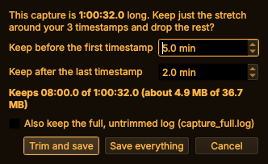

# Using CANopener

How to do things, screen by screen. What it can do, with pictures: [FEATURES.md](FEATURES.md).
Installing: [INSTALL.md](INSTALL.md).

* [Connecting](#connecting)
* [Equipment and trucks (J1939)](#equipment-and-trucks-j1939)
* [Battery trucks and controllers (CANopen)](#battery-trucks-and-controllers-canopen)
* [Cars and light trucks (OBD-II)](#cars-and-light-trucks-obd-ii)
* [Machine profiles](#machine-profiles)
* [Naming things CANopener doesn't know](#naming-things-canopener-doesnt-know)
* [Recording a job (the Log tool)](#recording-a-job-the-log-tool)
* [What it sends](#what-it-sends)
* [The handheld screen](#the-handheld-screen)
* [Command line](#command-line)
* [Where things are saved](#where-things-are-saved)

## Connecting

1. Plug the adapter into the laptop and connect it to CAN-H and CAN-L (the machine's diagnostic
   port, or back-probe any CAN pair). Key on.
2. Open **🔌 Connection** (top left, or **F3**). Pick **SocketCAN adapter**; the interface
   (`can0`) appears below it. The list looks again each time you open it (or press **⟳**), so
   plugging in after the app opened is fine.
3. Pick the bitrate: **250k** for most equipment and trucks, **500k** for cars and some newer
   machines, **125k** or **250k** for many CANopen controllers, or **Auto** to find it (Auto
   listens only, so it never disturbs the bus).
4. Press **Connect**.

**The lamps** at the bottom of the window (and in the Connection panel):

* **Adapter:** is the adapter plugged in and working?
* **Bus:** is it hearing the machine? **Green** = traffic. **Amber** = connected but silent (key
  on? probes on CAN-H / CAN-L?). **Red** = errors only (wrong bitrate, or the wires swapped).
  **Indigo, "quiet (gateway?)"** = a newer car with a security gateway, which stays silent until
  the tool asks something. That's normal.

**Find signal** (Connection panel, or **F4**): press it, then go place your probes. It listens
without sending, **chimes** when it hears steady traffic, locks in the bitrate and connects. A
falling tone means the traffic dropped out, a rising one that it's back. Both chimes can be
switched off in the Connection panel; **Settings → Sound cues** picks the speaker or a buzzer.

**Listen-only** (Connection panel): the laptop sends nothing at all. J1939 codes (DM1) and live
data still work, because the machine broadcasts them.

**Connect on startup** (**Settings**): clicking the icon with the adapter plugged in opens
CANopener already connected. With **Auto** bitrate it's safe on any machine.

**Simulators:** tick **Connection → Show simulators**, then pick **Simulator** (a telehandler,
J1939), **CANopen simulator (battery truck)** or **OBD-II simulator (car)** and press **Connect**.

### Other adapters

**CANable** (either firmware), candleLight, PEAK PCAN-USB, Kvaser, 8devices and Innomaker work as
`can0` with no extra setup on Linux. Note: a CANable with **slcan** firmware can't do listen-only,
so **Auto**, **Find signal** and **Listen-only** don't work on it; pick the bitrate by hand or
flash candleLight ([how](install/linux-laptop.md#your-usb-adapter-canable-20--20-pro)).

For anything else (PEAK, Kvaser, Vector, IXXAT ... through their own drivers): install the maker's
driver, then **Connection → Find other adapters**, or type the adapter under Interface as
`interface:channel`, e.g. `pcan:PCAN_USBBUS1`, `kvaser:0` or `slcan:/dev/ttyACM0`, and pick its
bitrate. This goes through [python-can](https://python-can.readthedocs.io), which the installer
includes.

## Equipment and trucks (J1939)

The default. Pick a profile for your machine in the **Profile** box (top right), or leave it on
the generic one.

| Tab | What you get |
|---|---|
| **Fault Codes** | **Read Active** / **Read Stored** / **Pending / Emissions** / **Full Scan**. Each code with its description, occurrence count and the warning lamps. Tick *Include every code seen this session* to catch intermittent ones. **Show this parameter in Live Data** jumps to the sensor behind a code. **Clear Codes…** clears active (DM11) or stored (DM3) codes on every module, or the one picked under ECU, after asking. |
| **Live Data** | Engine speed, temperatures, pressures, voltages, DPF / DEF and more, with min / max. Tick values to chart them. **Hide unticked** and **Hide plots** tidy a small screen. |
| **Bus Monitor** | Every raw frame, or one row per ID with changing bytes highlighted. **Find changes…** and **Label…** ([below](#naming-things-canopener-doesnt-know)). |
| **Network** | Every module on the bus and what it sends. **Name this module…** gives one your own name. |
| **Machine Info** | Component and software IDs, VIN, engine hours, fuel used. |
| **Report** | A text report of the last scan, to save or copy. |

**Modules beyond the engine** (ABS, transmission, body): **Diagnostics → Read a module (UDS)**
reads their codes, and can clear them or reset the module.

## Battery trucks and controllers (CANopen)

Many electric forklifts and their motor, pump and battery controllers talk **CANopen** instead of
J1939, often at 125k or 250k (**Auto** finds it). Pick the **Generic CANopen** profile and the
same tabs switch to CANopen: no warning lamps or J1939 reads, and nothing J1939 is sent. For a bus
with both (a J1939 engine and CANopen controllers), pick **Generic J1939 + CANopen**. On a J1939
profile, CANopener notices CANopen nodes and offers the right profile; nothing changes unless you
say so.

| Tab | What you get |
|---|---|
| **Fault Codes** | Errors a controller reports (CANopen "EMCY") are **Active**; **Read Stored** also reads each controller's error history. The meaning shown is the standard class (e.g. *Device temperature*); a maker's own codes can be named in a profile. **Clear Codes → Clear CANopen error history…** empties a controller's history, after asking. |
| **Network** | Every node with its state (*Operational*, *Pre-operational*, *Stopped*), heartbeat, restarts and each message it sends. **Read node info** reads its name, versions, product and serial number (also in **Machine Info** and a **Full Scan**). **Find CANopen nodes** asks every node number, for controllers that don't send a heartbeat. **NMT…** starts, stops or resets a node: that changes the machine, so it asks first. Only do it parked and safe. |
| **Live Data, Bus Monitor** | Work on CANopen messages (11-bit IDs) just like J1939, with what each message is (e.g. *TPDO1 node 01*). A maker's message layout isn't published, so [labeling](#naming-things-canopener-doesnt-know) is how you name the values. |

## Cars and light trucks (OBD-II)

Pick the **OBD-II vehicle** profile (top right; connecting the OBD-II simulator does it for you),
usually at **500k**. The screen becomes one row of pages:

| Page | What you get |
|---|---|
| **Trouble Codes** | **Check codes** reads every module (engine, transmission ...): stored, pending and permanent codes, with descriptions, and the check-engine light. **Clear codes** asks first and tells you what else it resets. Pick a sensor code and press **Show in Live Data** to watch that sensor, or **Show freeze frame**. |
| **Live Data** | Every value the car offers, streaming, with min / max and charts. |
| **Freeze Frame** | The values saved when the code was set. |
| **Readiness** | Inspection monitors: complete, incomplete or not supported, and a READY / NOT READY verdict. |
| **On-Board Tests** | Ask the car to run a test, e.g. the EVAP leak test. |
| **Test Results** | Each monitor's last test value against its limits. Spots a part that passes, but only just. |
| **Vehicle Info** | VIN, calibration IDs, module names. |
| **Bus Monitor** | Raw frames, as on the J1939 side. |

## Machine profiles

A profile names a specific machine's modules and adds its own parameters. The **Profile** box (top
right) picks one; CANopener recognises a machine from the modules it hears and offers its profile.

* **Profiles → Manage profiles…** hides ones you don't use and sets the order.
* **Profiles → Save profile as…** copies the one in use under a new name (one per machine).
* **Profiles → Import profile…** loads one someone exported.

Writing one by hand: [DEVELOPING.md](DEVELOPING.md#machine-profiles).

## Naming things CANopener doesn't know

Most forklift and equipment traffic is the maker's own. Label it yourself and keep it:

* **Name a module:** in **Network**, pick an address (or CANopen node) and press **Name this
  module…** (e.g. "Traction controller"). The name shows everywhere that module does.
* **Find the data that moves:** in **Bus Monitor**, press **Find changes…**. Hold the pedal (or
  switch, or lever) one way and press **Mark now** on A, the other way and **Mark now** on B. The
  bytes that changed are listed, likeliest first (rolling counters are left out). You can also
  compare two Log tool timestamps, or two stretches of a saved log.
* **Label it:** pick a result (or a row in Bus Monitor) and press **Label…**. Choose the byte(s) or
  bits, then set scale, offset and unit while you work the control and watch the live number and
  chart. Add a normal range or states (`0 = Off`, `1 = On`) if you like. **Save**, and it's in
  **Live Data** straight away (group *My labels*). If a value jumps about, try **high byte
  first**: some makers send numbers that way.

Your labels go in a profile of your own (the first label asks you to name it, e.g. "Unit 14 reach
truck"), built on the profile you had picked, so nothing built in is changed.
**Profiles → My labels…** lists them to edit or remove, and has **Recognise this machine** (next
time it offers this profile when it sees these modules), **Export…** (to a USB stick, say) and
**Delete profile…**.

## Recording a job (the Log tool)

Open it with **📝 Log** (top right, or **F2**).

1. Name the job, write the customer concern, and list the timestamps you expect ("Key on",
   "Start", "Shuts down" ...), or load a template like *Intermittent shutdown*.
2. **Start**, then tag each moment with the spacebar as you work the machine. The Live Data chart
   shows each tag as a line.
3. **Stop**, fix up names and notes if needed, then **Save**.

On a car, the Log tool keeps it talking while it records: it reads the codes once, then streams
the ticked live values.

**Keys** (only while the Log panel is open, and never while you're typing in a box: **Esc** leaves
a box). Remap them under **Log → Keyboard shortcuts…**.

| Key | Not recording | Recording |
|---|---|---|
| **Enter** | start | stop |
| **Space** | add a timestamp and type its name | tag the next timestamp |
| **Shift+Space** | add a timestamp and type its name (also while typing one: keeps it and starts the next) | add a timestamp at the end |
| **1** … **9**, **0** | | tag timestamp 1 … 10 directly |
| **Backspace** | | undo the last tag |

**What's saved:** each capture is a folder in `~/canopener/logs/`:

| File | What's in it |
|---|---|
| `summary.txt` | Your notes and timestamps, and one timeline of codes appearing and clearing, warning lamps, and modules dropping off the bus, each with the phase it happened in. **The file to send someone.** |
| `live_data.csv` | Every live value twice a second, with your timestamps in a column. Opens in a spreadsheet. |
| `capture.log` | Every raw frame. Reopen it with **Open…** in the Log panel, then **View data**. |
| `markers.csv`, `capture.json` | The timestamps, and everything in machine-readable form. |



**Trimming a long one:** when you press **Save**, the Log tool offers to keep just the stretch
around your timestamps: a few minutes before the first and after the last (you pick how many, and
it remembers). It shows how much it keeps before it cuts, can keep the full log alongside, and
**Save everything** skips it. **Trim…** in the Log panel does the same any time, saved captures
included.

<br clear="right">

**How long can a recording be?** As long as the disk allows: frames go straight to the file. A busy
250k J1939 bus is about 100 to 170 MB an hour. Saving reads the whole log back to write the summary
(about 350 MB of memory per hour), so multi-hour captures are fine on a laptop; split all-day
ones. The Bus Monitor and **File → Export frames as CSV** only keep the latest 250,000 frames (a
few minutes on a busy bus); the capture's log has everything.

**After a crash**, the next start offers to recover anything unsaved.

**Export Logs** (in the Log panel, or **Ctrl+E**): plug in a USB stick and press **Export**. It
copies this session's captures and reports onto the stick and ejects it.

## What it sends

* **Reading** sends only standard requests (J1939, OBD-II, UDS and CANopen SDO reads). Tick
  **Listen-only** to send nothing at all. (Not on a CANable with slcan firmware, which can't do
  listen-only: see [Other adapters](#other-adapters).)
* **Commands that change a vehicle** (clear codes, start an on-board test, reset a module, a
  CANopen start / stop / reset) say what they change and wait for a **Yes**. Nothing is sent in
  listen-only.
* **Diagnostics → Transmit a frame** sends a frame you compose: off by default, it shows the exact
  bytes and asks before every send.

## The handheld screen

The handheld UI runs on the laptop too: **Settings → Handheld (Pi) screen** closes CANopener and
reopens it as the handheld UI in a window, and it stays that way until you pick **System →
Desktop app instead**. On the Pi, **System → Exit to desktop** closes it and shows the Pi's
desktop; open it again from the menu. Keyboard stand-ins for the buttons and everything else:
[DEVICE.md](DEVICE.md).

## Command line

Everything works over SSH too, handy on a Pi. On a laptop install the commands are in
`~/CANopener/.venv/bin/`.

```bash
canopener-cli find --iface can0 --sound             # signal finder: wait for traffic, chime
canopener-cli scan --iface can0 --full --units imperial
canopener-cli clear --iface can0 --stored           # J1939: clear stored codes (asks first)
canopener-cli obd --iface can0 --all                # car: codes, readiness, freeze frame, live data
canopener-cli obd --iface can0 --clear              # car: clear codes (asks first)
canopener-cli canopen --iface can0 --info --errors  # CANopen: nodes, state, errors, identity
canopener-cli interfaces                            # what adapters it sees, and why one isn't working
canopener-cli decode capture.log --csv frames.csv   # decode a saved log
canopener-cli capture FOLDER --trim 5 2             # trim a capture: 5 min before, 2 min after its timestamps
canopener-cli update                                # check for and install updates
canopener-cli --help                                # everything else
```

## Where things are saved

| Path | What |
|---|---|
| `~/canopener/logs/` | Captures from the Log tool, one folder each |
| `~/canopener/reports/` | Saved reports (plus the raw log alongside) |
| `~/.config/canopener/settings.json` | Settings both screens share (connection, units, profile, sound); the desktop app keeps the rest in `~/.config/CANopener/` |
| `~/.config/canopener/profiles/*.json` | Your machine profiles and labels |
| `~/.config/canopener/profile_list.json` | Which profiles the picker shows, and their order |
| `~/.config/canopener/spn_names.csv` | Optional extra SPN names, `spn,name` per line |
| `~/.config/canopener/github-token.json` | GitHub sign-in for plugin installs, mode 600 |
| `~/<repo name>/` | Plugins installed from GitHub; a non-git copy found there is kept as `.old-<date>` |
