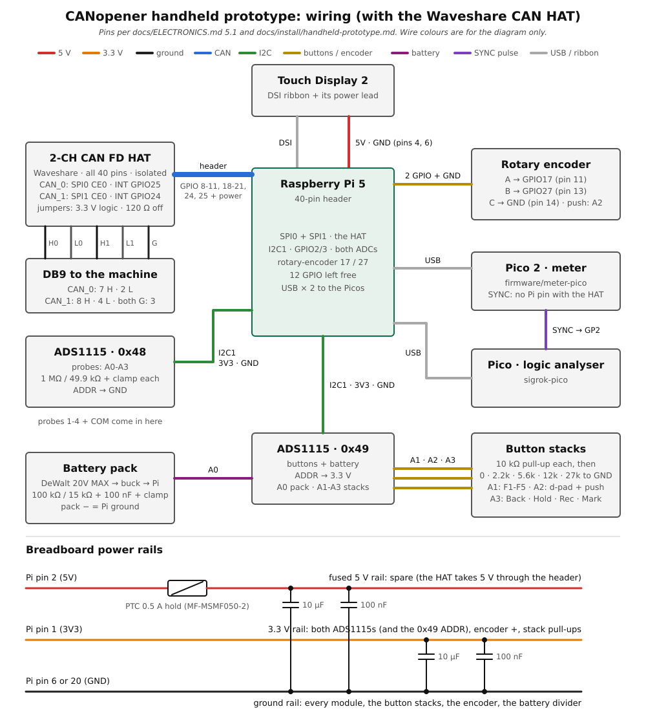

# Handheld prototype: wiring the modules (stages 1-3)

How to wire the prototype's modules to the Pi 5 on the back of the display: the CAN board (the
Waveshare HAT, or the MCP2518FD module before it), both Picos, the ADS1115 with its probe inputs,
and the second ADS1115 that reads the buttons and the battery, all powered from breadboard rails.
It follows [Handheld, first steps](handheld-stage0.md) (the Pi and the screen).

The pins match the app's installed options, `deploy/raspberry-pi/config-hardware.txt` and
`config-controls.txt`, so nothing needs changing in the software. Pin decisions and the reasons for
them are in [ELECTRONICS.md](../ELECTRONICS.md) section 5.1, which is the source of truth if the
two ever disagree.

> **Status:** written from the docs and the module's product photos, **not yet wired up**. Steps
> marked [verify] are the likely spots to differ; note what you actually saw.



## What you need

| Item | Notes |
|---|---|
| The stage 0 / 0b build | Pi 5, Touch Display 2, buttons and encoder ([first steps](handheld-stage0.md)) |
| MCP2518FD module (MusRock, "MCP2518FD SPI CAN FD Controller Module") | What it is and how it differs from the listing: [ELECTRONICS.md 5.2a](../ELECTRONICS.md#52a-stage-1-on-the-prototype-musrock-mcp2518fd-module-v-from-the-product-photos) |
| Raspberry Pi Pico 2 (meter) and original Pico (logic analyser) | USB cables to the Pi |
| 2 × ADS1115 breakout | Both on the Pi's I2C: one for the probes (0x48), one for the buttons and battery (0x49). A third goes on the meter Pico at stage 7 |
| The button stacks: 3 × 10 kΩ, 3 × 2.2 kΩ, 3 × 5.6 kΩ, 3 × 12 kΩ, 2 × 27 kΩ (1% or 5%) | [Section 2](#2-buttons-encoder-and-battery-the-button-adc) |
| The battery input: 100 kΩ and 15 kΩ 1%, 100 nF, one more BAT54S | Section 2 |
| 1 resettable fuse (PTC), MF-MSMF050-2 | 0.5 A hold, for the 5 V rail |
| 2 × 10 µF and 2 × 100 nF capacitors | One pair per rail |
| 4 × 1 MΩ 1% metal-film, 4 × 49.9 kΩ 0.1% 0805, 4 × 100 nF, 4 small-signal Schottky pairs (BAT54S, BAT43, BAT85) | The probe inputs |
| Solderable breadboards, hook-up wire, an 0805 adapter board | |

## Pi 5 header map

Pin 1 is the square pad, at the end of the header farthest from the USB ports. Odd pins are the row
nearer the middle of the board.

The prototype has the **Waveshare 2-CH CAN FD HAT** instead of the MCP2518FD module
([section 3b](#3b-the-waveshare-hat-instead-of-the-module)), and every button on resistor stacks
read by a second ADS1115 ([section 2](#2-buttons-encoder-and-battery-the-button-adc)). The HAT sits
on all 40 pins, so the encoder and the ADS1115s take their pins through it (a stacking header under
it, or its pass-through) [verify how yours is fitted]. Pins marked *HAT* are its own: wire nothing
else to them.

| Use | GPIO | Pin | Pin | GPIO | Use |
|---|---|---|---|---|---|
| 3.3 V rail | 3V3 | 1 | 2 | 5V | Fuse, then the 5 V rail |
| SDA: both ADS1115s | 2 | 3 | 4 | 5V | Display power |
| SCL: both ADS1115s | 3 | 5 | 6 | GND | Display ground |
| Free | 4 | 7 | 8 | 14 | Free (UART TX: an ESP32 later) |
| ADS1115s' ground, probe COM | GND | 9 | 10 | 15 | Free (UART RX) |
| **Encoder A** | 17 | 11 | 12 | 18 | *HAT:* CAN_1 chip select |
| **Encoder B** | 27 | 13 | 14 | GND | **Encoder ground** (its C pin) |
| Free | 22 | 15 | 16 | 23 | Free |
| Spare 3.3 V | 3V3 | 17 | 18 | 24 | *HAT:* CAN_1 interrupt |
| *HAT:* SPI0 MOSI | 10 | 19 | 20 | GND | Ground |
| *HAT:* SPI0 MISO | 9 | 21 | 22 | 25 | *HAT:* CAN_0 interrupt |
| *HAT:* SPI0 SCLK | 11 | 23 | 24 | 8 | *HAT:* CAN_0 chip select |
| Ground | GND | 25 | 26 | 7 | Free (SPI0's spare chip select) |
| Don't use | ID_SD | 27 | 28 | ID_SC | Don't use |
| Free | 5 | 29 | 30 | GND | Ground |
| Free | 6 | 31 | 32 | 12 | Free (PWM: a buzzer, if one comes back) |
| Free (PWM) | 13 | 33 | 34 | GND | Ground |
| *HAT:* SPI1 MISO | 19 | 35 | 36 | 16 | Free |
| Free | 26 | 37 | 38 | 20 | *HAT:* SPI1 MOSI |
| Ground | GND | 39 | 40 | 21 | *HAT:* SPI1 SCLK |

Twelve pins are free: GPIO 4, 5, 6, 7, 12, 13, 14, 15, 16, 22, 23 and 26. With the HAT there's no
SYNC pin on GPIO21 or buzzer on GPIO18 (both are the HAT's SPI1); either could go on a free pin
later. Without the HAT (the module in section 3) the buttons can be on GPIO instead, one pin each:
the pin table is in [first steps](handheld-stage0.md#stage-0b-buttons-and-the-encoder), and GPIO7,
14, 15 and 20 are kept for CAN stack B and an ESP32 ([ELECTRONICS.md](../ELECTRONICS.md) 5.1).

## 1. Power rails

Everything on the breadboards takes its power from the Pi's header through two rails you build
once. The Pi's 5 V pins connect straight to its USB-C input with nothing in between, so a short on a
breadboard rail would pull the whole Pi down. The fuse stops that.

1. **5 V rail:** pin 2, through the PTC, to the breadboard's 5 V rail.
2. **3.3 V rail:** pin 1 to the 3.3 V rail. It needs no fuse: the Pi's own power chip limits it, and
   nothing on it draws much.
3. **Ground rail:** pin 6 or 20. Add a second ground wire from pin 25 if the rail is long.
4. At the start of each rail, a **10 µF** (10 V or more) and a **100 nF** ceramic from the rail to
   ground. On an electrolytic, the stripe (minus) goes to ground.

| Rail | Feeds | Not on it |
|---|---|---|
| 5 V (fused) | The CAN module's 5V | The display: it keeps its own lead to pins 4 and 6 |
| 3.3 V | Both ADS1115s' VDD, the button stacks' pull-ups, a KY-040 encoder's +, the CAN module's 3V3 if its test says so (step 3) | Anything that needs 5 V |
| Ground | Every module's GND, the buttons, the encoder | |

The PTC holds 0.5 A and trips at about 1 A; your loads are around 100 mA. A short makes it hot and
high-resistance until the short is gone and it cools. It's rated 15 V, fine on a 5 V rail (that's
why it can't go in the probe path).

**Check before anything plugs in:** with the Pi on, the 5 V rail reads about 5 V (a little under
the pin, from the fuse) and the 3.3 V rail reads 3.3 V. With the Pi off, neither rail is shorted to
ground.

## 2. Buttons, encoder and battery: the button ADC

Every button goes on one of three **resistor stacks**, read by the second ADS1115. Only the
encoder's turning lines stay on GPIO. Full description and the reasons:
[DEVICE.md](../DEVICE.md#buttons-and-battery-on-the-second-adc).

**The second ADS1115:**

| ADS1115 (buttons) | Goes to | Notes |
|---|---|---|
| VDD | 3.3 V rail | |
| GND | Ground rail | |
| SCL | Pin 5 (GPIO3) | Same wire as the probe ADC's |
| SDA | Pin 3 (GPIO2) | Same wire as the probe ADC's |
| ADDR | **3.3 V rail** | Address **0x49**. The probe ADC's ADDR stays on ground (0x48) |
| ALRT | Nothing | |
| A0 | The battery divider (below) | |
| A1 | Stack 1: the top row | |
| A2 | Stack 2: the d-pad and the encoder's push | |
| A3 | Stack 3: the side buttons | |

Most breakouts already have I2C pull-ups on SDA and SCL. Two boards' worth in parallel is fine.

**Each stack:** a **10 kΩ** from the 3.3 V rail to its input. Then each button from that input to
the ground rail, through its own resistor:

```
3.3 V rail ──[10 kΩ]──┬──────────────────── ADS1115 (0x49) A1 / A2 / A3
                      ├─[button 1]──────────────── ground     0 V
                      ├─[button 2]───[2.2 kΩ]───── ground     0.60 V
                      ├─[button 3]───[5.6 kΩ]───── ground     1.18 V
                      ├─[button 4]───[12 kΩ]────── ground     1.80 V
                      └─[button 5]───[27 kΩ]────── ground     2.41 V
                                          nothing pressed:     3.3 V
```

| Stack | Button 1 | Button 2 | Button 3 | Button 4 | Button 5 |
|---|---|---|---|---|---|
| A1: top row | F1 | F2 | F3 | F4 | F5 |
| A2: d-pad and push | Up | Down | Left | Right | Encoder push |
| A3: side | Back | Hold | Record | Timestamp | (none) |

* The resistor can be on either side of the switch. Keep the stack's wires short and away from
  the HAT's CAN terminals.
* Buttons on different stacks can be held together; two on one stack can't.
* **Check with a meter before connecting A1-A3:** each input reads 3.3 V with nothing pressed, and
  about the voltage in the drawing with each button held.

**The encoder:** A to **pin 11 (GPIO17)**, B to **pin 13 (GPIO27)**, C (common) to **pin 14
(ground)**. Its push switch is button 5 on stack A2, not a GPIO. A KY-040-style module's **+**
goes to the **3.3 V rail**, never 5 V.

**The battery on A0.** The pack (DeWalt 20V MAX) powers the Pi through its buck converter. Its
voltage reaches A0 through a divider:

```
pack + ──[100 kΩ 1%]──┬──────────── ADS1115 (0x49) A0
                      ├─[15 kΩ 1%]──── ground (pack −)
                      ├─[100 nF]────── ground
                      └─ BAT54S: one diode to 3.3 V, one from ground
```

* Take **pack +** from the pack side of the buck converter's input, after any fuse or switch.
* The pack's minus has to be the Pi's ground. With an ordinary (non-isolated) buck converter it
  already is: check for continuity from pack − to pin 9.
* **Before connecting A0:** with the pack on, the divider's middle reads about 2.4-2.7 V (a full pack
  is about 20.5 V). Never above 3.3 V.

Then turn it on in **System > Installed options**: **Buttons and encoder** and **Buttons and
battery ADC** both **Installed** (below, [Turn it on](#turn-it-on)). Set **System > Controls >
Button 5 does** to **Soft key 5**: Back has its own side button.

## 3. The CAN module (stage 1)

The module's transceiver can't take a 36/48 V battery lead on CAN-H the way the TCAN1051V can, and
its termination is a jumper: [ELECTRONICS.md 5.2a](../ELECTRONICS.md#52a-stage-1-on-the-prototype-musrock-mcp2518fd-module-v-from-the-product-photos)
has the details.

**First, check its logic voltage.** The Pi's GPIO pins are 3.3 V only. Connect the module's **5V**
to the 5 V rail and **GND** to pin 20, nothing else, and measure to ground:

* **3V3 header pin reads about 3.3 V:** the board makes its own 3.3 V. Leave its 3V3 pin
  unconnected.
* **3V3 header pin reads 0 V:** it expects 3.3 V from outside. Wire it to the 3.3 V rail.
* **MCP2518FD pin 14 (VDD) reads about 5 V:** stop. Its SDO would drive 5 V into GPIO9; it needs a
  level shifter.

Also confirm the header labels by continuity: both GND pins beep to the **G** screw terminal. Leave
**P2** (the 2-pin input by the bridge rectifier) unconnected.

| Module P1 | Goes to | Notes |
|---|---|---|
| 5V | 5 V rail | |
| GND | Pin 20 | Run it alongside the SPI wires |
| 3V3 | 3.3 V rail | Only if the check read 0 V |
| SCK | Pin 23 (GPIO11) | |
| SDI | Pin 19 (GPIO10, MOSI) | Pi out, chip in |
| SDO | Pin 21 (GPIO9, MISO) | Chip out, Pi in |
| nCS | Pin 24 (GPIO8, CE0) | |
| INT | Pin 22 (GPIO25) | The driver needs it |
| INT0, INT1, CLK | Nothing | CLK is a test point: it shows the crystal running |

* Keep the SPI wires about 10 cm or shorter and roughly equal in length. A 22-33 Ω resistor in
  series with SCK helps if `dmesg` shows SPI errors.
* Screw terminal to the DB9: **H** to pin 7, **L** to pin 2, **G** to pin 3
  ([ELECTRONICS.md 5.5](../ELECTRONICS.md#55-db9-can-a-can-b-k-line-d9-pinout-decided-can-a-per-cia-303-1)).
  Twist H and L together.
* **Termination jumper:** off for listening on a machine; on for the bench bus with the CANable.

## 3b. The Waveshare HAT (instead of the module)

The Waveshare 2-CH CAN FD HAT replaces the module and, later, CAN stack B: two isolated
MCP2518FD channels on the header, nothing to wire to the Pi. Mark it installed in **System >
Installed options > Waveshare 2-CH CAN FD HAT** and the app sets the Pi up for it, with the
encoder's A line moved to GPIO7.

| HAT terminal | DB9 pin | Notes |
|---|---|---|
| CAN_0 H / L | 7 / 2 | `can0`: CAN 1 on the handheld |
| CAN_1 H / L | 8 / 4 | `can1`: CAN 2 |
| CAN_0 G and CAN_1 G | 3 | Both grounds to the machine's ground |

* **Logic-level jumper on 3.3 V** (the Pi's), **termination jumpers off** on a machine (it's
  terminated already).
* Check each H and L lands on the DB9 pin above, with continuity, before plugging into a machine.
  A pair on the wrong pins doesn't damage anything, but that port can't join the bus: Connect
  says it "couldn't join the bus" (`dmesg`: *failed to enter mode ... stays in Configuration
  Mode*). If it connects with the cable unplugged and not with it plugged in, it's the wiring.
* With both ports in use, Connect makes the busier bus the main one
  ([DEVICE.md](../DEVICE.md)).

## 4. The Picos (stages 2a and 2b)

Both plug into the Pi's USB for data and power. The only extra wire is the SYNC pulse: the meter
Pico makes it, and the Pi and the logic Pico both time-stamp it.

| From | To | Notes |
|---|---|---|
| Pico 2 (meter), USB | Pi USB | Flash [firmware/meter-pico](../../firmware/meter-pico/README.md) |
| Pico (logic), USB | Pi USB | Flash sigrok-pico ([firmware/logic-pico](../../firmware/logic-pico/README.md)) |
| Pico 2 GP15 (pin 20) | Pi pin 40 (GPIO21) | 10 pulses a second. Not with the HAT: GPIO21 is its SPI1 |
| Pico 2 GP15 (pin 20) | Pico GP2 (pin 4) | sigrok channel D2 [verify: sigrok's D numbers are GPIO numbers] |
| Pico 2 GND (pin 18) | Pi pin 39 and Pico GND (pin 3) | USB shares ground already; this keeps the return beside SYNC |

**Optional, CAN bus voltages on the meter:** CAN H, L and G from the screw terminal into Pico 2
GP26, GP27 and GP28 (pins 31, 32, 34), each through the divider and clamp below with **100 kΩ 1%
over 10 kΩ 0.1%** and a 10 nF cap, AGND (pin 33) as their ground. That's the 11:1 the firmware
expects.

## 5. The ADS1115 and the probe inputs (stage 3)

The ADS1115 is on the Pi's own I2C bus, so no probe ever lands on it directly: each input goes
through a divider and a clamp.

| ADS1115 | Goes to | Notes |
|---|---|---|
| VDD | 3.3 V rail | Never 5 V on the Pi's bus |
| GND | Pin 9 | Also the probe COM |
| SCL | Pin 5 (GPIO3) | |
| SDA | Pin 3 (GPIO2) | |
| ADDR | Ground | Address 0x48 |
| ALRT | Nothing | |
| A0-A3 | Probes 1-4, each through the circuit below | |

```
probe tip ---[ R1 1 MΩ ]---+-------------+-----------+---> ADS1115 A0 (A1, A2, A3)
                           |             |           |
                      [ R2 49.9 kΩ ]  [ 100 nF ]   BAT54S: one diode to 3.3 V,
                           |             |           |     one from ground
probe COM (ground) --------+-------------+-----------+
```

* **R1:** 1 MΩ 1% metal film (blue body, five bands). Measure your stock and use the four closest to
  1 MΩ. Not carbon film: it drifts a percent or two with temperature.
* **R2:** 49.9 kΩ 0.1% 0805, on an 0805 adapter board.
* **Clamp:** a small-signal Schottky pair. Not a 1N5817 / 1N5819: their leakage through this
  divider shifts the reading by volts.
* Clean the flux off around the 1 MΩ joints: at these resistances it leaks enough to matter.
* The ratio is 21.04: 60 V reads 2.85 V at the pin, and the clamp starts near 69 V.

Probe COM is the Pi's ground. When the probes or the CAN lead are on a machine, run the Pi from a
battery or power bank, not a wall supply ([ELECTRONICS.md section 10](../ELECTRONICS.md#10-power-and-grounding)).

## Turn it on

Build in this order, checking each before the next: power rails, the button ADC and encoder, the
CAN board, Picos, the probe ADS1115.

Tell the app what's fitted, and it sets the Pi up for it: on the handheld, **System > Installed
options**, then set each part you've built to **Installed** (or **Set all from build stage**). It
shows the lines it will add to the Pi's boot settings and asks first. The CAN board and both
ADS1115s start working straight away; the encoder and the ESP32 need a restart, which it offers. On a
breadboard, set **CAN stack A SPI speed** to **1 MHz** (just below the part on the same page).
From SSH: `canopener-cli hardware --stage 3 --apply`.

The [Pi installer](raspberry-pi.md) sets up the small helper that's allowed to change the boot
settings (run it once more after updating, so the helper knows the button ADC). The lines it writes are the
ones in [`config-hardware.txt`](../../deploy/raspberry-pi/config-hardware.txt), in a marked block at
the end of `/boot/firmware/config.txt`; the rest of the file isn't touched.

## Check it

- [ ] `dmesg | grep mcp251xfd` shows the controller with a 20 MHz oscillator, and
      `canopener-cli hardware` finds `can_a`. Then the loopback and bench-bus steps in
      [ELECTRONICS.md section 13](../ELECTRONICS.md#13-stage-1-bring-up-checklist).
- [ ] `canopener-cli hardware` finds `logic_pico`, `meter_pico` and `sync` (`/dev/pps0`).
- [ ] `i2cdetect -y 1` shows 48 and 49 (both shown as `UU` once their drivers have them), and
      **System > Installed options** shows both ADCs found: *ADC on the Pi* on 0x48, *Buttons and
      battery ADC* on 0x49 [verify: the ads1115 overlay loaded twice, once per address].
- [ ] Every button does its job, the encoder turns the list, and holding the encoder's push is Back.
- [ ] The status strip shows the battery's charge, and **System > Power > Battery** shows about the
      pack's voltage on your meter (within a few tenths of a volt).
- [ ] **System > Meters > ADC input divider** is **21.04 (1M / 49.9k)**, and a probe on a 12 V
      battery reads about 12 V on the meter.
- [ ] Calibrate each channel: [Calibrating the meter](../DEVICE.md#calibrating-the-meter).
