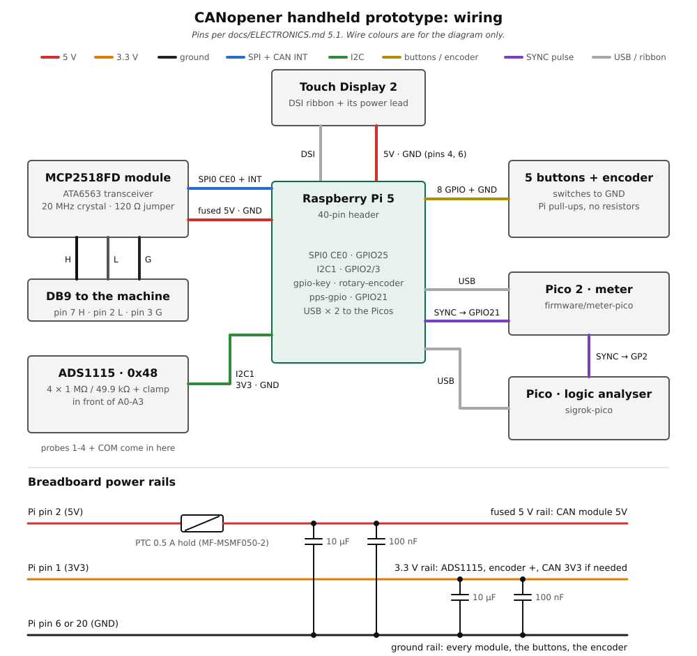

# Handheld prototype: wiring the modules (stages 1-3)

How to wire the prototype's modules to the Pi 5 on the back of the display: the MCP2518FD CAN
module, both Picos and the ADS1115 with its probe inputs, all powered from breadboard rails. It
follows [Handheld, first steps](handheld-stage0.md) (the Pi, the screen, the buttons and the
encoder).

The pins match the app's installed options, `deploy/raspberry-pi/config-hardware.txt` and
`config-controls.txt`, so nothing needs changing in the software. Pin decisions and the reasons for
them are in [ELECTRONICS.md](../ELECTRONICS.md) section 5.1, which is the source of truth if the
two ever disagree.

> **Status:** written from the docs and the module's product photos, **not yet wired up**. Steps
> marked [verify] are the likely spots to differ; note what you actually saw.



## What you need

| Item | Notes |
|---|---|
| The stage 0 / 0b build | Pi 5, Touch Display 2, buttons and encoder ([first steps](handheld-stage0.md)) |
| MCP2518FD module (MusRock, "MCP2518FD SPI CAN FD Controller Module") | What it is and how it differs from the listing: [ELECTRONICS.md 5.2a](../ELECTRONICS.md#52a-stage-1-on-the-prototype-musrock-mcp2518fd-module-v-from-the-product-photos) |
| Raspberry Pi Pico 2 (meter) and original Pico (logic analyser) | USB cables to the Pi |
| ADS1115 breakout | One on the Pi's I2C now; a second one goes on the meter Pico at stage 7 |
| 1 resettable fuse (PTC), MF-MSMF050-2 | 0.5 A hold, for the 5 V rail |
| 2 × 10 µF and 2 × 100 nF capacitors | One pair per rail |
| 4 × 1 MΩ 1% metal-film, 4 × 49.9 kΩ 0.1% 0805, 4 × 100 nF, 4 small-signal Schottky pairs (BAT54S, BAT43, BAT85) | The probe inputs |
| Solderable breadboards, hook-up wire, an 0805 adapter board | |

## Pi 5 header map

Pin 1 is the square pad, at the end of the header farthest from the USB ports. Odd pins are the row
nearer the middle of the board. Pins marked *kept free* belong to later stages: don't use them for
anything else.

| Use | GPIO | Pin | Pin | GPIO | Use |
|---|---|---|---|---|---|
| 3.3 V rail | 3V3 | 1 | 2 | 5V | Fuse, then the 5 V rail |
| ADS1115 SDA | 2 | 3 | 4 | 5V | Display power |
| ADS1115 SCL | 3 | 5 | 6 | GND | Display ground |
| Encoder B | 4 | 7 | 8 | 14 | *Kept free* (ESP32, stage 6) |
| ADS1115 GND, probe COM | GND | 9 | 10 | 15 | *Kept free* (ESP32, stage 6) |
| D-pad up (later) | 17 | 11 | 12 | 18 | Buzzer (optional) |
| D-pad down (later) | 27 | 13 | 14 | GND | Ground |
| D-pad left (later) | 22 | 15 | 16 | 23 | D-pad right (later) |
| Spare 3.3 V | 3V3 | 17 | 18 | 24 | Encoder A |
| CAN SDI | 10 (MOSI) | 19 | 20 | GND | Ground rail, CAN module GND |
| CAN SDO | 9 (MISO) | 21 | 22 | 25 | CAN INT |
| CAN SCK | 11 (SCLK) | 23 | 24 | 8 (CE0) | CAN nCS |
| Ground | GND | 25 | 26 | 7 (CE1) | *Kept free* (CAN stack B) |
| Don't use | ID_SD | 27 | 28 | ID_SC | Don't use |
| Button 1 (F1) | 5 | 29 | 30 | GND | Buttons' ground |
| Button 2 (F2) | 6 | 31 | 32 | 12 | Button 3 (F3) |
| Button 4 (F4) | 13 | 33 | 34 | GND | Ground |
| Spare | 19 | 35 | 36 | 16 | Button 5 (F5, Back) |
| Encoder push | 26 | 37 | 38 | 20 | *Kept free* (CAN stack B INT) |
| Encoder ground, SYNC ground | GND | 39 | 40 | 21 | SYNC in from the Pico 2 |

## 1. Power rails

Everything on the breadboards takes its power from the Pi's header through two rails you build
once. The Pi's 5 V pins connect straight to its USB-C input with nothing in between, so a short on a
breadboard rail would pull the whole Pi down. The fuse stops that.

1. **5 V rail:** pin 2, through the PTC, to the breadboard's 5 V rail.
2. **3.3 V rail:** pin 1 to the 3.3 V rail. It needs no fuse: the Pi's own power chip limits it, and
   nothing on it draws much.
3. **Ground rail:** pin 6 or 20. Add a second ground wire from pin 25 if the rail is long.
4. At the start of each rail, a **10 µF** (10 V or more) and a **100 nF** ceramic from the rail to
   ground. On an electrolytic, the stripe (minus) goes to ground.

| Rail | Feeds | Not on it |
|---|---|---|
| 5 V (fused) | The CAN module's 5V | The display: it keeps its own lead to pins 4 and 6 |
| 3.3 V | ADS1115 VDD, a KY-040 encoder's +, the CAN module's 3V3 if its test says so (step 3) | Anything that needs 5 V |
| Ground | Every module's GND, the buttons, the encoder | |

The PTC holds 0.5 A and trips at about 1 A; your loads are around 100 mA. A short makes it hot and
high-resistance until the short is gone and it cools. It's rated 15 V, fine on a 5 V rail (that's
why it can't go in the probe path).

**Check before anything plugs in:** with the Pi on, the 5 V rail reads about 5 V (a little under
the pin, from the fuse) and the 3.3 V rail reads 3.3 V. With the Pi off, neither rail is shorted to
ground.

## 2. Buttons and encoder (stage 0b)

As in [first steps](handheld-stage0.md#stage-0b-buttons-and-the-encoder): each switch between its
GPIO and the ground rail, no resistors. A KY-040-style encoder module's + goes to the **3.3 V
rail**, never 5 V.

## 3. The CAN module (stage 1)

The module's transceiver can't take a 36/48 V battery lead on CAN-H the way the TCAN1051V can, and
its termination is a jumper: [ELECTRONICS.md 5.2a](../ELECTRONICS.md#52a-stage-1-on-the-prototype-musrock-mcp2518fd-module-v-from-the-product-photos)
has the details.

**First, check its logic voltage.** The Pi's GPIO pins are 3.3 V only. Connect the module's **5V**
to the 5 V rail and **GND** to pin 20, nothing else, and measure to ground:

* **3V3 header pin reads about 3.3 V:** the board makes its own 3.3 V. Leave its 3V3 pin
  unconnected.
* **3V3 header pin reads 0 V:** it expects 3.3 V from outside. Wire it to the 3.3 V rail.
* **MCP2518FD pin 14 (VDD) reads about 5 V:** stop. Its SDO would drive 5 V into GPIO9; it needs a
  level shifter.

Also confirm the header labels by continuity: both GND pins beep to the **G** screw terminal. Leave
**P2** (the 2-pin input by the bridge rectifier) unconnected.

| Module P1 | Goes to | Notes |
|---|---|---|
| 5V | 5 V rail | |
| GND | Pin 20 | Run it alongside the SPI wires |
| 3V3 | 3.3 V rail | Only if the check read 0 V |
| SCK | Pin 23 (GPIO11) | |
| SDI | Pin 19 (GPIO10, MOSI) | Pi out, chip in |
| SDO | Pin 21 (GPIO9, MISO) | Chip out, Pi in |
| nCS | Pin 24 (GPIO8, CE0) | |
| INT | Pin 22 (GPIO25) | The driver needs it |
| INT0, INT1, CLK | Nothing | CLK is a test point: it shows the crystal running |

* Keep the SPI wires about 10 cm or shorter and roughly equal in length. A 22-33 Ω resistor in
  series with SCK helps if `dmesg` shows SPI errors.
* Screw terminal to the DB9: **H** to pin 7, **L** to pin 2, **G** to pin 3
  ([ELECTRONICS.md 5.5](../ELECTRONICS.md#55-db9-can-a-can-b-k-line-d9-pinout-decided-can-a-per-cia-303-1)).
  Twist H and L together.
* **Termination jumper:** off for listening on a machine; on for the bench bus with the CANable.

## 4. The Picos (stages 2a and 2b)

Both plug into the Pi's USB for data and power. The only extra wire is the SYNC pulse: the meter
Pico makes it, and the Pi and the logic Pico both time-stamp it.

| From | To | Notes |
|---|---|---|
| Pico 2 (meter), USB | Pi USB | Flash [firmware/meter-pico](../../firmware/meter-pico/README.md) |
| Pico (logic), USB | Pi USB | Flash sigrok-pico ([firmware/logic-pico](../../firmware/logic-pico/README.md)) |
| Pico 2 GP15 (pin 20) | Pi pin 40 (GPIO21) | 10 pulses a second |
| Pico 2 GP15 (pin 20) | Pico GP2 (pin 4) | sigrok channel D2 [verify: sigrok's D numbers are GPIO numbers] |
| Pico 2 GND (pin 18) | Pi pin 39 and Pico GND (pin 3) | USB shares ground already; this keeps the return beside SYNC |

**Optional, CAN bus voltages on the meter:** CAN H, L and G from the screw terminal into Pico 2
GP26, GP27 and GP28 (pins 31, 32, 34), each through the divider and clamp below with **100 kΩ 1%
over 10 kΩ 0.1%** and a 10 nF cap, AGND (pin 33) as their ground. That's the 11:1 the firmware
expects.

## 5. The ADS1115 and the probe inputs (stage 3)

The ADS1115 is on the Pi's own I2C bus, so no probe ever lands on it directly: each input goes
through a divider and a clamp.

| ADS1115 | Goes to | Notes |
|---|---|---|
| VDD | 3.3 V rail | Never 5 V on the Pi's bus |
| GND | Pin 9 | Also the probe COM |
| SCL | Pin 5 (GPIO3) | |
| SDA | Pin 3 (GPIO2) | |
| ADDR | Ground | Address 0x48 |
| ALRT | Nothing | |
| A0-A3 | Probes 1-4, each through the circuit below | |

```
probe tip ---[ R1 1 MΩ ]---+-------------+-----------+---> ADS1115 A0 (A1, A2, A3)
                           |             |           |
                      [ R2 49.9 kΩ ]  [ 100 nF ]   BAT54S: one diode to 3.3 V,
                           |             |           |     one from ground
probe COM (ground) --------+-------------+-----------+
```

* **R1:** 1 MΩ 1% metal film (blue body, five bands). Measure your stock and use the four closest to
  1 MΩ. Not carbon film: it drifts a percent or two with temperature.
* **R2:** 49.9 kΩ 0.1% 0805, on an 0805 adapter board.
* **Clamp:** a small-signal Schottky pair. Not a 1N5817 / 1N5819: their leakage through this
  divider shifts the reading by volts.
* Clean the flux off around the 1 MΩ joints: at these resistances it leaks enough to matter.
* The ratio is 21.04: 60 V reads 2.85 V at the pin, and the clamp starts near 69 V.

Probe COM is the Pi's ground. When the probes or the CAN lead are on a machine, run the Pi from a
battery or power bank, not a wall supply ([ELECTRONICS.md section 10](../ELECTRONICS.md#10-power-and-grounding)).

## Turn it on

Build in this order, checking each before the next: power rails, controls, CAN module, Picos,
ADS1115.

Add the lines for what you've built to `/boot/firmware/config.txt` (after the controls' lines) and
reboot:

```
dtparam=spi=on
dtoverlay=mcp251xfd,spi0-0,oscillator=20000000,interrupt=25
dtoverlay=pps-gpio,gpiopin=21
dtparam=i2c_arm=on
dtoverlay=ads1115,addr=0x48,cha_enable,chb_enable,chc_enable,chd_enable
```

Then tell the app what's fitted: `canopener-cli hardware --stage 3`, or **System > Installed
options > Set all from build stage** on the handheld.

## Check it

- [ ] `dmesg | grep mcp251xfd` shows the controller with a 20 MHz oscillator, and
      `canopener-cli hardware` finds `can_a`. Then the loopback and bench-bus steps in
      [ELECTRONICS.md section 13](../ELECTRONICS.md#13-stage-1-bring-up-checklist).
- [ ] `canopener-cli hardware` finds `logic_pico`, `meter_pico` and `sync` (`/dev/pps0`).
- [ ] `i2cdetect -y 1` shows 48, and `adc_pi` reads **ok**.
- [ ] **System > Meters > ADC input divider** is **21.04 (1M / 49.9k)**, and a probe on a 12 V
      battery reads about 12 V on the meter.
- [ ] Calibrate each channel: [Calibrating the meter](../DEVICE.md#calibrating-the-meter).

**A part isn't found?** On **System > Installed options**, put the focus on it and press
**Diagnose**: it shows the config lines, kernel messages and `/sys` entries for that part, and
**Save** keeps the report ([DEVICE.md](../DEVICE.md#meters-and-the-data-log-the-groundwork)). On a
Pi 5, `/dev/ttyAMA10` is the board's debug connector, not the CAN module: the CAN module only ever
appears as a network interface (`can0` / `can1`).
